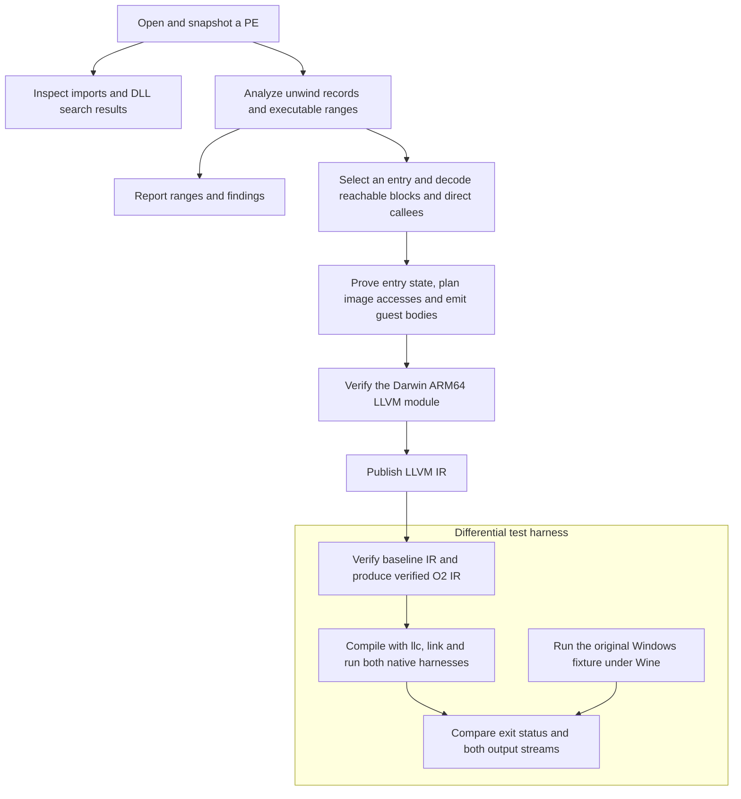

# Forge program architecture and design contracts

At revision `686140d`, Task 8 added direct guest function calls. Forge can now lift a selected function and its reachable direct callees into one verified LLVM module. The next architectural step is to give that recovered group an explicit lifetime inside the lifter. The existing PE image, invocation context, and module-owned globals already have the ownership needed for calls within the group. [Component design guide](design-guide.md) · [Lifting entry point](../src/lift/lift.h)

## Current Architecture

| Stage | What it owns and what crosses the boundary |
| --- | --- |
| File input and PE parsing | `InputFile` opens the file and captures its physical identity. `ParsedImage` owns the snapshot, the LLVM COFF reader that borrows it, and `forge::Module` with observed PE records. Section mappings borrow the image. The parser maps relative virtual addresses (RVAs) to file bytes, distinguishes file-backed from zero-filled extents, and identifies relocations and loader-written ranges. [Input](../src/pe/input.h) · [Image contract](../src/pe/image.h) · [Parser](../src/pe/pe.cpp) |
| Inspection and analysis | `inspect` reports imports by name or ordinal, exports, and how each DLL dependency was classified or resolved. Function analysis skips the import/export symbol tables and retains complete exception records when trailing bytes warrant a finding. Image planning can still protect loader-written import slots. `AnalyzedImage` owns the image, coalesces identical begin/end/unwind triples while retaining their record indices, identifies conflicts and chained fragments, and optionally enriches eligible ranges with DWARF. Gaps in executable sections can contain code, padding or data. [Inspection](../src/pe/dependencies.cpp) · [Range discovery](../src/analysis/analysis.cpp) |
| Decode and control flow | `generateIR` selects an exact eligible start in one PE32+ AMD64 executable. LLVM MC decodes reachable instructions in each validated range. The CFG retains branch order and parallel edges. A direct near call is an ordered instruction with a fallthrough continuation, which may be in the same block. `discoverGroup` validates the separate callee range and decodes each reachable function once, including recursive targets. An unrecorded leaf, import thunk or indirect transfer can prevent lifting. [CFG discovery](../src/lift/cfg.cpp) · [Entry and callee validation](../src/lift/lift.cpp) |
| Source state and LLVM emission | `translateGroup` predeclares one internal body per RVA. It composes register-bit and flag effects to a fixed point over normal returns and propagates the definitions available from callers. Each translator plans addresses before the group emits its shared image resolver. Integer lowering, register views, flag PHIs and memory guards implement the supported machine operations. The retained register-state adapter initializes each invocation. [Call-flow proof](../src/lift/call_flow.cpp) · [Integer semantics](../src/lift/integer.cpp) · [Entry adapters](../src/lift/execution_context.cpp) |
| Verification, CLI and publication | The caller owns the returned `llvm::Module` and supplies an `LLVMContext` that outlives it. The module is verified and independent of the input bytes after generation. The CLI owns options, diagnostics rendering and exit status. It preflights the output, then publication checks input identity again, closes a sibling temporary and renames it. A failed lift preserves an existing output. [Lift executor](../src/cli/commands/lift_execution.cpp) · [Publication](../src/output/publication.cpp) · [Core contract tests](../tests/unit/lift.cpp) |
| Runtime and native execution | Checked stack operations, image lookup, traps and any image initializer are emitted into the LLVM module. CLI11 serves the command layer. LLVM supplies PE/DWARF readers, MC decoding and IR services. Native test rules invoke `opt` and `llc` and link an ARM64 harness. The Wine reference environment belongs to testing. Production `forge lift` ends at IR publication. [Build dependencies](../CMakeLists.txt) · [Generated memory operations](../src/lift/memory.cpp) · [Native build rules](../tests/CMakeLists.txt) |

### One call group in practice

In `functions/sequence`, `call_sequence` passes the address of a live stack local to `pair`. The helper dereferences it and calls `increment` twice. The entry and its helper reach the same `increment` body and its writable PE counter. The internal `forge_lifted_<rva>(ptr)` adapter takes seven register slots and allocates a fresh invocation context. The optional external `forge_lifted(i64, i64)` wrapper supplies RCX/RDX and returns RAX. Nested bodies share the invocation's registers, flags and checked stack. Each calling activation retains its expected return slot and the nonvolatile values it must check. At a nested call Forge checks RSP alignment and shadow space, pushes the guest VA of the next instruction, and validates the frame on return. Each emitted `forge_guest_<rva>` body receives the same guest-state pointer. [Fixture source](../tests/differential/fixtures/functions/sequence.cpp) · [Call lowering](../src/lift/lift.cpp) · [Stack checks](../src/lift/memory.cpp)

Register and flag proofs apply to reads on every incoming path. A shared helper can carry the caller's flag through without reading it, including when another caller enters with that flag undefined. Runtime byte marks protect opaque incoming nonvolatile values during saves and restores. Image stores require concrete bytes. [Call-flow contract](design-guide.md#forge-specific-decisions) · [Register and stack checks](../tests/integration/test_stack.py)

The counter has a different lifetime. The resolver maps guest VAs to selected immutable spans or writable sections after checking the full access width and permissions. Supported PE relocations affect the initial bytes, and protected loader slots remain inaccessible. All accesses to the counter's writable section use one module-owned backing. Repeated external calls see prior writes, while a fresh process starts with the PE initial state. The manifest's first and last argument pairs are both `0 1`. The counter's intervening writes change the expected output from `33` to `141`. Separate lift requests create separate modules and backings. [Image storage and initialization](../src/lift/image_memory.cpp) · [Expected sequence](../tests/differential/manifests/functions_sequence.json)

The Windows reference executes the whole fixture under Wine. The native side calls the selected export's lifted group through the declared harness signature. For enabled cases, baseline and O2 must each match the validated reference's exit status and raw stdout/stderr for the specified PE configuration. The evidence binds those observations to the PE and IR digests. The optional Unicorn CTest compares function-level machine-code results separately. A passing function comparison establishes behavior for those inputs and observations. The harness cannot convey an arbitrary nonzero Windows exit. Whole-process startup and imported services require their own evidence. [Case contracts](../tests/differential/cases.json) · [Comparison and artifact rules](../tests/differential/README.md#compare-a-lifted-function-with-wine) · [Unicorn test scope](../README.md#verification-and-fastgron)

## Architectural Assessment

The component refactor at `c62956b` established one parsed image, a private core library, structured failures, and separate publication. That refactor left internal CFG and state-analysis extraction for later work. Revision `2288fa0` extracted reachable CFG discovery, and Task 8 added interprocedural call-flow proofs. Task B addresses the remaining boundary between recovery of the group, preparation of source-state facts, and LLVM emission. It reuses both extractions. The earlier lifting evaluation chose to retain LLVM MC and Forge's semantics, and to add recovery techniques when a fixture demonstrates a need. Its historical fixture counts and instruction coverage describe its pinned revision. [Component guide](design-guide.md#where-does-the-change-belong) · [Lifter decision and follow-up criteria](binary-lifting-evaluation.md#decision-and-integration-boundaries)

| Gap and source | Consequence and recommended change | Alternative, dependency, timing and cost |
| --- | --- | --- |
| `discoverGroup` already runs before emission. Register-effect summarization and address planning still live on a `Translator` that needs an LLVM function to construct its IR builder. The CFG, proof and body maps are keyed by RVA, and each stage visits calls. [Group discovery and translation](../src/lift/lift.cpp) · [Flow types](../src/lift/call_flow.h) | Another consumer could reconstruct a different call graph or retain a borrowed step too long. Give the recovered group one private owner and have proofs and lowering consume the same ordered calls. Keep proof summaries and emitted bodies as derived results, so neither owns function identity. | Putting a fully decoded graph on every `AnalyzedImage` would make even a range report pay for recovery. Use the existing decoder and CFG first. **Before expanding cross-function lifting, Task B.** Medium effort. Diagnostic ordering and borrow lifetimes are the main risks. |
| Across calls, volatile address facts and stack-spill facts are discarded. A nested entry has frame-relative RSP. Independently lifted entries also receive separate image storage. [Address planning](../src/lift/lift.cpp) · [Image memory](../src/lift/image_memory.h) | Conservative address selection can admit more image data into the resolver or exceed a lifting budget. Independent entries cannot promise coherent global writes. Preserve current guards and ownership. Refine an alias proof only for a demonstrated precision loss. If multiple entries must share state, emit them against one image instance and test cross-entry writes. | A per-function image copy would break aliases. A process-wide singleton conflates independent programs. **Task B** tests today's invocation and image lifetimes. Extra alias proofs (medium effort) and multi-entry storage (high effort and risk) wait for a fixture that requires them. |
| Unwind-backed ranges, unknown executable gaps and inspection's dependency graph express different kinds of evidence. Inspection distinguishes a located DLL, a system DLL classified as `external_api`, and an unresolved API-set contract. An export can also name a forwarder. [Function ranges](../src/analysis/analysis.h) · [Dependency report](../src/pe/dependencies.h) | More permissive discovery could turn unresolved edges into executable guesses. Retain the evidence and conflicting candidates with any new inference. Resolve a guest external against an explicit ABI and service implementation before emitting a call. | Inferring leaves from gaps or binding by symbol spelling loses essential evidence. **Future**, after an input requires a new discovery rule or service. A bounded recovery rule is medium effort. OS compatibility is high risk and service-specific. |
| Source decode, target layout and adapter generation meet in `generateAmd64IR`. Native integer loads use the output layout, and large image tails rely on Mach-O zero-fill behavior. [Target selection](../src/lift/lift.cpp) · [Stack loads](../src/lift/memory.cpp) · [Image initializer](../src/lift/image_memory.cpp) | A different triple alone cannot establish correct byte order, ABI, loader initialization or OS effects. Keep these assumptions identifiable and make target-specific decisions explicitly when emitting for a second target. | A backend hierarchy now would have one implementation. **Future**, triggered by a specific second target, its ABI and an execution oracle. High effort, with the main risks at the ABI and loader boundaries. |
| Step locations and diagnostic bytes survive failures. Successful emission retains RVA-based names for functions and blocks. Optimization can merge or erase those values. The harness already records artifact identity. [Decoded steps](../src/lift/cfg.h) · [Diagnostic validation](../tests/differential/lift_diagnostics.py) · [Coverage gate](../tests/differential/coverage_report.py) | A later transformation needs a source identity and validation contract independent of LLVM names. Reuse the recovered group for source locations and the current artifact records for transform evidence. | An LLVM-only map loses erased instructions. A compulsory per-instruction sidecar adds cost without a reader. **Task C**, after B's identities, before relying on transformed provenance. Medium effort. Test stale evidence and ambiguous origins. |

## Proposed Architecture

Keep image facts, recovery for a selected group, and executable state under their respective owners within the private core.

1. **Per input image.** Keep bytes, PE sections, raw relocations, imports and exports under the policy that reads them. Keep function ranges, record indices, conflicts, optional symbols and executable gaps in the existing analysis. A relocation describes a loader fixup. A selected guest load base is an input to lifting. A recovered function's identity is its image and start RVA. Debug names and native symbol spellings can change independently. For stored evidence use the snapshot digest and function start RVA so a different build at the same path cannot inherit the identity. [Image and relocation model](../src/pe/image.h) · [Analysis model](../src/analysis/analysis.h)
2. **Per selected group.** Recover the reachable functions once per request. Retain the ordered instructions and successors, and make each validated direct target and its call site available to consumers. The continuation is the next instruction RVA. Keep the analyzed image alive for `Step::bytes` and the decoder's name tables alive for `Step::opcode`. Image planning also borrows sections and steps. A consumer that outlives recovery takes value locations, such as RVA and extent. It can recover bytes from the identified snapshot. [Decoded CFG](../src/lift/cfg.h) · [Image planner borrows](../src/lift/image_memory.h)
3. **Per lift and execution.** Derive register and flag proofs from the entry contract, and memory-access plans from the group and chosen guest base. Emit LLVM computation, adapters and checked memory operations from those results. Keep activation-local return checks, invocation-local machine state, and persistent image bytes under their current owners. An indirect or unresolved call ends executable lifting with the applicable diagnostic. A future partial analysis can retain the source site, candidate targets, supporting evidence and reason resolution stopped. [Call summaries](../src/lift/call_flow.h) · [Context layout](../src/lift/execution_context.h) · [Supported entry interfaces](../README.md#lifting-interface-and-targets)

### Platform and transformation boundaries

| Concern | Current assumption | Extension boundary |
| --- | --- | --- |
| Source ISA | The decoder uses `x86_64-pc-windows-msvc`. Forge models register views, partial writes, flags and instruction effects. | A 32-bit x86 guest needs its own decoder mode, widths, address arithmetic and tests. A 64-bit output pointer cannot define a 32-bit guest address. |
| Source format and OS ABI | PE32+ supplies layout, unwind records and loader fixups. Windows x64 supplies argument registers, stack arguments, shadow space and nonvolatile rules. | Select format evidence and source calling rules independently. A PE32 guest needs appropriate discovery and an explicit calling convention. |
| Recovered semantics | Checked guest addresses, memory effects and control flow describe the supported machine behavior. The wrapper signature is supplied by the caller. | Keep architectural effects and unresolved facts available without inferring source-language types, object lifetimes or intent. |
| Target ISA and layout | The module already carries `arm64-apple-macosx11.0.0` and its data layout. LLVM lowers it to native instructions. | Recover source facts independently. Generate and verify IR with each target's layout and revalidate any layout-sensitive transform. |
| Target OS ABI and services | The harness provides a Darwin entry point and link environment. Forge emits its memory helpers. Inspection can report Windows imports. | OS compatibility must define calling, data, errors and observable side effects for each supported service. Native linking, application startup and packaging consume that contract. |

In the proposed flow, image analysis produces a recovered group, which feeds LLVM generation. Verification and transformation produce the candidate for backend lowering, native linking and packaging. Keep target layout selection available to IR generation and optimization as it is today. Implement packaging only when a program has an entry point and bindings for its required services.

The existing verifier belongs immediately after emission. Canonicalization and conventional LLVM optimizations can consume verified IR and produce a separately verified candidate. A Forge pass that uses relocation or call evidence must state which recovered facts it needs and which mutations invalidate them. A compatibility rewrite for an external service needs a concrete binding. For example, a file-read replacement must reproduce the byte count, buffer contents, error behavior and file-position change that its callers observe. Target-sensitive optimization follows selection of the target layout. LLVM's verifier establishes structural validity. Behavioral validation compares executions. [Generation and verification](../src/lift/lift.cpp) · [Existing verify, O2 and code-generation order](../tests/CMakeLists.txt)

For a **compatibility transformation**, record its input identity, assumptions, promised observables and comparison oracle. Preserve the same defined results, memory effects and traps within the declared scope. For **modernization**, specify the intended difference, permitted inputs and affected observations before applying the change. Compare unaffected behavior to the old reference and the changed behavior to an independently specified expectation. A verifier failure, unmet assumption, missing observation or unexplained change disqualifies the candidate. Keep the canonical input and the failed stage's evidence. ML-guided pass selection belongs at this same decision point. LLM-assisted analysis can suggest a target or repair for review, with its evidence recorded as an inference until validated.

For provenance, the durable anchor is the input image, function RVA, instruction range and, for a transfer, the recovered edge and its kind. Existing failures can already identify the requested entry, actual nested function, block, instruction bytes, file offset and attempted target. Add LLVM annotations only where a consumer can use them. A guard may be synthetic, an inlined operation may have several origins, and a deleted instruction may have no output location. The evidence accompanying an optimized artifact should identify its canonical input and the transformation that produced it, even when a precise instruction mapping is unavailable. [Diagnostic schema](../README.md#lift-diagnostics) · [Callee and target regressions](../tests/integration/test_functions.py)

## Design Contracts

| Principle | Enforceable today | Extension contract |
| --- | --- | --- |
| Recover once, transform separately, retarget independently. | Decode each reachable function once within the request, including recursive targets. | Reuse the source facts. Derive layout-sensitive IR per target and retain canonical input so each transformation can be reproduced. |
| Keep source semantics distinct from target services. | Review guest VAs and Windows call frames separately from native pointers and the Darwin wrapper. | A new target or service bridge must demonstrate its own ABI and observable effects. |
| Give program state an owner and a lifetime. | Test a callee reading its caller's stack, a fresh invocation, and repeated entry calls observing an earlier global write. These expose accidental copies and resets. | Multiple entries that share globals must name the same image instance. |
| Keep binary evidence independently of LLVM IR. | Keep raw records, conflicting ranges and user-selected entry contracts distinguishable. | Keep identities needed by later consumers available when LLVM removes a value. |
| Declare what a transformation may change. | The baseline and O2 variants use the same fixture observations. | A new pass declares assumptions, allowed differences and its oracle so a reviewer can judge the result. |
| Surface unsupported and invalid behavior precisely. | Preserve stage, category, code and location. A call into the middle of an already decoded instruction is invalid. A target without an exact discovered start can be unsupported. Out-of-bounds computed loads trap on execution. | Keep unresolved recovery visible. An enabled case that becomes unsupported remains a failure. |
| Preserve provenance where evidence supports it. | Check diagnostic bytes and file offsets against the PE snapshot. | Report synthetic, merged or unavailable origins accurately, including when diagnosing an optimized run. |
| Introduce an abstraction for a concrete consumer. | Reuse the private core, parser, CFG and LLVM types. Extract responsibilities with a distinct owner or lifetime. | Add a shared interface when a second implementation serves a demonstrated use case. |
| Preserve behavioral and differential coverage. | Keep positive and negative cases. Compare both native variants with the same reference for each enabled configuration. A verifier can accept IR that loses a carry flag or resets a global. | Add independent observations for each new capability. |
| Keep platform choices at identifiable boundaries. | Keep file offsets, RVAs, guest VA widths and native pointer layouts separate. | Generalize for a second ISA, format or runtime against a real input, a defined ABI and an execution oracle. |

## Decision Log

| Decision | Alternatives considered and rationale |
| --- | --- |
| Use existing domain objects plus lightweight recovered-group metadata. | Keeping facts solely in LLVM metadata would couple recovery to emission and optimizer retention. A dedicated instruction IR would add another instruction representation and a translation step to validate. A private value over the existing CFGs can give consumers the required source locations and edges with explicit borrow lifetimes. |
| Keep one group per selected entry for now. | Decoding every eligible function eagerly would make an unrelated unsupported body affect a working entry. Linking independently generated modules to share mutable state would duplicate backing and initialization. A future multi-entry request must specify the image instance and entry contracts first. |
| Keep the existing lifter and conservative call-boundary proofs. | The earlier evaluation found that a replacement engine still leaves PE recovery, state policy and ABI transitions to Forge. Whole-program alias analysis would add complexity before a failing fixture establishes a need. Retain the LLVM MC path and the checked resolver. [Prior evaluation](binary-lifting-evaluation.md#decision-and-integration-boundaries) |
| Validate transformations in the existing differential harness first. | A production registry would have no current client. A mandatory instruction map after O2 would imply precision the optimizer can erase. The current harness already retains canonical IR, both compiler inputs and independent observations. [Artifact checks](../tests/differential/coverage_report.py) |

## Migration Plan

**Before expanding program-level state, complete Task B.** Existing fixes and fixtures for behavior already supported can proceed within today's boundaries. Task C depends on stable recovered identities and can run alongside later memory work.

### Task B — Program model and lifting boundaries

- **Objective and scope.** Make discovery of one entry's reachable group consumable before LLVM body creation. Keep the change private to the lifter. Start at `discoverGroup`, `translateGroup`, `FunctionGraphs` and their call-flow consumers. Leave `AnalyzedImage` responsible for range evidence and `generateIR` responsible for returning a verified module. [Group orchestration](../src/lift/lift.cpp) · [CFG and call-flow interface](../src/lift/call_flow.h)
- **Review order.** First obtain the scoped recovery result in a core test without constructing an LLVM module. Check deterministic iteration, image-relative identities, ordered call sites, continuations and successors on the same input. Then have call effects, image selection and emission consume that result. Compute each fact in one place. Keep the storage for the image, decoder names and decoded steps alive through the last consumer.
- **Acceptance and regression coverage.** A repeated or recursive callee has one body. Preserve duplicate conditional edges, nested failure locations and prior output on failure. The register-state and typed entry modes keep their established register and flag behavior. Check a caller-stack alias, a protected return slot, callee-saved registers, a rebased return VA and persistent global writes. Run the existing Debug/Release baseline and O2 differential obligations, including `functions/recursive`, `functions/mutual`, `functions/flags` and `functions/sequence`. The separate `functions/calls` fixture supplies a whole-PE Wine reference. [Core tests](../tests/unit/lift.cpp) · [Nested frame tests](../tests/integration/test_stack.py) · [Image tests](../tests/integration/test_image.py) · [Reviewed obligations](../tests/differential/coverage-baseline.json)

### Task C — Transformation and provenance contracts

- **Objective and scope.** Use the baseline/O2 comparison as the first consumer. Reuse its existing PE digest, selected entry, run identity, IR hashes, per-stage results and exact streams. Record the actual LLVM tool version and pass pipeline for each variant alongside the existing evidence. Keep its assumptions tied to the selected target layout, entry contract and fixture observations. [Runner](../tests/differential/differential.py) · [Variant validation](../tests/differential/coverage_report.py)
- **Review order.** First cross-check the recorded pipeline against the variant and the actual compiler input. Baseline verifies canonical IR. O2 runs `default<O2>` on verified IR and verifies its output. Then use a nested-call fixture as the first source-mapping consumer. Trace one canonical call to its guest call site and callee. After optimization, report an origin only when the evidence supports it. These changes can be reviewed separately from any future production pass.
- **Acceptance and regression coverage.** Reject a mislabeled optimization, swapped or stale PE/IR evidence, a false callee byte offset, and a transformation that passes LLVM verification but changes a defined result. Attribute failures to the appropriate stage, retain the canonical module, and report both variants independently. Baseline and O2 must match the same validated Wine observation. Keep any later modernization expectation separate from that compatibility gate. [Diagnostic validation](../tests/differential/lift_diagnostics.py) · [Stale-variant regressions](../tests/differential/test_coverage.py) · [Native negative tests](../tests/differential/test_native_differential.py)

## Deferred Work

- **Additional platforms.** Evaluate PE32 x86 to a 64-bit target, other executable formats, and other native targets against representative binaries when independent reference execution is available.
- **Full executable and OS compatibility.** Multiple external entries, cross-module calls, indirect dispatch, loader startup, TLS execution, unwinding, Windows API implementations and application packaging each need a concrete consumer and end-to-end observations. The current DLL inspection report remains useful input to that work.
- **Broad transformations.** A custom semantic IR, pass registry, plugin framework, ML/LLM integration and automated modernization remain future decisions. Revisit them when a specific transformation, its required facts, and its success and failure criteria can be named.
