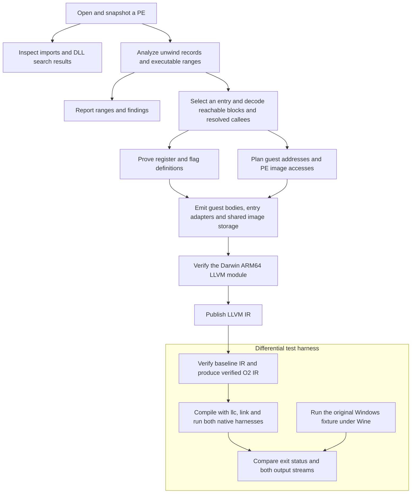

# Forge program architecture and design contracts

Forge recovers one selected PE function and its reachable statically resolved callees before creating LLVM IR. The private recovered group owns the decoded control flow and validated call sites. Register proofs, address planning, and emission all consume that group. [Recovery interface](../compiler/src/lift/recovery.h) · [Lifting entry point](../compiler/src/lift/lift.h)

## Current Architecture



| Stage | What it owns and what crosses the boundary |
| --- | --- |
| File input and PE parsing | `InputFile` opens the file and captures its physical identity. `ParsedImage` owns the snapshot, the LLVM COFF reader that borrows it, and `forge::Module` with observed PE records. Section mappings borrow the image. The parser maps relative virtual addresses (RVAs) to file bytes, distinguishes file-backed from zero-filled extents, and identifies relocations and loader-written ranges. [Input](../compiler/src/pe/input.h) · [Image contract](../compiler/src/pe/image.h) · [Parser](../compiler/src/pe/pe.cpp) |
| Inspection and analysis | `inspect` reports imports by name or ordinal, exports, and how each DLL dependency was classified or resolved. Function analysis skips the import/export symbol tables and retains complete exception records when trailing bytes warrant a finding. Image planning can still protect loader-written import slots. `AnalyzedImage` owns the image, coalesces identical begin/end/unwind triples while retaining their record indices, identifies conflicts and chained fragments, and optionally enriches eligible ranges with DWARF. Gaps in executable sections can contain code, padding or data. [Inspection](../compiler/src/pe/dependencies.cpp) · [Range discovery](../compiler/src/analysis/analysis.cpp) |
| Recovery | Select an exact eligible start and decode only reachable blocks and resolved callees. The recovered functions retain validated ranges, ordered instructions and CFG successors, including parallel edges. Each resolved call records its caller, block, instruction and continuation. Guest targets identify the callee and the evidence for its address. External targets identify the IAT slot, owning descriptor and service binding. The continuation is the RVA immediately after the call and can lie in the same block. A guest call at the function’s exclusive end produces a `FallOff` block and emission reports unsupported fallthrough. External calls require an in-function continuation during recovery. Each guest callee’s incoming-site index refers to its callers’ records. [Recovery](../compiler/src/lift/recovery.cpp) · [CFG discovery](../compiler/src/lift/cfg.cpp) |
| Group analysis | For the selected entry contract, compose register-bit and flag effects to a fixed point and propagate caller definitions. The address worklist uses the selected guest base, argument and return facts, and recovered continuations to determine stack access routes and select image bytes. Finish relocation, permission and budget checks before creating an LLVM module. [Group analysis](../compiler/src/lift/group_analysis.cpp) · [Call-flow proof](../compiler/src/lift/call_flow.cpp) |
| LLVM emission | Select the Darwin ARM64 data layout, declare the guest bodies, and emit the adapter and shared image resolver. Each body lowers the recovered CFG using the proofs and checked memory routes. The module owns its LLVM globals and their initialization. [Body emission](../compiler/src/lift/lift.cpp) · [Image storage](../compiler/src/lift/image_memory.cpp) · [Entry adapters](../compiler/src/lift/execution_context.cpp) |
| Verification, CLI and publication | The caller owns the returned `llvm::Module` and supplies an `LLVMContext` that outlives it. The module is verified and independent of the input bytes after generation. The CLI owns options, diagnostics rendering and exit status. It preflights the output, then publication checks input identity again, closes a sibling temporary and renames it. A failed lift preserves an existing output. [Lift executor](../cli/src/commands/lift_execution.cpp) · [Publication](../compiler/src/output/publication.cpp) · [Core contract tests](../tests/unit/lift.cpp) |
| Generated code and native execution tests | Checked stack operations, image lookup, traps and any image initializer are emitted into the LLVM module. Only the CLI links CLI11. LLVM supplies PE/DWARF readers, MC decoding and IR services. Native test rules invoke `opt` and `llc` and link an ARM64 harness. The Wine reference environment belongs to testing. Production `forge lift` ends at IR publication. [CLI dependencies](../cli/CMakeLists.txt) · [Compiler dependencies](../compiler/CMakeLists.txt) · [Generated memory operations](../compiler/src/lift/memory.cpp) · [Native build rules](../tests/CMakeLists.txt) |
| Native runtime | The host owns the instance that identifies a guest process. Each guest thread belongs to that instance. The host passes both the instance and the thread token to the runtime-enabled entry. Nested bodies borrow the pair from the invocation context for validated IAT calls. A checked-memory entry registers the generated image and lends the active stack to the instance for synchronous service access. [Guest process and address space](runtime-architecture.md#guest-process-and-address-space) · [C ABI](../runtime/include/forge/runtime.h) |

### Recovering a called leaf without unwind metadata

Group discovery obtains the PE loader-write ranges once for recorded-function and inferred-leaf checks. A recorded body must have a disjoint half-open extent, including any padding or inline data. This applies to standalone entries, recursive roots and callees reached through either call kind. A write starting at the exclusive end is disjoint. An overlap in a callee is reported at the originating call with the target and first overlapping RVA. An overlap in a standalone entry produces `LIFT_IMAGE_MEMORY` with its recorded extent, unless a register-call or jump-table proof provides a more specific diagnostic.

Windows x64 can unwind a true leaf by simulating its return. Such a function can omit its exception-directory record. Forge still requires an eligible unwind record for the externally selected entry. It follows reachable resolved calls to exact recorded entries first. The remaining exact call targets supply the only starting points for leaf inference. PE analysis continues to report the observed records and gaps. [Windows x64 unwindability](https://learn.microsoft.com/en-us/cpp/build/x64-calling-convention#unwindability)

The shared CFG decoder starts at the target, inside one file-backed executable section. Its window ends at the first observed function boundary, the end of file-backed bytes, or 64 KiB from the entry, whichever comes first. Ineligible or conflicting records also fence decoding. A trailing partial runtime-function record leaves the set of claimed ranges incomplete, so only recorded functions can be recovered from that image. Each candidate may decode up to 4,096 distinct reachable instructions. The full encoding of each reachable instruction must be free of base relocations and loader-written slots, including the TLS index and import address table. The group claims the half-open byte spans of reachable instructions. A branch can skip embedded data, padding, or another independently called leaf. The original source-level boundary and ownership of skipped bytes can remain unknown. An overlap between distinct entries rejects the lift, including a shared instruction tail. [Leaf recovery](../compiler/src/lift/leaf_recovery.cpp)

Every branch and fallthrough must stay within the window and land on an instruction boundary. At least one reachable plain return is required. Loops may return to the entry or run forever along one path. A wholly return-free graph, an edge below the entry, or fallthrough beyond the window has insufficient evidence. When decoding fails at an internal fence, Forge can inspect up to 15 file-backed bytes in the same section to establish that an instruction crosses it. The diagnostic identifies the in-window bytes and the originating call. An invalid encoding retains its decoder error. The group identifies a function by its image and explicit entry RVA.

The supported instruction and operand model must establish that every reachable instruction preserves RSP and all nonvolatile GPRs until RET. Every explicit integer source, destination and effective address must use modeled operands. Reads of nonvolatile registers are allowed. Partial and conditional writes, pushes, pops, and save/restore pairs disqualify the candidate. Stack arguments, caller-provided pointers and PE data use ordinary checked memory semantics. Nested calls, unresolved transfers, and unmodeled instructions, including SIMD and floating-point control operations, prevent inference. A validated leaf joins the ordinary group with its recovery origin, bounded section view, CFG and incoming call sites. Multiple calls share one guest body. [Operand model](../compiler/src/lift/operands.cpp) · [Recovery contract](../compiler/src/lift/recovery.h)

### Statically resolved register calls

While tracing, Forge checks that a register call has a possible producer before decoding its continuation. Recovery then scans each finished basic block in instruction order, including boundaries discovered later through branches or jump tables. A `CALL64r` must read the same full-width GPR last written by a RIP-relative `LEA64r`. Only the single-byte `90` and the supported alignment NOPs may appear between them. A branch or table edge entering after the LEA starts a separate block and breaks the proof. Register copies, partial writes, pointer slots and targets selected at runtime do not establish a call site.

The caller must have a recorded extent in immutable, file-backed executable code free of base fixups and known loader writes. A dynamic relocation table with an unknown write footprint prevents this proof. Recovery adds the signed 32-bit displacement to the **end of the LEA**, checks that the result fits in an RVA, and submits it to the same unwind and leaf discovery rules as a direct target. The selected guest base plays no part in discovery.

The caller owns one record per call instruction. Its evidence RVA identifies the LEA for a register call or the call instruction for a direct call. The callee’s incoming index and interprocedural proofs borrow that record. During emission the original LEA writes the guest register. At the CALL the actual register value must equal the selected guest base plus the validated callee RVA. A mismatch traps before the return slot or RSP changes. Successful calls share the existing guest body and activation checks. [Execution and failure tests](../tests/integration/test_indirect.py)

### Imported call recovery

The PE reader walks ordinary and delay descriptors with bounded, eight-byte thunk reads. Each descriptor records its source RVA and file offset, DLL spelling and normalized identity, original lookup RVA and first IAT RVA. The position of a symbol identifies its lookup entry and slot in the owning snapshot. An IAT call triggers the full identity walk. Function discovery alone can skip symbol details. Loader-write exclusions use the same descriptor and thunk reader and also protect slots when the aggregate IAT directory is absent.

The parsed image builds the binding index on its first executable import lookup. All lifts of that snapshot share the immutable result or the same ownership failure. Recovery attaches the requesting instruction to its own copy of a failure.

The binding index checks both table extents, matching indices and terminators, and disjoint slot ownership. Each ordinary and delay descriptor must have stable destination fields and table terminators. The null descriptor terminating each directory must also survive relocation and loader writes. A slot claimed by a TLS index, a load-config field or delay-module handle cannot supply an executable binding. Unbound entries must agree. An unbound image with no original lookup table can identify a name through its IAT. A bound ordinary descriptor needs a separate, intact lookup table disjoint from bound address storage. The descriptor, DLL name, hint/name record and lookup entries through the selected slot must survive relocation and loader writes. An unbound shared lookup slot is consumed before the loader replaces it. Inspection reports a bound slot without lookup identity as `{"unresolved": true}`. Malformed records yield a PE diagnostic. A valid slot for an unsupported service yields a lifting diagnostic with the call and import identity.

For an unwind-backed caller, recovery adds the signed displacement to the end of the decoded `CALL64m` and looks up the exact slot. The caller’s canonical site holds either a guest target or an external service with its descriptor and slot. Only guest targets have incoming guest edges and body-return summaries. An external transfer supplies explicit generated and carried register and flag masks. The existing fixed point composes those effects through joins, loops and nested guest returns. [Runtime contract](runtime-architecture.md#lifted-last-error-services)

### Bounded indirect branches

An unwind-backed function can dispatch through a table of signed 32-bit offsets. The pinned MinGW GCC emits this contiguous sequence for the seven-case C switch in both fixture configurations.

```asm
cmp     rcx, 6
ja      default_case
lea     r8, [rip + table]
movsxd  rax, dword ptr [r8 + rcx * 4]
add     rax, r8
jmp     rax
```

Recovery matches decoded operands. The base must survive the load and the ADD must form the value consumed by JMP. Unsigned JA leaves indices 0 through the immediate bound on its fallthrough. A 32-bit CMP requires a 32-bit register copy immediately after JA that zero-extends the compared value into the actual address index on every incoming path. For example, two paths can both prove `ECX <= 1` while one still reaches the load with `RCX = 0x100000001`. Signed guards, additional index arithmetic, absolute VA tables and calls through tables are unsupported. [Recognition and entry validation](../compiler/src/lift/jump_table.cpp)

The current recovery policy requires an unwind-backed function extent for table targets. An inferred leaf's decode window can contain unclaimed bytes belonging to another function. At an indirect jump in such a leaf, the diagnostic identifies the source CALL and reports the leaf's jump RVA, bytes, and missing extent. [Leaf recovery](../compiler/src/lift/leaf_recovery.cpp)

The table must fit in file-backed, immutable, non-executable data in one section. Each complete four-byte entry must be free of loader writes and base fixups. Conflicting fixups at an entry produce `INVALID_PE` with the dispatch instruction, table RVA and first affected index. The recorded code range must also be stable. A PE advertising a Dynamic Value Relocation Table has an unknown loader write footprint. Forge rejects table recovery in that image, including when the table is identified by section index at offset zero. A PE initialization failure at a recognized dispatch retains the JMP location and the table range. Recovery adds each sign-extended little-endian entry to the table RVA and schedules the destination in the same validated function. Existing instruction extents and pending leaders detect overlapping decodes. The limit is 1,024 entries per site and 4,096 entries per function, counting duplicates.

CFG discovery drains direct paths, resolves pending register jumps in RVA order and follows their targets. Each scheduled leader records explicit incoming edges separately from ordinary fallthrough. Before partitioning, recovery checks every proof against those leaders. If a table edge and an instruction extent overlap, the diagnostic identifies the dispatch, its entry index and both conflicting RVAs. An edge to the CMP rechecks the bound. Any edge entering the sequence after the CMP can bypass part of the proof and rejects the lift, including edges found through a later table. An unresolved site fails the request before LLVM emission. The recovered block owns the comparison, guard, load and table RVAs and an ordered successor for each index. Repeated targets retain their indices. The original JA owns the out-of-range edge. [CFG discovery](../compiler/src/lift/cfg.cpp) · [Recovered-group tests](../tests/unit/recovery.cpp)

Group analysis selects the proven table byte span for its indexed load. The generated code still performs the checked four-byte read, signed extension and 64-bit ADD, including its flags. An LLVM switch compares the computed guest VA with the selected load base plus each distinct destination RVA. A mismatched address traps. Flag PHIs take their inputs from the actual emitted predecessor edges after any memory or register checks. [LLVM emission](../compiler/src/lift/lift.cpp) · [Execution and failure tests](../tests/integration/test_jump.py)

### One call group in practice

In `functions/sequence`, `call_sequence` passes the address of a live stack local to `pair`. The helper dereferences it and calls `increment` twice. The entry and its helper reach the same `increment` body and its writable PE counter. The internal `forge_lifted_<rva>(ptr)` adapter takes seven register slots and allocates a fresh invocation context. The optional external `forge_lifted(i64, i64)` wrapper supplies RCX/RDX and returns RAX. Nested bodies share the invocation's registers, flags and checked stack. Each calling activation retains its expected return slot and the nonvolatile values it must check. At a nested call Forge checks RSP alignment and shadow space, pushes the guest VA of the next instruction, and validates the frame on return. Each emitted `forge_guest_<rva>` body receives the same guest-state pointer. [Fixture source](../tests/differential/fixtures/functions/sequence.cpp) · [Call lowering](../compiler/src/lift/lift.cpp) · [Stack checks](../compiler/src/lift/memory.cpp)

Register and flag proofs apply to reads on every incoming path. A shared helper can carry the caller's flag through without reading it, including when another caller enters with that flag undefined. Runtime byte marks protect opaque incoming nonvolatile values during saves and restores. Image stores require concrete bytes. [Call-flow contract](design-guide.md#forge-specific-decisions) · [Register and stack checks](../tests/integration/test_stack.py)

The counter has a different lifetime. The resolver maps guest VAs to selected immutable spans or writable sections after checking the full access width and permissions. Supported PE relocations affect the initial bytes, and protected loader slots remain inaccessible. All accesses to the counter's writable section use one module-owned backing. Repeated entry calls see prior writes. Starting a fresh native harness process initializes the module again. This fixture uses the ordinary entry. Checked-memory entries bind the initialized writable backing to one occurrence and reject a second process claiming it. The manifest's first and last argument pairs are both `0 1`. The counter's intervening writes change the expected output from `33` to `141`. Separate lift requests create separate modules and backings. [Image storage and initialization](../compiler/src/lift/image_memory.cpp) · [Expected sequence](../tests/differential/manifests/functions_sequence.json)

The Windows reference executes the whole fixture under Wine. The native side calls the selected export's lifted group through the declared harness signature. For enabled cases, baseline and O2 must each match the validated reference's exit status and raw stdout/stderr for the specified PE configuration. The evidence binds those observations to the PE and IR digests. The optional Unicorn CTest compares function-level machine-code results separately. A passing function comparison establishes behavior for those inputs and observations. The harness cannot convey an arbitrary nonzero Windows exit. Whole-process startup and imported services require their own evidence. [Case contracts](../tests/differential/cases.json) · [Comparison and artifact rules](../tests/differential/README.md#compare-a-lifted-function-with-wine) · [Unicorn test scope](../README.md#verification-and-fastgron)

## Architectural Assessment

The component refactor at `c62956b` established one parsed image, a private core library, structured failures, and separate publication. That refactor left internal CFG and state-analysis extraction for later work. Revision `2288fa0` extracted reachable CFG discovery, and Task 8 added interprocedural call-flow proofs. Group recovery and preparation now reuse both components before LLVM emission. The earlier lifting evaluation chose to retain LLVM MC and Forge's semantics, and to add recovery techniques when a fixture demonstrates a need. Its historical fixture counts and instruction coverage describe its pinned revision. [Component guide](design-guide.md#where-does-the-change-belong) · [Lifter decision and follow-up criteria](binary-lifting-evaluation.md#decision-and-integration-boundaries)

| Gap and source | Consequence and recommended change | Alternative, dependency, timing and cost |
| --- | --- | --- |
| Guest callees invalidate volatile address and stack-spill facts. The two pointer-free last-error services invalidate volatile facts and spills that may overlap the eight-byte CALL return slot. A nested entry has frame-relative RSP. Independently lifted entries also receive separate image storage. [Address planning](../compiler/src/lift/group_analysis.cpp) · [Image memory](../compiler/src/lift/image_memory.h) | Conservative address selection can admit more image data into the resolver or exceed a lifting budget. Independent entries cannot promise coherent global writes. Preserve current guards and ownership. Refine an alias proof only for a demonstrated precision loss. If multiple entries must share state, emit them against one image instance and test cross-entry writes. | A per-function image copy would break aliases. A process-wide singleton conflates independent programs. The call and image suites exercise the current lifetimes. Extra alias proofs (medium effort) and multi-entry storage (high effort and risk) wait for a fixture that requires them. |
| Unwind-backed ranges, unknown executable gaps and inspection's dependency graph express different kinds of evidence. Inspection distinguishes a located DLL, a system DLL classified as `external_api`, and an unresolved API-set contract. An export can also name a forwarder. [Function ranges](../compiler/src/analysis/analysis.h) · [Dependency report](../compiler/src/pe/dependencies.h) | More permissive discovery could turn unresolved edges into executable guesses. Retain the evidence and conflicting candidates with any new inference. Resolve a guest external against an explicit ABI and service implementation before emitting a call. | Bounded leaf recovery uses resolved call evidence and validated instructions. Additional recovery strategies and external service binding require their own evidence. |
| Emission selects the target layout and generates the entry adapters. Native integer loads use the output layout, and large image tails rely on Mach-O zero-fill behavior. [Target selection](../compiler/src/lift/lift.cpp) · [Stack loads](../compiler/src/lift/memory.cpp) · [Image initializer](../compiler/src/lift/image_memory.cpp) | A different triple alone cannot establish correct byte order, ABI, loader initialization or OS effects. Keep these assumptions identifiable and make target-specific decisions explicitly when emitting for a second target. | A backend hierarchy now would have one implementation. **Future**, triggered by a specific second target, its ABI and an execution oracle. High effort, with the main risks at the ABI and loader boundaries. |
| Step locations and diagnostic bytes survive failures. Successful emission retains RVA-based names for functions and blocks. Optimization can merge or erase those values. The harness already records artifact identity. [Decoded steps](../compiler/src/lift/cfg.h) · [Diagnostic validation](../tests/differential/lift_diagnostics.py) · [Coverage gate](../tests/differential/coverage_report.py) | A later transformation needs a source identity and validation contract independent of LLVM names. Reuse the recovered group for source locations and the current artifact records for transform evidence. | An LLVM-only map loses erased instructions. A compulsory per-instruction sidecar adds cost without a reader. **Task C**, after B's identities, before relying on transformed provenance. Medium effort. Test stale evidence and ambiguous origins. |

## Ownership and platform boundaries

Keep image facts, recovery for a selected group, and executable state under their respective owners within the private core.

1. **Per input image.** Keep bytes, PE sections, raw relocations, imports and exports under the policy that reads them. Keep function ranges, record indices, conflicts, optional symbols and executable gaps in the existing analysis. A relocation describes a loader fixup. A selected guest load base is an input to lifting. A recovered function's identity is its image and start RVA. Debug names and native symbol spellings can change independently. For stored evidence use the snapshot digest and function start RVA so a different build at the same path cannot inherit the identity. [Image and relocation model](../compiler/src/pe/image.h) · [Analysis model](../compiler/src/analysis/analysis.h)
2. **Per selected group.** A function's in-memory identity is the source snapshot and its start RVA. One noncopyable `RecoveredFunctionGroup` borrows the caller's live analyzed image, owns its LLVM MC decoder resources, and owns the CFGs and call records. The mapped section and instruction bytes borrow the snapshot. Opcode names borrow the decoder's instruction table. The CFGs are destroyed before the decoder. Lookup by instruction RVA and the ordered incoming-site index both refer to the same call record. A consumer that retains evidence beyond this scope needs snapshot identity and value locations, such as an instruction RVA and extent. Keeping recovery private and scoped to the requested entry lets analysis-only clients inspect ranges without paying to decode them. [Recovery contract](../compiler/src/lift/recovery.h)
3. **Per lift and execution.** Register and flag proofs borrow recovered call sites. Image selection borrows sections and selecting steps while it checks access widths, permissions, relocation exclusions and budgets. Its finished plan owns relocated initialized bytes and accessible intervals. These facts depend on guest semantics, the entry contract and the guest load base. Native pointer layout, LLVM globals, resolver instructions and Mach-O initialization belong to emission. The recovered group and proofs can be released before the caller uses the verified module. [Group preparation](../compiler/src/lift/group_analysis.h) · [Image plan](../compiler/src/lift/image_memory.h) · [Execution state](../compiler/src/lift/execution_context.h)

### Platform and transformation boundaries

| Concern | Current assumption | Extension boundary |
| --- | --- | --- |
| Source ISA | The decoder uses `x86_64-pc-windows-msvc`. Forge models register views, partial writes, flags and instruction effects. | A 32-bit x86 guest needs its own decoder mode, widths, address arithmetic and tests. A 64-bit output pointer cannot define a 32-bit guest address. |
| Source format and OS ABI | PE32+ supplies layout, unwind records and loader fixups. Windows x64 supplies argument registers, stack arguments, shadow space and nonvolatile rules. | Select format evidence and source calling rules independently. A PE32 guest needs appropriate discovery and an explicit calling convention. |
| Recovered semantics | Checked guest addresses, memory effects and control flow describe the supported machine behavior. The wrapper signature is supplied by the caller. | Keep architectural effects and unresolved facts available without inferring source-language types, object lifetimes or intent. |
| Target ISA and layout | The module already carries `arm64-apple-macosx11.0.0` and its data layout. LLVM lowers it to native instructions. | Recover source facts independently. Generate and verify IR with each target's layout and revalidate any layout-sensitive transform. |
| Target OS ABI and services | The harness provides a Darwin entry point and link environment. Forge emits its memory helpers. Inspection can report Windows imports. | OS compatibility must define calling, data, errors and observable side effects for each supported service. Native linking, application startup and packaging consume that contract. |

The lifter recovers the group from analyzed ranges, then prepares the facts needed for LLVM generation. Verification and transformation produce the candidate for backend lowering, native linking and packaging. Keep target layout selection available to IR generation and optimization as it is today. Implement packaging only when a program has an entry point and bindings for its required services.

The existing verifier belongs immediately after emission. Canonicalization and conventional LLVM optimizations can consume verified IR and produce a separately verified candidate. A Forge pass that uses relocation or call evidence must state which recovered facts it needs and which mutations invalidate them. A compatibility rewrite for an external service needs a concrete binding. For example, a file-read replacement must reproduce the byte count, buffer contents, error behavior and file-position change that its callers observe. Target-sensitive optimization follows selection of the target layout. LLVM's verifier establishes structural validity. Behavioral validation compares executions. [Generation and verification](../compiler/src/lift/lift.cpp) · [Existing verify, O2 and code-generation order](../tests/CMakeLists.txt)

For a **compatibility transformation**, record its input identity, assumptions, promised observables and comparison oracle. Preserve the same defined results, memory effects and traps within the declared scope. For **modernization**, specify the intended difference, permitted inputs and affected observations before applying the change. Compare unaffected behavior to the old reference and the changed behavior to an independently specified expectation. A verifier failure, unmet assumption, missing observation or unexplained change disqualifies the candidate. Keep the canonical input and the failed stage's evidence. ML-guided pass selection belongs at this same decision point. LLM-assisted analysis can suggest a target or repair for review, with its evidence recorded as an inference until validated.

For provenance, the durable anchor is the input image, function RVA, instruction range and, for a transfer, the recovered edge and its kind. Group analysis reports its input path and requested entry even when invoked independently of emission. An instruction failure can also identify the actual nested function, block, instruction bytes, file offset and attempted target. Add LLVM annotations only where a consumer can use them. A guard may be synthetic, an inlined operation may have several origins, and a deleted instruction may have no output location. The evidence accompanying an optimized artifact should identify its canonical input and the transformation that produced it, even when a precise instruction mapping is unavailable. [Diagnostic schema](../README.md#lift-diagnostics) · [Callee and target regressions](../tests/integration/test_functions.py)

## Design Contracts

| Principle | Enforceable today | Extension contract |
| --- | --- | --- |
| Recover once, transform separately, retarget independently. | Decode each reachable function once within the request, including recursive targets. | Reuse the source facts. Derive layout-sensitive IR per target and retain canonical input so each transformation can be reproduced. |
| Keep source semantics distinct from target services. | Review guest VAs and Windows call frames separately from native pointers and the Darwin wrapper. | A new target or service bridge must demonstrate its own ABI and observable effects. |
| Give program state an owner and a lifetime. | Test a callee reading its caller's stack, a fresh invocation, and repeated entry calls observing an earlier global write. These expose accidental copies and resets. | Multiple entries that share globals must name the same image instance. |
| Keep binary evidence independently of LLVM IR. | Keep raw records, conflicting ranges and user-selected entry contracts distinguishable. | Keep identities needed by later consumers available when LLVM removes a value. |
| Declare what a transformation may change. | The baseline and O2 variants use the same fixture observations. | A new pass declares assumptions, allowed differences and its oracle so a reviewer can judge the result. |
| Surface unsupported and invalid behavior precisely. | Preserve stage, category, code and location. A call into the middle of an already decoded instruction is invalid. A direct target with insufficient leaf evidence remains unsupported. Out-of-bounds computed loads trap on execution. | Keep unresolved recovery visible. An enabled case that becomes unsupported remains a failure. |
| Preserve provenance where evidence supports it. | Check diagnostic bytes and file offsets against the PE snapshot. | Report synthetic, merged or unavailable origins accurately, including when diagnosing an optimized run. |
| Introduce an abstraction for a concrete consumer. | Reuse the private core, parser, CFG and LLVM types. Extract responsibilities with a distinct owner or lifetime. | Add a shared interface when a second implementation serves a demonstrated use case. |
| Preserve behavioral and differential coverage. | Keep positive and negative cases. Compare both native variants with the same reference for each enabled configuration. A verifier can accept IR that loses a carry flag or resets a global. | Add independent observations for each new capability. |
| Keep platform choices at identifiable boundaries. | Keep file offsets, RVAs, guest VA widths and native pointer layouts separate. | Generalize for a second ISA, format or runtime against a real input, a defined ABI and an execution oracle. |

## Decision Log

| Decision | Alternatives considered and rationale |
| --- | --- |
| Use existing domain objects plus lightweight recovered-group metadata. | Keeping facts solely in LLVM metadata would couple recovery to emission and optimizer retention. A dedicated instruction IR would add another instruction representation and a translation step to validate. The private group supplies those locations and edges over the existing CFGs. |
| Keep one group per selected entry for now. | Decoding every eligible function eagerly would make an unrelated unsupported body affect a working entry. Linking independently generated modules to share mutable state would duplicate backing and initialization. A future multi-entry request must specify the image instance and entry contracts first. |
| Keep the existing lifter and conservative call-boundary proofs. | The earlier evaluation found that a replacement engine still leaves PE recovery, state policy and ABI transitions to Forge. Whole-program alias analysis would add complexity before a failing fixture establishes a need. Retain the LLVM MC path and the checked resolver. [Prior evaluation](binary-lifting-evaluation.md#decision-and-integration-boundaries) |
| Validate transformations in the existing differential harness first. | A production registry would have no current client. A mandatory instruction map after O2 would imply precision the optimizer can erase. The current harness already retains canonical IR, both compiler inputs and independent observations. [Artifact checks](../tests/differential/coverage_report.py) |

## Migration Plan

### Task B — Program model and lifting boundaries

The recovery contract test exercises call-site order, fallthrough continuations, recursion, parallel CFG edges, diagnostic locations, and source lifetimes without creating LLVM IR. The native and differential suites exercise the execution contracts across the boundary, including caller-stack aliases, nonvolatile checks, rebased return addresses, and persistent image writes. [Recovery contract test](../tests/unit/recovery.cpp) · [Nested frame tests](../tests/integration/test_stack.py) · [Image tests](../tests/integration/test_image.py) · [Differential obligations](../tests/differential/coverage-baseline.json)

### Task C — Transformation and provenance contracts

- **Objective and scope.** Use the baseline/O2 comparison as the first consumer. Reuse its existing PE digest, selected entry, run identity, IR hashes, per-stage results and exact streams. Record the actual LLVM tool version and pass pipeline for each variant alongside the existing evidence. Keep its assumptions tied to the selected target layout, entry contract and fixture observations. [Runner](../tests/differential/differential.py) · [Variant validation](../tests/differential/coverage_report.py)
- **Review order.** First cross-check the recorded pipeline against the variant and the actual compiler input. Baseline verifies canonical IR. O2 runs `default<O2>` on verified IR and verifies its output. Then use a nested-call fixture as the first source-mapping consumer. Trace one canonical call to its guest call site and callee. After optimization, report an origin only when the evidence supports it. These changes can be reviewed separately from any future production pass.
- **Acceptance and regression coverage.** Reject a mislabeled optimization, swapped or stale PE/IR evidence, a false callee byte offset, and a transformation that passes LLVM verification but changes a defined result. Attribute failures to the appropriate stage, retain the canonical module, and report both variants independently. Baseline and O2 must match the same validated Wine observation. Keep any later modernization expectation separate from that compatibility gate. [Diagnostic validation](../tests/differential/lift_diagnostics.py) · [Stale-variant regressions](../tests/differential/test_coverage.py) · [Native negative tests](../tests/differential/test_native_differential.py)

## Deferred Work

- **Additional platforms.** Evaluate PE32 x86 to a 64-bit target, other executable formats, and other native targets against representative binaries when independent reference execution is available.
- **Full executable and OS compatibility.** Multiple external entries, cross-module calls, broader indirect dispatch, loader startup, TLS execution, unwinding, Windows API implementations and application packaging each need a concrete consumer and end-to-end observations. The current DLL inspection report remains useful input to that work.
- **Broad transformations.** A custom semantic IR, pass registry, plugin framework, ML/LLM integration and automated modernization remain future decisions. Revisit them when a specific transformation, its required facts, and its success and failure criteria can be named.
