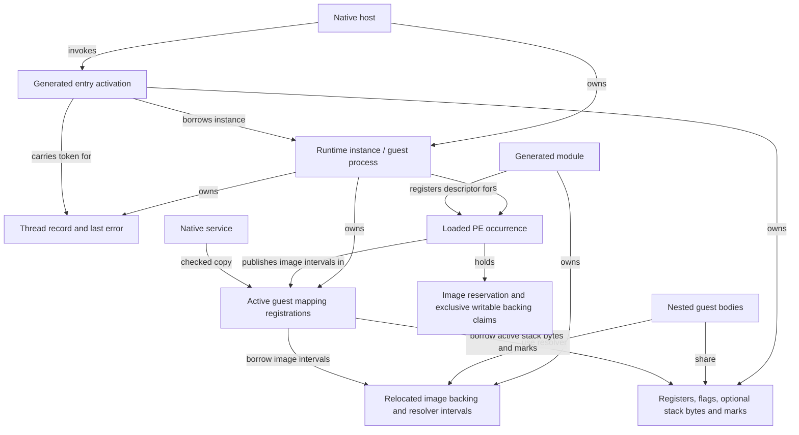

# Forge Runtime on macOS ARM64

A native host can link `libforge_runtime.a`, create a runtime instance and keep a 32-bit last-error value for each of its guest threads. A C translation unit and hand-authored LLVM IR compiled to ARM64 Mach-O exercise the public ABI alongside real lifted calls. The compiler API also produces reusable process artifacts for one-shot execution. The CLI can publish a function-level LLVM module or link a process artifact with the native startup adapter. [Compile a native executable](../README.md#compile-and-run-a-native-executable) [Process artifact contract](#12f--process-lifecycle-integration) [Public C header](../runtime/include/forge/runtime.h) · [Build and linkage](../runtime/README.md)

## Runtime component boundaries

Forge translates Windows x64 code ahead of time and runs the resulting ARM64 code on macOS. The managed process composes a core execution instance with per-process Windows compatibility state. The same core also serves hosts that create standalone instances. [Runtime source ownership](#runtime-source-ownership)

| Responsibility | What it owns | Allowed dependencies |
| --- | --- | --- |
| Runtime core | Guest process and thread identity, invocation admission and retirement, execution state and results, address-space reservations, backing lifetimes, stack and memory access, and the synchronization those operations require. | Core may use Darwin mechanisms. Dependencies on Win32 or CRT implementations, LLVM, CLI11 and Wine are forbidden. |
| Windows compatibility | Win32 defines guest handles, last error, process parameters, the top-level filter, Windows-visible I/O and `ExitProcess`. CRT defines MSVCRT startup data, allocation policy, strings, errno and fatal CRT diagnostics. | Services use core mechanisms and may call Darwin through explicit private interfaces. Exports from different DLLs may share an implementation. |
| Managed process composition | Stages one process occurrence, selects the resources its imports need, binds its IAT slots and publishes its lifecycle state. | Uses core, compatibility and the shared service catalogue through private interfaces. Hosts and executable startup call the process C ABI. |
| Darwin platform | Native descriptor capture and I/O, filesystem operations, clocks, threads, waits, synchronization and macOS process integration. Native memory allocation and protection belong here when needed. | Adapters expose host operations and their native outcomes. They must be usable independently of Windows compatibility. For example, a Mach VM operation belongs here, while interpreting Windows `VirtualAlloc` flags and failures belongs to Win32. |

The startup adapter is a client of the process ABI. It supplies host inputs, runs the managed process and renders its result. The compiler owns PE interpretation, Windows x64 call lowering and LLVM optimization. It can use the shared headers without linking a runtime implementation. Generated ARM64 code crosses the boundary through the versioned native C ABI and artifact descriptor. The native linker combines the generated object, `forge_startup` and `forge_runtime`. Embedded hosts supply their own entry point. Both archives stay static and the runtime-only build stays supported. Native executable output runs independently of Wine and Rosetta. [Build targets](../runtime/CMakeLists.txt) · [Native linker](../compiler/src/output/executable.cpp) · [Build and linkage](../runtime/README.md)

### Resource ownership and borrowing

Registration constructs one `LoadedProcess` at a stable address. A successful registration transfers its owning pointer to the process handle. The occurrence contains a `ProcessImage` and a `WindowsProcessState`. Its core instance borrows the execution view and Windows state after binding succeeds. A standalone instance has neither borrow. [Managed process](../runtime/src/managed_process.cpp) · [Core instance](../runtime/src/core/instance.h) · [Windows process state](../runtime/src/compat/process_state.h)

```text
Before R3.3
  process handle → loaded image → core instance → Win32 parameters, handles, filter
  core/process.cpp → import selection, Win32 services, image registration and execution

After R3.3
  process handle → one managed occurrence
                     ├─ core image and instance → PE backing, stack, threads, mappings, heap
                     └─ Windows process state → parameters, CRT data, handles, filter
  compatibility services → core admission, checked memory and terminal results
  Win32 handles → Darwin descriptor duplicates
```

| Resource | Authoritative owner and lifetime | Who may use it |
| --- | --- | --- |
| Process, threads and invocations | An embedding host owns its standalone instance or its managed process handle. In managed mode the handle owns one loaded image occurrence with its instance, primary thread and execution record. Core admits the run and retires it once. The thread record owns its last-error value and active invocation association. | Generated code and adapters borrow the instance and thread token. Guest identity follows that pair across host threads. Stack access requires the current synchronous invocation. |
| Image, stack and mappings | A function artifact owns its generated image backing and each entry activation owns its stack. A managed process borrows immutable artifact tables and bytes, owns fresh writable backing for each occurrence, and owns its stack and registers. Core owns the reservations and mapping registrations in both modes. | Registration borrows stable descriptors and byte ranges. A reservation can contain inaccessible holes. Writable aliases share a backing claim. Leave retires a stack before its storage expires. Detach or close retires image mappings before the owner releases their storage. |
| Parameters and CRT state | The occurrence’s Windows state owns the command line, primary TIB, CRT startup data and errno. One errno cell serves the single primary guest thread. | The host lends startup inputs during registration. Core mapping records borrow stable descriptors, strings and cells. Guest services return addresses in that mapping. |
| Heap | The core instance owns the process’s heap blocks, their backing and their address-space registrations. MSVCRT defines allocation sizes, budget and error results. | Checked guest access and writable CRT argv copies use the same blocks. Free removes the reservation before releasing its bytes. |
| Handles and descriptors | Win32 assigns opaque process-scoped guest handles. The host retains its original descriptors. The process owns close-on-exec duplicates of available standard streams when an imported service needs them. | A synchronous write borrows a duplicate for the transfer. Completion, including a fault, retires the duplicates before the host sees the final process state. Embedders retain ownership of host signal policy. |
| Registered callbacks | The Windows state stores the top-level filter’s opaque guest VA until replacement, clearing or close. | Win32 exchanges the VA on the active guest invocation. Future filter delivery would require a validated guest target, signature and re-entry path. |
| Execution results and faults | The managed execution record holds the tagged result. Generated guards report faults and a terminal service can publish an exit. Core validates the result, retires the invocation and delivers it to the host. | The embedding host receives the full result. Standalone `main` translates it into host exit status or diagnostics. A guest exit or fault ends guest execution inside an embedding host. |

Core mapping records borrow their descriptors, bytes and writable claim words. On registration failure or close, the occurrence’s destructor calls `ProcessImage::retire`. It clears reservations and thread records and drops the two instance borrows while the parameter cells, heap blocks, PE backing and primary stack are still live. A successful writable claim remains consumed for the lifetime of that backing, including after detach. During execution, the running state pins the occurrence. The runner retires the invocation and stack, releases the captured descriptors, then publishes completion. [Core retirement](../runtime/src/core/process.cpp) · [Registration rules](#process-mappings-and-lifecycle) · [Managed lifecycle](#12f--process-lifecycle-integration)

### From PE import to native call

1. **Identify the import.** The PE reader relates an import address table (IAT) slot to its owning descriptor and symbol. Recovery validates the slot and call evidence, including a supported linker thunk or statically proved register target where applicable. It selects the normalized DLL and exact export name from the Windows x64 service catalogue. An unsupported or ambiguous call produces a lift diagnostic. [PE import evidence](../compiler/src/pe/image.h) · [Call recovery](../compiler/src/lift/recovery.cpp)
2. **Lower the guest call.** The shared C++ catalogue is the single source of function service contracts for compiler and runtime. Each declaration names the DLL, export and native symbol, checks the C adapter prototype, and specifies the guest calling convention, argument and result types, pointer access and extent, last-error policy, process requirement, and returning or terminal control flow. Group analysis uses those facts for memory planning. Emission reads Windows registers or checked stack slots at their declared widths and calls the bound native symbol with the instance, thread and any result or fault slots. [Service catalogue](../runtime/include/forge/service_signature.h) · [Argument positions](../compiler/src/lift/service_location.h) · [Call emission](../compiler/src/lift/lift.cpp)
3. **Bind process storage at registration.** An artifact can separately describe observed function IAT slots and CRT data imports. The runtime publishes stable opaque guest addresses for imported functions and guest cell addresses for supported data exports. A recovered register call checks the target against its IAT value before calling the linked adapter. Merely loading a function address does not request the process resources needed to *execute* that service. Artifact tables describe that artifact's uses. Introducing a second runtime signature registry would give those uses competing definitions. [Artifact contract](../runtime/include/forge/process.h) · [Imported function addresses](#imported-function-addresses)
4. **Execute and return.** Win32 or CRT implements observable results, error state and side effects, using checked guest access and any required native operation. The native status reports bridge success or failure separately from the Windows return value. Generated code checks that status before consuming outputs or continuing. Managed terminal calls propagate a tagged result to the host without taking the guest fallthrough. [Service buffer helpers](../runtime/include/forge/service_memory.h) · [Execution checks](../compiler/src/lift/execution_checks.cpp)

### Runtime source ownership

At the source root, `managed_process.cpp` assembles the executable process inside `forge_runtime`. The separate `startup.cpp` builds into `forge_startup` and drives the public process ABI. Core, compatibility and Darwin each own the mechanisms or behavior below. [Runtime sources](../runtime/src/) · [R2 and R3 handoff](#r2-and-r3-handoff)

| File under `runtime/src/` | Responsibility | Ownership and dependencies | Invariant to preserve |
| --- | --- | --- | --- |
| [managed_process.cpp](../runtime/src/managed_process.cpp) | Process C ABI, import-driven setup, IAT binding and lifecycle transitions | A registration-local owner transfers the occurrence to the process handle. Composition coordinates its core and Windows resources. | Publish `Ready` only after all bindings succeed. Release standard streams before publishing completion. |
| [core/instance.h](../runtime/src/core/instance.h) | Thread records, heap blocks, reservations and the process memory lock | Core owns these records. The instance borrows the managed execution view and the occurrence’s Windows state. | Core needs only the forward declaration of the compatibility type. The borrows expire with their occurrence. |
| [core/runtime.cpp](../runtime/src/core/runtime.cpp) | Instance and thread lifecycle and token generation | Core owns thread identity and the lifetime of its 32-bit last-error slot. Win32 defines how services use that slot in standalone and managed modes. | Tokens are never recycled. Preserve standalone and managed invocation checks. |
| [core/registration.cpp](../runtime/src/core/registration.cpp) | Image/stack registration, range placement, backing claims and invocation admission/retirement | Core commits the reservation and its claims under the existing locks. | A failed image publication consumes no claims. Busy images and threads cannot be retired. |
| [core/guest_memory.cpp](../runtime/src/core/guest_memory.cpp) | Checked validation/copies, stack marks, managed scalar resolution and fault detail | Core. Keep mapping traversal and protection checks together. | Preflight covers every byte. Scalar resolution respects its single-interval rule. |
| [core/process.cpp](../runtime/src/core/process.cpp), [core/process_image.h](../runtime/src/core/process_image.h) | Artifact metadata validation, private image backing, primary execution context, guest entry and terminal-result publication | Core checks the public descriptor versions and table extents, materializes the image and stack, admits and retires the invocation and validates the tagged result. | Keep registered bytes stable, execute outside the lifecycle lock and return control to the host. |
| [core/heap.cpp](../runtime/src/core/heap.cpp), [compat/crt/process_heap.cpp](../runtime/src/compat/crt/process_heap.cpp) | Guest heap allocation and free, CRT allocation services and writable argv copies | Core maintains blocks, reservations and allocation hints. CRT owns the budget, per-block charge, errno and guest return values. | Publish the mapping before exposing the VA. Remove it before freeing the block. |
| [compat/process_state.h](../runtime/src/compat/process_state.h), [compat/process_state.cpp](../runtime/src/compat/process_state.cpp) | Windows state and the combined parameter mapping | One aggregate owns Win32 parameters, optional CRT startup data, errno, charged heap usage, standard handles and the filter. Core borrows its mapping descriptor and rows. | Preserve the guest layout, including the reserved TIB holes. Its addresses stay stable until mapping retirement. |
| [compat/win32/process_parameters.cpp](../runtime/src/compat/win32/process_parameters.cpp), [compat/win32/process_parameters.h](../runtime/src/compat/win32/process_parameters.h) | Windows command line, primary TIB and accessors | Win32 owns the strings, stack bounds and TIB self pointer. CRT can consume the command line during startup. | Preserve the narrow and wide strings across guest calls. |
| [compat/crt/crt_parameters.cpp](../runtime/src/compat/crt/crt_parameters.cpp), [compat/crt/crt_parameters.h](../runtime/src/compat/crt/crt_parameters.h) | MSVCRT argument parsing, environment storage, relocated guest cells and `__getmainargs` | CRT. Keep parsing and guest layout together. Its writable argv copies use the process heap. | Publish guest addresses into process-owned storage and validate the output slots before allocation. |
| [compat/crt/standard_streams.cpp](../runtime/src/compat/crt/standard_streams.cpp) | Legacy standard FILE records, text-mode `fwrite` and terminal stream flushing | CRT owns the records and buffers, borrows the Win32 standard handles and uses Darwin for physical writes. | Retire mappings before freeing their backing. Preflight input and the required tail allocation before publishing any output prefix. |
| [compat/crt/msvcrt.cpp](../runtime/src/compat/crt/msvcrt.cpp) | Byte-string comparison, length and copy adapters | CRT. Extend the existing byte-service module for related behavior. | Use checked guest buffers and preserve the declared fault and return semantics. |
| [compat/crt/fatal.cpp](../runtime/src/compat/crt/fatal.cpp) | Legacy MSVCRT fatal diagnostic and exit | CRT selects the diagnostic for the signed error identifier and borrows the process's stderr. | Validate the pending invocation before output and publish the guest exit through core. |
| [compat/string_scan.h](../runtime/src/compat/string_scan.h) | Shared checked NUL scan for Win32 `lstrlenA` and CRT `strlen` | Shared compatibility. Both callers already use the same mechanism and supply their own limits. | A speculative chunk crossing an inaccessible byte must still find a preceding NUL. |
| [compat/win32/services.cpp](../runtime/src/compat/win32/services.cpp) | Last-error access, `lstrlenA`, `Sleep`, `SetUnhandledExceptionFilter` and `ExitProcess` | Win32 selects the guest-visible result, exchanges the filter VA and supplies the DWORD exit result to core. | Use the calling thread’s last-error cell. Preserve it across filter registration and sleep. Hold no process lock across a host wait. |
| [compat/win32/startup_info.cpp](../runtime/src/compat/win32/startup_info.cpp) | Windows x64 startup-info views and guest string storage | Win32 owns the creation fields and the per-variant handle rules. | Validate the full output and preserve W’s omitted bytes and stack marks. |
| [compat/win32/console.cpp](../runtime/src/compat/win32/console.cpp) | Standard-handle selection, checked guest buffers and `WriteFile` results | Win32 owns handle validation, guest byte counts and translation of native write errors to last error. | Validate guest buffers before external output. Report the committed prefix even after a partial write fails. |
| [compat/win32/standard_handles.cpp](../runtime/src/compat/win32/standard_handles.cpp), [compat/win32/standard_handles.h](../runtime/src/compat/win32/standard_handles.h) | Opaque handle assignment and the process’s three standard-stream slots | Win32 pairs each issued identity with its owned Darwin descriptor and translates capture failures to registration status. | Close owned duplicates on failure and retirement. Preserve host descriptors and shared flags. |
| [platform/darwin/io.h](../runtime/src/platform/darwin/io.h), [platform/darwin/io.cpp](../runtime/src/platform/darwin/io.cpp) | Descriptor duplication, classification, access-mode inspection, signal checks, native writes and close | Darwin. A move-only descriptor owns one duplicate. Its write accepts host bytes and returns the committed count and native error. | Keep pipe requests atomic and preserve host signal dispositions and shared descriptor flags. |
| [platform/darwin/wait.h](../runtime/src/platform/darwin/wait.h), [platform/darwin/wait.cpp](../runtime/src/platform/darwin/wait.cpp) | Host thread yield, finite sleep and indefinite wait | Darwin performs the selected operation and returns its native error. | Resume a finite sleep with its remaining duration after a caught signal. Keep indefinite waits blocked across caught signals. |
| [startup.cpp](../runtime/src/startup.cpp) | Native `main`, host signals and inputs, process ABI calls and exit reporting | Standalone bootstrap. Keep in its own archive. | Own host policy for the executable. Consume the tagged guest outcome from core. |

For each recovered call, composition matches the DLL case-insensitively and the export name exactly against the service catalogue. The matched native adapter selects standard handles, command-line strings or CRT arguments. Data imports identify the CRT cells to initialize and bind. Function-address imports occupy a reserved hole in the same core address space. Their identity uses the catalogue entry’s index, so a repeated import gets the same guest VA and distinct exports get distinct VAs even if they share an adapter. Reading an IAT address alone consumes no startup inputs. [Registration and resource selection](../runtime/src/managed_process.cpp) · [Service catalogue](../runtime/include/forge/service_signature.h)

`runtime/include/forge/` remains the external include path. `runtime.h`, `process.h` and `msvcrt_process.h` declare C entry points and ABI types. Runtime ABI version negotiation and artifact descriptor versions are separate contracts. `guest_range.h`, `service_signature.h` and `service_memory.h` provide C++ range, binding and buffer contracts at source level. Private state layouts, locks and Darwin interfaces belong behind those headers. [External headers](../runtime/include/forge/)

### Native execution costs

Keep proved stack and image operations in generated native code so LLVM can optimize them. Use checked access at the boundaries that require runtime provenance, permissions or stack marks. Resolve supported services during lifting and linking and keep any registration-time binding out of the per-call path. Introduce a copy or lock where correctness requires it, such as a checked transfer or a registration commit. Keep each guest/host transition identifiable so entry, service and host work can be measured independently. [Native call benchmark](#reproduce-the-native-call-benchmark) · [Lifted entry measurement](#lifted-entry-measurement)

## Guest process and address space

One live `forge_rt_instance` identifies one logical guest process. Its native host creates it and controls its lifetime. Within that lifetime the pair (instance, thread token) selects a guest thread on any host thread. ABI v1 exposes thread services and checked guest-memory operations. Lifting with `--checked-memory` enables image registration and stack publication at the existing typed runtime entry. A Windows-visible process ID would be a separate process-owned value.

Checked failures raised by a bounded guest-table CALL carry the instruction RVA in the upper DWORD of the fault result’s `value` and the table header RVA in the lower DWORD. The standalone launcher prints both before the fault class. A memory fault also retains its address, access and reason. The ordinary guest caller owns the return slot and validates it on normal return. [Compiler proof and dispatch](program-architecture.md#bounded-indirect-calls-through-pointer-tables)

### Function-level entry ownership

| Owner | State and lifetime |
| --- | --- |
| Compiler (`forge_core`) | Owns parsing, recovery, instruction semantics and generation of ARM64-targeted IR. The private recovered group carries proven guest-call sites and continuations. Neither the compiler nor the CLI links the runtime. [PE model](../compiler/src/pe/image.h) · [Recovery contract](../compiler/src/lift/recovery.h) · [Compiler build](../compiler/CMakeLists.txt) |
| Generated module | Each invocation initializes its register and flag context. When group analysis requires a checked guest stack, the adapter also allocates and initializes stack storage in that context. Guest bodies share the context across nested calls. Image backing and its resolver belong to the generated module. Writable bytes persist across entry calls to that module, independently of runtime instance lifetime. [Entry adapters](../compiler/src/lift/execution_context.cpp) · [Guest stack](../compiler/src/lift/memory.cpp) · [Image backing](../compiler/src/lift/image_memory.cpp) |
| Native host | Owns each runtime instance from successful creation until destruction. It chooses which guest thread runs and keeps the instance live while callers use it. The existing lifting harnesses separately supply the selected entry's arguments and observe its return or trap. [Existing test harnesses](../tests/support/) |
| Runtime (`forge_runtime`) | Owns its thread records, active invocation associations, image reservations and mapping registrations. Runtime initialization needs only the native C++ runtime and OS facilities. Its implementation has no LLVM, compiler, CLI11 or Wine dependency. [Runtime component](../runtime/) |

With checked memory enabled, the runtime borrows the storage that generated instructions already access.



With plain `--runtime`, the adapter stores its instance and token in the private invocation context and forwards them on each imported call. The host must supply a live pair. ABI validation occurs at the service call, so an entry that executes no import may return without looking up a token. Runtime-free entries can execute the generated stack and image paths independently. [Entry adapters](../compiler/src/lift/execution_context.cpp) · [Service lowering](../compiler/src/lift/lift.cpp)

Function-level translation gives image bytes and stack bytes different lifetimes.

- A generated module covers a selected root and its recovered callees. Its private writable globals last as long as the native module. Plain entries reuse those globals across calls. Checked entries finish one-time initialization of mixed sections before publication and claim the writable backing for one loaded occurrence.
- Each outer invocation that needs a stack owns 4 KiB of bytes and per-byte marks at the fixed guest range `[0x70000000, 0x70001000)`. Two independent native activations can therefore assign different storage to the same guest VA. Existing nested recovered calls pass the original context and push frames onto its stack. [Group analysis](../compiler/src/lift/group_analysis.cpp) · [Stack model](../compiler/src/lift/memory.h) · [Image initialization](../compiler/src/lift/image_memory.cpp)

### Native C ABI v1

The public header defines an opaque `forge_rt_instance`, a 64-bit `forge_rt_thread_token` and a 32-bit `forge_rt_status`. Exported functions use C linkage and the native platform calling convention. The creation signature is the version handshake. A caller passes the version it compiled against, including as a literal in generated IR. An incompatible version returns `FORGE_RT_ABI_MISMATCH` before a caller receives an instance. Future incompatible changes must retain a callable version check at this entry point or introduce a separately named entry point.

| Call | On success |
| --- | --- |
| `forge_rt_create(FORGE_RT_ABI_VERSION, &instance)` | Returns a new independent instance to the host. |
| `forge_rt_thread_create(instance, &token)` | Creates a guest thread record with last error zero and publishes its nonzero token. |
| `forge_rt_set_last_error(instance, token, value)` | Stores all 32 bits for the selected thread. |
| `forge_rt_get_last_error(instance, token, &value)` | Copies all 32 bits into the caller's output slot. |
| `forge_rt_thread_destroy(instance, token)` | Releases that thread record and invalidates the token. |
| `forge_rt_destroy(instance)` | Releases the instance and any threads it still owns. |

`FORGE_RT_OK` means the operation completed. A null required instance or output pointer returns `FORGE_RT_INVALID_ARGUMENT`. Zero, retired and foreign thread tokens return `FORGE_RT_INVALID_THREAD` for a valid instance and valid arguments. Native ABI callers treat the token as opaque. Guest-visible standard handles use separate opaque values scoped to one managed process. Tokens identify a creation, with a shared generation counter ensuring distinct values across runtime instances in the linked runtime. Generation exhaustion fails before reuse. Allocation or capacity exhaustion returns `FORGE_RT_RESOURCE_EXHAUSTED`. Unexpected implementation failures return `FORGE_RT_INTERNAL_ERROR`. Exceptions stay inside the native boundary. Ordinary output slots retain their original values on failure. The checked memory operations also have a dedicated guest-fault diagnostic. A writable, correctly aligned output slot and a live instance pointer from this runtime are caller preconditions. Passing an arbitrary non-null address cannot be made safe by examining its bits.

Operations on a live instance synchronize access to its records. Guest identity follows the explicit token even when calls move between host threads. One host thread can also serve several guest threads. A read racing a thread removal observes a result consistent with their order. A set followed by a get comprises two operations, so a caller requiring both to be indivisible must arrange its own ordering. Before destroying an instance, its owner stops new calls and waits for every in-flight use to finish. After destruction every copy of that instance pointer is unusable. Destroying a guest thread retires its state only. There is no host thread to join on that account.

### Guest addresses and generated memory

The guest is AMD64 PE32+ with unsigned 64-bit virtual addresses. An RVA is relative to one guest image. A file offset indexes input bytes. A native pointer addresses live host storage on the ARM64 target. Only the backing owner supplies the native address. Services receive guest pointers as guest VAs. A future x86 guest will validate its own pointer width at decoding and marshalling boundaries before using the same mapping contract. [Guest range checks](../runtime/include/forge/guest_range.h) · [PE address definitions][pe]

A mapped range has a start VA and a positive byte count. For a guest maximum address `maxVA`, require `length - 1 <= maxVA - start` after checking the start fits. A single byte at `UINT64_MAX` is representable in 64-bit range arithmetic. Guest access still requires an eligible active mapping and the right permission. This arithmetic makes no assumption about the Windows user-mode VA layout. Containment and overlap use byte offsets or inclusive last bytes so they also work at this boundary. Two ranges sharing a byte overlap. Adjacent ranges have no shared byte. Empty requests are handled by the access operation.

The compiler selects image storage during group analysis. The completed image plan owns the selected initialized bytes, relocated fragments and accessible RVA intervals. Supported AMD64 DIR64 fixups use the chosen guest load base. Emission builds native globals and resolver rows containing each accessible interval's guest VA, length, native start and writability. A writable section's aliases share one backing. A section can contain several accessible intervals separated by excluded loader-written bytes or unsupported fixups. Native storage allocated for a hole confers no guest access to that hole. [PE initialization](../compiler/src/pe/pe.cpp) · [Image plan and resolver](../compiler/src/lift/image_memory.cpp)

Generated scalar memory operations can use a proved stack path, or dispatch to the stack or the generated image resolver. The image resolver checks the full scalar width and write permission in one interval before deriving a native pointer. Stack access also checks the byte marks. The outer synthetic return slot is inaccessible to guest data operations. Nested return addresses can be read as concrete guest bytes and are protected from writes while live. Opaque saved-register identities can be copied and restored by translated code. They cannot be exposed as concrete buffer bytes. Function entries trap on invalid accesses. Process entries propagate a tagged failure to their host. For protection-enabled process artifacts, generated nonstack accesses call the runtime scalar resolver, which checks the effective guest permissions under the instance lock. [Stack checks](../compiler/src/lift/memory.cpp) · [Generated memory contract](../README.md#pe-image-memory)

### Managed guest page protection

A recovered call to `KERNEL32.dll!VirtualProtect` selects the version 6 managed artifact. Its version 5 prefix is followed by source section extents and R/W/X attributes, including a fixed-protection flag for shared, discardable or noncached sections. Registration checks these facts against the selected mapping rows. The source section describes the initial page access. Each row still limits which individual bytes, permissions and private backing Forge can publish. The runtime continues to admit version 1–5 artifacts for their existing services.

The managed occurrence owns the page state. Its image reservation borrows the original section spans and sparse intervals for read-only overrides and pages that have become private after a write. Writable SEC_IMAGE data starts with Windows copy-on-write protection. The runtime already owns its backing per process. Checked copies collect their image range while validating access. Multi-output services reserve space for every affected private interval before writing guest bytes. For `__getmainargs` this precedes allocation of the argument vector. The first checked write records the guest page as private, which changes a later old-protection result from `PAGE_WRITECOPY` to `PAGE_READWRITE`. Sections containing relocation footprints can have acquired private pages during loading. Until a guest write establishes their state, a call that requires their uncertain initial value reports unsupported. Returning pages to their original access removes the override. All allocations and checks precede the old-DWORD transfer and interval swap under the instance lock. Registration rollback and teardown retire the reservation before releasing its storage. Two guest VAs that share private bytes may have different permissions, and two processes registered from the same artifact own separate bytes and overrides.

The supported operation covers complete 4096-byte guest pages backed throughout by admitted private, non-executable writable PE data. A one-byte request protects its entire page. The API can report an initial copy-on-write value for image data. Requesting a new copy-on-write mapping or promoting an immutable compiler constant requires a separate implementation. For a known range, the compiler selects writable backing across every section touched by its rounded pages. A known starting address with a dynamic size selects the contiguous writable sections from that page. The four output bytes can span adjacent writable sections or reside on the checked stack. Core preflights byte ranges and stack marks for native services and applies the same effective permission to managed scalar and interlocked accesses. One scalar still requires one mapping row. A permission boundary within that row reports the first denied guest byte. The managed invocation pins the returned pointer through the instruction and excludes a concurrent protection change by another host thread.

Immutable PE data, translated instructions, protected loader fields and IAT aliases retain their access ceilings. Stack, CRT heap and process-parameter mappings establish byte extents. A request starting on a page shared with one of these synthetic mappings also reports unsupported in the padding beyond its byte extent. An image reservation can contain source pages omitted from the compiled artifact. A request needing those pages terminates with `FORGE_RT_UNSUPPORTED_PAGE_PROTECTION`. Executable promotion, guard exceptions, generic copy-on-write and cache-policy emulation are also outside the supported subset. A future `VirtualQuery` service can consume the same reservation, section and effective-access state.

Windows Server 2022 preserves a seeded last error on success. A zero size or overflowing user range fails with error 87 and preserves the output bytes. On the zero-size path, the write probe still realizes a pristine image page containing the output DWORD. A bad output pointer fails with error 998. The Win32 adapter also rejects targets and output pointers below the Windows user minimum of 0x10000 when an embedder has mapped those addresses. For an inaccessible target after a successful output probe, Windows returns error 487 and writes `PAGE_NOACCESS` to the valid output. If the output itself becomes read-only during the operation, Windows can return true while leaving the DWORD untouched. On a pristine image page, a successful output probe realizes the page privately before Windows determines the old value. An unaligned DWORD on the neighboring page can likewise change its reported protection. Restoring writable access preserves the distinction between pristine and realized pages. The transaction stages these effects under the mapping lock. The Linux Wine 8 reference differs on image first-write reporting, zero size and the order of invalid-output handling. [SDK-free measurements](../tests/differential/reference/virtual-protect.json) · [45 Windows Server 2022 observations](https://github.com/RecastIR/forge/actions/runs/45911091982/job/140222678936) · [Windows API contract](https://learn.microsoft.com/en-us/windows/win32/api/memoryapi/nf-memoryapi-virtualprotect) · [Protection constants](https://learn.microsoft.com/en-us/windows/win32/memory/memory-protection-constants) · [Wine 8 KernelBase](https://github.com/wine-mirror/wine/blob/wine-8.0/dlls/kernelbase/memory.c) · [Wine 8 virtual memory](https://github.com/wine-mirror/wine/blob/wine-8.0/dlls/ntdll/unix/virtual.c)

### Process mappings and lifecycle

The low-level function-entry contract lets a host lend its own backing. For runtime-owned backing and one-shot execution, see [process lifecycle integration](#12f--process-lifecycle-integration).

Each checked function artifact supplies a native C descriptor generated from its image plan. The descriptor identifies one translated group from the same PE snapshot and selected load base as its code. The process reserves the full `SizeOfImage`, including headers, gaps, excluded bytes and images with zero published rows. Before emitting a checked artifact, the compiler verifies that this reservation fits at the selected guest base and, if the entry publishes a stack, that the two ranges are disjoint. Only the sorted resolver intervals grant access. Their guest start, length, native byte pointer and R/W/X permissions describe the same storage used by generated code.

On the first checked entry, `forge_rt_enter` validates the thread, image and optional stack, checks overlaps against existing reservations, and commits the image and activation together. Later entries reuse the registration in that instance. A checked module also exports `const forge_rt_image *forge_lifted_image(void)`. This accessor completes backing initialization and supplies the same stable descriptor to a host that needs explicit registration or detach. The runtime entry uses it for lazy registration. The owner keeps the descriptor, row table and backing addresses stable while borrowed. Descriptors, row tables and claim words reside outside guest-accessible storage. [Generated descriptors and C ABI](../runtime/include/forge/runtime.h)

Each initialized writable backing has an owner-supplied claim word shared by all its aliases, including read-only intervals. Each interval's permissions govern reads and writes through its guest VA. The first successful registration binds the backing to a non-recycled occurrence identity, even after detach or process destruction. A failed registration consumes no claims. Loading the same guest VAs independently requires fresh writable storage. Immutable relocated bytes can be shared. The published permissions and backing are fixed for the registration lifetime, including between entries when optimizations may have folded immutable loads.

An outer entry obtains a fresh invocation token and publishes its stack bytes, marks and synthetic return-slot location. The owner lends the bytes and marks exclusively to that activation. Native descriptor producers must keep the two spans disjoint from each other, all image backing, other active stacks and registration metadata across instances. Nested recovered guest bodies share that activation. Each guest thread admits one independent execution chain. The fixed guest stack VA admits at most one published stack per process. Entry collisions fail before the guest body runs. `forge_rt_leave` removes the association and stack before the generated activation releases its storage. A native service can call other runtime functions synchronously. Guest execution and imported calls run with the mapping lock released.

Detaching an executing image or destroying a busy guest thread reports a lifecycle failure. A successful detach waits out current checked copies in that instance and retires its reservation. Before releasing descriptor or backing storage, the owner stops new registrations and entries that use it, waits for outstanding descriptor users, and detaches every registration borrowing that storage or destroys each such instance. This includes other instances sharing immutable image bytes. Instance destruction retains the host's existing stop-and-drain precondition. Generated guard traps terminate native execution. Recovering a trapped activation through signal handling or nonlocal jumps has no cleanup protocol.

### Checked guest buffers

A native service obtains the current invocation with `forge_rt_current_invocation(instance, thread, &invocation)`. It passes the instance, thread, invocation, guest VA and byte count to `forge_rt_read_guest`, `forge_rt_write_guest` or `forge_rt_validate_guest`. Validation accepts read, write or both. Copy calls also take a native buffer and its capacity. For a nonempty copy the caller supplies live, disjoint host storage for its buffer and outputs. A zero-length operation validates the association and access direction, then succeeds without looking up the VA or touching the buffer. Windows APIs can apply their own null-parameter rules.

The process lock protects lookup, validation, transfer and stack-mark updates. The bridge checks unsigned range overflow, locates the first mapping, and walks consecutive intervals by remaining length. Every byte must be mapped with the requested permissions. Adjacent guest intervals can refer to separate native allocations. Only after the entire range passes does the bridge copy the bytes and mark the stack output concrete. Failure leaves the host read destination, guest destination and marks unchanged. A validation succeeds for that call alone. It supplies no lasting pointer or permission for later host I/O.

Only the synchronous, innermost activation on its entering native thread can expose its stack. This prevents a service from racing changes to frame protections or opaque origins. Input accepts concrete bytes and live nested guest return addresses. The synthetic outer return slot is inaccessible. During a native-to-guest initializer call, checked transfers also enforce the callback stack bound and opaque return-slot rules. Output may initialize an uninitialized byte or overwrite an opaque save, and must avoid all protected return bytes. Read/write validation applies both rules. Guest threads remain responsible for synchronizing conflicting direct accesses to shared image bytes.

| Failure domain | Observable outcome |
| --- | --- |
| Native runtime | Invalid association, invalid host arguments, busy lifecycle, mapping conflicts, exhaustion and internal failures return a native status. The function-level entry traps on a failed native call. A process entry returns a tagged result. |
| Guest memory | `FORGE_RT_GUEST_FAULT` supplies the requested start VA for range overflow, or the first failing VA for unmapped memory, denied permission or invalid stack access. It records the requested access and reason. Retired invocation tokens fail association validation even when the same stack VA has been reused. |
| Windows service | The binding chooses the Windows return value, transfer count and last-error behavior. Checked memory operations preserve thread last error. |

Translated scalar instructions keep their existing stack checks and single-interval image resolver. Both paths access the same native bytes. The runtime performs synchronization at registration and checked-copy boundaries. For `WriteFile`, the managed run pins the output storage through write-back of the committed byte count. A future scoped native borrow for service buffers requires one contiguous interval and the same stack protection and mark-update guarantees. Longer-lived input must be copied into owned storage. [Stack lowering](../compiler/src/lift/memory.cpp) · [Image resolver](../compiler/src/lift/image_memory.cpp) · [Standard streams and process exit](#standard-streams-and-process-exit)

### Guest addresses and calls

Windows x64 passes the first four integer or pointer arguments in RCX, RDX, R8 and R9 by position and declared width. The caller reserves 32 bytes of shadow space and aligns its stack to 16 bytes before CALL. With the return address on the stack, callee-entry RSP is eight modulo 16, and the fifth argument starts at entry RSP + 40. Later positional slots follow at eight-byte intervals. Forge reads only the declared four or eight bytes from each register or stack slot. For imports, lowering uses the RSP returned by the existing guest CALL push. Address analysis sees the caller before that push, so the fifth argument is at caller RSP + 32. Both stages use the same positional rule. Stack loads check bounds and byte marks before entering the native service. [Windows x64 ABI][win-abi] · [Apple ARM64 ABI][darwin-abi] · [Forge guest frame](../README.md#guest-stack-memory)

Calling through a guest callback address requires a proved guest entry, signature and controlled re-entry into lifted code with the originating process, thread and frame. A callback VA cannot serve as a native function pointer. Floating-point/vector parameters and returns, aggregates, varargs and alternate conventions require separate signature and register rules. PE32 x86 needs its own guest ABI and pointer width. Managed execution and Windows exception dispatch also fall outside v1.

### Lifted last-error services

The host selects the runtime-enabled two-integer entry explicitly. It creates an instance with the ABI version expected by the generated object (1), checks the status, and supplies a live instance and thread token to `forge_lifted_with_runtime`. A version mismatch fails instance creation. Arbitrary or expired non-null instance addresses violate the host lifetime contract. Zero, foreign or retired tokens and a null instance fail at the service boundary. The generated module checks every returned status and takes its normal native trap path before reading an output or executing the continuation.

| Ordinary named import from KERNEL32.dll | Guest behavior | Native ABI call |
| --- | --- | --- |
| `SetLastError` | Read the low 32 defined RCX bits. The void return leaves RAX undefined. | `forge_rt_set_last_error(instance, thread, value)` |
| `GetLastError` | Read the selected thread’s DWORD. Write EAX, defining all of RAX by zero extension. | `forge_rt_get_last_error(instance, thread, &host_dword)` |
| `Sleep` | Yield for zero, suspend the calling host thread for a finite DWORD millisecond count, or wait indefinitely for `UINT32_MAX`. Win32 validates the thread and any required active invocation before selecting the Darwin operation. A host failure returns `FORGE_RT_INTERNAL_ERROR`. All paths preserve guest last error. | `forge_rt_sleep(instance, thread, milliseconds)` |

Recovery selects the binding by normalized DLL and exact symbol spelling. A static reference to that binding supplies its signature and native symbol to analysis and emission. Each call checks the Windows shadow area and alignment, installs its guest continuation, invokes the service with the Darwin ARM64 C ABI, then validates and pops the guest return slot. The runtime receives only its instance, token and scalar or host output slot. The invocation owns the stack, register state, and native binding arguments. Nested guest bodies share this context. Runtime calls preserve nonvolatile GPRs and RSP and invalidate modeled volatile registers and flags except for the getter’s defined result. Neither last-error service receives a guest pointer. A caller’s saved stack values survive when their slots are provably disjoint from the return slot written by CALL.

The import contract assumes the loader-selected binding remains fixed. Named imports from other modules, delay loads, ordinals, forwarding, runtime hooks, and arbitrary pointer dispatch require additional evidence. [PE recovery](program-architecture.md#imported-call-recovery) · [Native linkage](../runtime/README.md#link-a-lifted-windows-function)

### Implementation boundaries and acceptance

The checked bridge implements the 12C range and ownership contract for one generated group per occurrence. The runtime contract suite covers segmented copies and registration lifetimes. The ARM64 integration suite exercises generated stores, service copies and generated reloads with baseline and O2 code. [Bridge integration](../tests/integration/test_checked_memory.py)

#### 12E – Windows x64 ABI Bridge

The production catalogue binds ordinary named KERNEL32 and MSVCRT imports. Function-level KERNEL32 services include `GetLastError`, `SetLastError`, `Sleep`, and `lstrlenA`. Process-only services include `GetStartupInfoA/W`, `GetStdHandle`, `WriteFile`, `ExitProcess`, and `SetUnhandledExceptionFilter`. The supported value types are signed and unsigned 32- and 64-bit integers, unsigned pointer-sized words, opaque 64-bit handles, guest virtual addresses, and void results. Handle bits have meaning only to the Windows service. [Service catalogue](../runtime/include/forge/service_signature.h) · [Legacy MSVCRT services](#process-parameters-and-legacy-msvcrt-storage)

The native ABI passes the instance, thread, and declared scalar arguments, then a host result slot for non-void services and a host fault slot for checked-memory services. Its return is a Forge status. The bridge checks the status before the guest sees a result or executes its continuation. A function-level entry traps on failure. A process entry propagates the fault or native status. Successful 32-bit results write EAX and zero the upper half of RAX, including negative signed results. Other scalar results write full RAX. A void return leaves RAX undefined. The bridge preserves guest nonvolatile registers and RSP and invalidates volatile register/flag definitions. Ordinary lifted calls continue to use guest bodies. [Service lowering](../compiler/src/lift/lift.cpp)

To add a service, declare its C adapter and register a `bind` entry with its normalized DLL, exact import name, last-error policy, result and positional arguments. Mark memory arguments as input, output or in/out and give each a fixed byte count, an unsigned length argument index (zero-based), a NUL-terminated input extent, or the initializer table’s exclusive pointer endpoint. Specify whether the service accepts null. Scalar services use `--runtime`. Memory access requires explicit `--checked-memory` on the existing two-integer public entry. Unsupported signatures receive a validation error, including floating-point/vector values, aggregates, variadics, alternate conventions, general callback parameters and cross-boundary unwinding.

A pointer adapter obtains the current invocation and constructs a `guestBuffer` using the binding and argument index. The binding supplies the view’s extent. The view borrows synchronous invocation state and holds a guest VA. A null-address or address-overflow fault is published only after checking the captured invocation token. A stale token returns an invocation error and preserves the caller’s diagnostic. Each scalar or bounded buffer operation checks the declared extent and uses the existing runtime copy or validation primitive. The service handles an absent optional argument at the point its contract specifies. Each operation checks the actual mappings and stack marks. A successful validation does not reserve the range for a later transfer. Services choose the order of memory operations, Windows errors and external effects, and must propagate each failure. [Guest buffer operations](../runtime/include/forge/service_memory.h)

**String service.** `lstrlenA` accepts an optional NUL-terminated input and returns a signed 32-bit length. The service obtains the current synchronous invocation and reads through `forge_rt_read_guest` into 256-byte local chunks. If a chunk includes inaccessible bytes after a terminator, checked byte reads recover the readable prefix and succeed at that terminator. No guest VA becomes a host pointer. Input bytes and Windows last error are preserved on every path. A null address returns zero after invocation validation, matching the [documented Windows contract](https://learn.microsoft.com/en-us/windows/win32/api/winbase/nf-winbase-lstrlena). Host outputs must be nonnull and disjoint from each other and guest storage. Length changes only on success; a memory fault changes only the diagnostic and reports the first failing address, or the original scan address for overflow. Other runtime failures preserve both outputs.

The initial service examines at most **1 MiB, including the NUL**. A terminator at offset 1,048,575 succeeds; a terminator at offset 1,048,576 is outside this implementation's supported range. Exhausting the limit returns `FORGE_RT_RESOURCE_EXHAUSTED`, never a truncated success. This is a temporary service compatibility restriction, not a checked-memory transfer limit or permanent Windows contract. It can be increased or removed without redesigning the ABI.

After address analysis converges, group analysis selects data reachable solely through pointer arguments that a service reads or writes. The initial analysis requires stack provenance or bounded exact image/stack address alternatives; null is also supported. Unresolved origins, executable-code pointers, protected starting bytes, and mapping-budget failures produce call-site diagnostics. A standalone PE entry also admits a proven read-only argument within its registered headers. Other entry contracts reject header pointers. For fixed buffers and buffers with a proved byte count, the compiler selects eligible portions of every intersecting PE section. It reads the length at its declared width from the pre-call registers or stack and uses the largest proved alternative. A proved zero count selects no bytes. A dynamic `fwrite` element product selects contiguous readable data sections from its proved starting address to the first gap or ineligible section. Other unknown counts and NUL scans select the starting data section. The existing permission, relocation, protected-hole and mapping-budget rules apply. Writable aliases share the same persistent backing. Selection never stops at an initial NUL, so translated stores can extend or shorten the string before either call. Stack reads use the published activation and its concrete-byte/return-slot checks. Traversal into an unregistered section or protected hole faults; no unrelated image data is registered to compensate for unknown provenance.

These provenance restrictions belong to the initial compiler analysis. The native service ABI accepts guest virtual addresses and validates the actual registered mappings dynamically, including adjacent mappings backed by separate native allocations. Managed heap and parameter storage use this same mapping contract. The string-length service is read-only, so saved stack-address facts survive unless CALL's own return-slot write overlaps them.

Pinned Wine 8 changes last error to 87 for NULL while returning zero. Forge intentionally retains the specified preservation policy. Differential tests compare NULL's documented result and continuation; native contract tests also verify preservation. The [reference probe and comparison boundary](../tests/differential/README.md#pointer-taking-string-import) record this backend difference separately from Windows guarantees.

For a bounded output, address analysis invalidates saved stack-pointer facts overlapping the possible write. A pointer spilled and reloaded within a nested activation retains its frame offset, so a disjoint save survives even when the output pointer is passed on the stack. Unbounded or unresolved aliases conservatively discard potentially stale saves. A test-only five-argument service exercises the shape of `WriteFile`, copies the count to guest memory, and emits its observable marker after the checked operations succeed. The same suite checks six scalar arguments, protected stack slots, signed results, and nested calls in baseline and optimized IR. [Lifted ABI fixtures](../tests/integration/test_service_abi.py)

#### 12F – Process Lifecycle Integration

Set `LiftRequest::output` to `LiftOutput::ProcessArtifact` with `EntryMode::WindowsX64I64Pair` and the selected root RVA. The generated module exports `const forge_rt_artifact *forge_lifted_artifact(void)`. This descriptor has its own version, the compiled guest load base, full PE image size, source PE subsystem, selected entry RVA, original PE entry RVA, used DLL/service names, memory templates and a native entry thunk. The group still has to pass normal recovery and ABI checks. A host targeting the PE entry selects the observed PE entry RVA. [Compiler interface](../compiler/src/lift/lift.h) · [Process C ABI](../runtime/include/forge/process.h)

| Owner | Lifetime and access |
| --- | --- |
| Compiled module | Owns immutable code, tables, read-only image bytes, and sparse initializers for writable backings. Keep the module loaded at stable native addresses through the last process close. |
| Managed process | Owns one occurrence containing its Windows state and core image. The core image holds the runtime instance, primary context and private PE backing. Each alias of a writable backing addresses the same allocation and carries the same claim. |
| Execution context | Owns register bits and origins, flags, stack bytes and marks. Its guest thread owns last error, initially zero. Native services borrow the process instance and thread for the synchronous invocation. |

Registration holds the process lifecycle lock while staging a fresh occurrence. After artifact validation, core prepares private PE storage and the primary thread, applies the artifact’s fragments to zero-filled writable storage and registers the image. Registration then classifies the CRT application type, captures the standard streams required by the recovered calls and initializes the parameter mapping. The loader then reserves any imported-function range, checks data and function IAT slots together for overlapping bytes and writable aliases, and patches the private backing. Before publishing `Ready`, it reserves space in the mapping table for the primary stack. Run admission uses that slot to map the stack without growing the table. A registration failure destroys the candidate, including its registrations and any captured descriptors. A retry starts with fresh private storage and claims. [Managed registration](../runtime/src/managed_process.cpp) · [Core image](../runtime/src/core/process.cpp) · [Image emission](../compiler/src/lift/image_memory.cpp)

| Host operation | State and outcome |
| --- | --- |
| `forge_rt_process_create` | Creates a handle in `Created` after checking the runtime ABI version. |
| `forge_rt_process_register` | Validates the artifact and prepares the private image, thread, and stack together. Success makes the process `Ready`. Failure leaves it `Created` and retryable. In `Ready`, the same descriptor is idempotent and a different descriptor reports `MAPPING_CONFLICT`. |
| `forge_rt_process_register_with_startup` | Copies the executable identity, arguments and environment needed by the declared imports. An explicitly configured registration requires a created process. |
| `forge_rt_process_run` | Admits exactly one run from `Ready`. Native code runs outside the lifecycle lock. Concurrent or reentrant admission, registration and close on a running process return `BUSY`. A rejected run preserves the caller's result slot. |
| `forge_rt_process_allow_host_output_signals` | In `Ready`, records the embedding host’s assurance that its output streams have safe signal handling throughout the run. |
| `forge_rt_process_get_state` | Reports the current state, including during execution or after close. |
| `forge_rt_process_close` | Releases process resources in any non-running state and leaves the handle `Closed`. Repeated close succeeds. |
| `forge_rt_process_destroy` | Closes as needed and frees the handle. The host must quiesce other callers before destroy. A fresh process runs the same artifact again. |

The stack occupies 4 KiB at guest VA `0x70000000`, disjoint from the full image reservation even for a stackless guest root. Initial RSP is `0x70000fd8`, eight modulo sixteen, with a protected eight-byte synthetic return and 32 bytes of shadow space above it. Each process uses its own bytes at this guest range. Nested calls share them and retain the existing Windows frame, origin and return-address checks.

The host can pass a null input pointer to start with RCX and RDX zero, or supply both registers in a `forge_rt_entry_inputs` value. A valid outer return moves the process to `Exited` and delivers the full 64-bit RAX. A memory, control-flow, or ABI fault moves it to `Faulted`. The result also represents an unsupported execution condition or an infrastructure failure carrying a runtime status. An admitted run returns `FORGE_RT_OK` when it delivers any of these results. Inspect `result.kind` before using the payload. Memory faults carry a guest address, access mask, and reason. A service's checked fault is copied verbatim. Generated bodies propagate failure before observing the service output, checking a caller continuation, or executing later guest effects. On return, the runtime retires the invocation and stack mapping. Close retires the image and releases its storage.

When a scalar stack access crosses the outer return slot or stack end, the process reports the first byte that the operation cannot access. For example, a four-byte read starting one uninitialized byte below the return slot faults at that byte. A write from the same address faults at the return slot. A register copy can read an opaque saved byte and preserve its origin.

A scalar image access must fit a single resolver interval. If it crosses into a gap or a region that denies the requested access, the process reports the first failing address and the full access mask. If every byte is accessible across consecutive intervals, the process returns `FORGE_RT_UNSUPPORTED` with status `FORGE_RT_OK` and an empty fault payload. Both outcomes leave the process `Faulted` before the instruction transfers data. Regenerate process artifacts and link them with the runtime providing `forge_rt_report_scalar_boundary` to obtain these diagnostics.

The executable bootstrap in `libforge_startup.a` is a native host for this ABI. Its `main` checks the artifact version and confirms that the compiled entry RVA equals the original PE entry RVA. It creates a process, registers the artifact, runs it with null entry inputs, and destroys the process before returning the host status. Registration and execution borrow the statically linked descriptor and code. A tagged normal return or explicit process exit supplies the guest DWORD whose low byte becomes the host exit status. All other outcomes produce a diagnostic on stderr and status 125. The compiler includes the validated PE headers as an immutable backing in standalone artifacts. Each process borrows the linked header bytes through its checked region table. The bootstrap uses the same checked stack, image, service adapters and direct guest calls as other process hosts. [Bootstrap source](../runtime/src/startup.cpp)

### Process parameters and legacy MSVCRT storage

The native launcher uses the original PE basename under the guest path `C:\` and forwards the arguments following the Mach-O executable name. An embedding host can supply a guest executable path. Windows executable-name quoting and CRT backslash/quote rules produce a single command line with a limit of 32,767 UTF-16 units including the terminator. `GetCommandLineA` and `GetCommandLineW` return process-owned, read-only guest pointers. The current encoding contract accepts ASCII for both APIs and the narrow CRT environment. The CRT accepts ordinary `NAME=value` entries totaling up to 1 MiB of string storage. Explicit startup inputs are borrowed only during registration. [Startup C interface](../runtime/include/forge/process.h)

The primary thread has a private GS base. `NT_TIB.Self`, `StackBase` and `StackLimit` are guest memory and initially reflect the actual thread and its stack bounds. Unimplemented TEB fields occupy reserved holes. A scalar access missing the generated PE lookup can resolve through the same checked process reservations used by native service copies. Its native storage borrow expires at the end of the guest instruction.

Legacy MSVCRT owns writable guest cells for `_acmdln`, `__initenv`, `_fmode` and `_commode`. Version 3 artifacts identify their IAT slots. Each slot occupies eight distinct bytes of private PE backing and holds its cell's guest address. Registration rejects slots that overlap in guest or backing addresses and any writable guest mapping of slot bytes.

The declared imports determine which startup inputs registration consumes. `_fmode` defaults to text and `_commode` to zero, independent of the command line and environment. `_acmdln` receives a writable copy of the Windows command line. `__initenv` receives the initial guest environment. `__getmainargs` requires both inputs. Each call reads the current `__initenv` pointer and builds a fresh writable argv vector and strings from the original command line. It supports the default wildcard and new-handler modes. [Microsoft CRT argument contract](https://learn.microsoft.com/en-us/cpp/c-runtime-library/getmainargs-wgetmainargs) · [Pinned Wine CRT implementation](https://github.com/wine-mirror/wine/blob/wine-8.0/dlls/msvcrt/data.c)

The managed CRT heap exposes `malloc`, `calloc`, `free` and `_errno`. Allocations are 16-byte aligned and belong to one process. Free retires the mapping before releasing the backing. Zero-length allocations receive a distinct guest address. Failed or overflowing allocations return zero and set guest errno to `ENOMEM`. The initial process budget is 64 MiB including a 256-byte charge per allocation for metadata. A `free` outside the set of live allocation starts reports an invalid argument. [CRT process ABI](../runtime/include/forge/msvcrt_process.h) · [Windows malloc contract](https://learn.microsoft.com/en-us/cpp/c-runtime-library/reference/malloc)

The byte-oriented MSVCRT adapters implement `strlen`, `strcmp`, `strncmp` and `memcpy` through the checked guest-memory interface. String comparisons use unsigned bytes and return −1, 0 or 1 at a mismatch, a terminator or the comparison limit, matching the pinned Wine 8 x64 reference. A zero-length operation can use null guest addresses. A nonempty copy checks the full source and destination before publication. A guest-memory fault leaves the destination and the service result unchanged. [CRT byte services](../runtime/src/compat/crt/msvcrt.cpp) · [Wine MSVCRT comparisons](https://github.com/wine-mirror/wine/blob/wine-8.0/dlls/msvcrt/string.c)

### Win32 startup information

Both `KERNEL32.dll!GetStartupInfoA` and `GetStartupInfoW` take one output address in RCX, return void and preserve guest last error. The public launcher supplies an executable identity, arguments and environment. Its deterministic startup information has `cb = 104`, zero flags, geometry, console attributes and show-window value, and process-owned string pointers for the shell-reserved field, desktop and title. The reserved byte count and its separate data pointer are zero. The shell field points to an empty string. The default desktop is `winsta0\default` and the title is the guest executable identity when available. Capturing host standard streams for console services leaves these defaults intact. [Microsoft API](https://learn.microsoft.com/en-us/windows/win32/api/processthreadsapi/nf-processthreadsapi-getstartupinfow) · [Structure fields](https://learn.microsoft.com/en-us/windows/win32/api/processthreadsapi/ns-processthreadsapi-startupinfoa)

The loaded occurrence owns one creation record in its Win32 process parameters. Both views write the stored window scalars regardless of their associated flags. An ASCII desktop or title has read-only, NUL-terminated ASCII and UTF-16LE views in its parameter mapping. Both variants share any reserved bytes. These guest addresses live until process close. Registration snapshots the three guest handle values only when startup metadata declares `STARTF_USESTDHANDLES`. A reports that snapshot, or three `INVALID_HANDLE_VALUE` values when the flag is clear. W queries the process's current guest handles with the flag set and leaves all three output slots untouched with the flag clear. Descriptor ownership stays with the process's standard streams. The public launcher currently supplies none of this optional metadata. [Process state](../runtime/src/compat/process_state.cpp) · [Win32 adapters](../runtime/src/compat/win32/startup_info.cpp)

The adapters require a pending managed invocation and check the entire 104-byte output for write access before committing any bytes. Both write named fields and preserve the two four-byte padding ranges at offsets 4 and 68, including their guest stack marks. Unmapped, read-only and protected stack ranges use the same fault reporting as other checked service outputs. [Runtime contract tests](../tests/unit/runtime_startup_info.cpp)

Wine 11.0 and current upstream convert the desktop and title to ANSI at process attach and cache the ANSI structure. The Unicode variant reads the process parameters at call time and returns the resident UTF-16 pointers. The Wine process tests exercise both flag states and changes to live parameters. Pinned Wine 8 caches both structures and reports creation handles in both variants even with the flag clear, substituting `INVALID_HANDLE_VALUE` for a null handle. The Windows Server 2022 probes verified Forge’s A/W handle distinction. Its creation metadata is immutable and it exposes no writable PEB process parameters. Native Windows preserved both padding ranges and returned a non-null shell string in both views. [Compared fields and raw captures](../tests/differential/fixtures/startup/termination/) [Wine 11 ANSI](https://github.com/wine-mirror/wine/blob/wine-11.0/dlls/kernel32/kernel_main.c) · [Wine 11 Unicode](https://github.com/wine-mirror/wine/blob/wine-11.0/dlls/kernelbase/process.c) · [Process tests](https://github.com/wine-mirror/wine/blob/wine-11.0/dlls/kernel32/tests/process.c) · [Wine 8 ANSI](https://github.com/wine-mirror/wine/blob/wine-8.0/dlls/kernel32/kernel_main.c) · [Wine 8 Unicode](https://github.com/wine-mirror/wine/blob/wine-8.0/dlls/kernelbase/process.c)

The process retains the original title bytes when the executable name is outside the ASCII repertoire. An executed A/W call first validates its output range, then reports `FORGE_RT_UNSUPPORTED_STARTUP_TITLE` before writing any fields. A branch that skips the call can run normally. Command-line services independently require an ASCII executable path at registration.

**Deferred filename compatibility.** Support non-ASCII PE filenames end to end by producing UTF-16 startup titles for W and converting titles with the Windows ANSI code page for A.

**Deferred launcher dependency (P3).** A launcher that accepts `STARTF_USESTDHANDLES` must request capture of the supplied standard handles before preparing the creation record, even for an artifact with no console-service imports. The current public launcher supplies zero startup flags and selects capture from imported services. Implement metadata-driven capture together with richer launch inputs.

### CRT initializer callback design

The bounded bridge for `msvcrt.dll!_initterm` uses a dispatcher owned by the compiled call site. Its only guest signature is Windows x64 `void(void)`. Recovery proves the table bounds and eligible entry RVAs. At execution, the CRT reads each eight-byte slot from the current guest mapping immediately before its turn. The generated dispatcher checks the live guest VA against its admitted entries at the selected guest load base and calls the corresponding translated body.

The CRT accepts aligned, ordered endpoints spanning at most 1,024 qwords. An empty range does no memory access. Each nonempty slot incurs one checked read. Nulls skip dispatch. A callback can change later slots to null or to another admitted target. A different address yields a tagged unsupported result. Recovery budgets all tables in a caller together at 4,096 entries. The exclusive endpoint must be representable at the preferred and selected guest bases. [Range and target proof](program-architecture.md#crt-initializer-table-reachability) · [CRT implementation](../runtime/src/compat/crt/initterm.cpp)

The managed process owns the execution view. The adapter checks the thread, current invocation and pending result before borrowing it, and releases the instance mutex before dispatch. If the active imported-call RSP is `S`, the callback enters at `C = S - 48` (eight modulo 16). The bridge installs an opaque eight-byte return at `C`, makes 32 bytes of home space available above it and reserves eight bytes of alignment padding. Callback entry supplies RSP, no parameters and no defined arithmetic flags. Incoming nonvolatiles may be saved and restored. RET verifies RSP, the slot and nonvolatile state. Nested guest calls keep their PE continuations, and nested initializer calls create smaller frames on the same bounded stack.

Explicit reads or writes of the synthetic continuation are unsupported, including checked copies by imported services. While the callback is active its accessible stack ends at `C + 40` (exclusive). This also excludes pointers into older frames, even when obtained through guest memory. Generated bodies forward this limit to nested calls. During dispatch, a native-thread-local token identifies the borrowed invocation. Nested calls restore the previous token on return. Checked service transfers into that invocation’s stack locate the innermost callback return mark in the existing 4 KiB validity map. Both paths retain the ordinary image and heap checks. A normal callback return preserves guest writes and last error. A fault, unsupported operation or terminal exit ends iteration immediately and propagates through the guest caller.

The module owns the VA switch and translated bodies for its lifetime. Registration supplies the existing instance-specific mappings. The adapter stores no callback pointer beyond the synchronous call, allocates no table copy and adds no process or artifact fields. Cost is a checked read per slot, a switch and bounded frame checks per nonzero target, and a bounded mark scan on service transfers into a callback’s stack. Ordinary invocations retain their original opaque-byte interpretation and skip the scan. TLS callbacks and other signatures need separate admission and execution contracts. [Process ABI](../runtime/include/forge/process.h) · [Executable comparison](../tests/differential/fixtures/startup/README.md#compatibility-boundary)

### Legacy MSVCRT termination handlers

The managed process owns one bounded stack of registrations. Each entry holds the guest callback VA and its compiler-proved registration origin. `_onexit` returns the same VA on success. A null argument returns null and preserves last error and CRT errno. A full registry or failed allocation returns null, sets last error to 8 and errno to 12, and preserves every earlier entry. Duplicate registrations occupy separate slots. The supported MinGW `atexit` wrapper converts this pointer result to zero on success and nonzero on failure. [Registration proof](program-architecture.md#retained-termination-callbacks) · [Runtime implementation](../runtime/src/compat/crt/termination.cpp)

Both `_cexit()` and `exit(int)` remove the newest entry before invoking its translated callback. A handler registered during cleanup joins the live stack. Each callback borrows the active execution view with the same guest frame, checked accesses and protected continuation as an initializer. The caller holds no vector reference or instance mutex across dispatch. Empty or repeated cleanup returns without changing last error. Guest writes and callback last error survive a successful return. A nested terminal result, guest fault or unsupported result stops all enclosing loops. After successful cleanup, `exit` publishes the supplied DWORD through the ordinary process result. Host destruction only releases storage.

A process permits 4,096 simultaneous registrations, 4,096 dispatches in one cleanup chain, and 16 active cleanup levels that dispatch handlers. An empty nested cleanup returns immediately, including at that limit. Excessive recursion or repeated registration during the same drain reports an unsupported result. These Forge limits bound guest-triggered work and host recursion. Returning cleanup preserves pending legacy standard-stream bytes. A terminal managed return or exit performs the final stream drain after guest callbacks. [Reference traces and limits](../tests/differential/fixtures/startup/termination/) · [Microsoft exit family](https://learn.microsoft.com/en-us/cpp/c-runtime-library/reference/exit-exit-exit) · [Microsoft _cexit](https://learn.microsoft.com/en-us/cpp/c-runtime-library/reference/cexit-c-exit) · [Microsoft _onexit](https://learn.microsoft.com/en-us/cpp/c-runtime-library/reference/onexit-onexit-m)

### Legacy CRT application type

`msvcrt.dll!__set_app_type(int)` takes the low signed DWORD of RCX and returns void to the guest. The adapter validates the pending managed invocation before accessing its process’s CRT state. It preserves guest last error and errno. Setter calls allocate no resources and leave guest memory, including MinGW’s independent `__mingw_app_type` variable, untouched. [Native CRT interface](../runtime/include/forge/msvcrt_process.h) · [Typed service catalogue](../runtime/include/forge/service_signature.h)

The compiler writes the main image’s PE subsystem into the version 5 process descriptor for both standalone and embedded function entries. Registration uses this field even when the guest has no header mapping. A console subsystem selects CRT type 1 and a GUI subsystem selects type 2, including before the first setter. The immutable subsystem continues to supply the effective type when a caller passes a conflicting or unusual value. The occurrence stores one effective value and its origin. No header bytes are retained by the CRT. For versions 1–4, registration reads the PE32+ header across contiguous, immutable, read-only image rows starting at the image base. A gap, a truncated optional header, or private backing ends the eligible header bytes.

The subsystem can be unrecognized, or a version 1–4 artifact can omit eligible main PE headers. Forge initializes its CRT value to unknown (0) and preserves its historical console diagnostic behavior before the first setter. For these artifacts a setter stores the exact signed input. An explicitly selected type other than console selects the GUI diagnostic path. These fallback state transitions are Forge runtime contracts. [Reference evidence and startup readiness](../tests/differential/fixtures/startup/README.md#legacy-crt-application-type-observations)

### Fatal CRT diagnostics

`msvcrt.dll!_amsg_exit(int)` is a managed, terminating service. It checks the instance, thread and pending invocation before borrowing the registered stderr descriptor. The CRT supplies the message bytes. Darwin performs the bounded write under the embedding host's output-signal policy. Later redirection of the host's descriptor 2 has no effect on this process. [CRT adapter](../runtime/src/compat/crt/fatal.cpp) · [Standard stream ownership](#standard-streams-and-process-exit)

The console subset reproduces the English diagnostics captured from x64 Windows Server 2022 `msvcrt.dll` 7.0.20348.5756. Each message begins with CR LF and `runtime error `. The signed error identifier selects the suffix, which can contain both CR LF and lone LF. Unknown identifiers produce the prefix alone. Files and pipes receive the same bytes. Pinned Wine 8 instead writes its shorter numeric diagnostic to the attached console and leaves the redirected streams empty. [Windows, Wine and standalone observations](../tests/differential/fixtures/startup/amsg-exit/)

For console routing, after the diagnostic attempt the adapter publishes `FORGE_RT_EXIT_PROCESS` with status `FORGE_RT_OK` and exit code 255. A missing, read-only or unsafe output stream suppresses the write. A native write error leaves any already-written prefix in place. Guest execution ends at the call, bypassing ordinary CRT exit handlers. The host receives the tagged result through the process API. Invalid calls return their admission error before output or publication. On the GUI path an unknown error identifier or the newline fragment (252) exits silently with code 255. An identifier that requires a dialog returns `FORGE_RT_UNSUPPORTED_CRT_ERROR_ROUTING` before writing or publishing exit 255. Generated code propagates the tagged unsupported result and the standalone launcher reports it with status 125. General GUI error dialogs remain deferred. [Shared service catalogue](../runtime/include/forge/service_signature.h) · [Focused reference evidence](../tests/differential/fixtures/startup/amsg-exit/)

### Imported function addresses

Descriptors from version 4 onward represent ordinary named function IAT slots read as 64-bit guest values. Version 4 appends the observed slot RVAs and their catalogue DLL and symbol names to the version 3 descriptor. Registration binds these slots and CRT data slots together, checking each eight-byte backing range for overlaps and writable aliases before publishing its value. Read-only aliases observe the same bytes. Earlier artifact versions retain their original layouts. [Process C ABI](../runtime/include/forge/process.h)

A process reserves guest addresses for imported functions outside the image, parameters, heap allocations and stack. Two slots for the same catalogue service compare equal throughout a run. Different services have distinct addresses. The reservation has no guest-accessible bytes. A guest can copy or compare a function address, and dereferencing it as data produces a checked memory fault. The separate list of recovered *calls* controls which services need process resources at startup. Reading `GetCommandLineA`'s function address alone therefore consumes no command-line inputs. [Process registration](../runtime/src/managed_process.cpp) · [Registration and isolation tests](../tests/unit/runtime_process.cpp)

### Top-level exception filter registration

`KERNEL32.dll!SetUnhandledExceptionFilter` exchanges one 64-bit guest function address on the active managed process. RCX supplies the new address and RAX receives the previous one. A fresh process returns zero on its first registration. Passing zero clears the filter. The exchange preserves guest last error. Process close releases the stored value with its Windows state. [Windows registration contract](https://learn.microsoft.com/en-us/windows/win32/api/errhandlingapi/nf-errhandlingapi-setunhandledexceptionfilter) · [Service catalogue](../runtime/include/forge/service_signature.h)

The ordinary PE relocation and x64 service bridge carry the guest address through the exchange, including when the PE loads it from a relocated read-only pointer cell. Registration treats its bits as opaque. A guest fault still terminates the invocation with its existing tagged result. Guest filter invocation, exception context construction, and resumption remain unsupported. [Win32 adapters](../runtime/src/compat/win32/services.cpp) · [Conventional startup evidence](../tests/differential/fixtures/startup/README.md)

### Legacy MSVCRT standard streams

A reachable `msvcrt.dll!__iob_func` or `fwrite` creates three process-owned 48-byte, eight-byte-aligned x64 `_iobuf` records. Repeated `__iob_func()` calls return the same guest base. Adding 48 selects stdout and adding 96 selects stderr. The address encodes a non-recycled occurrence token and is placed outside existing reservations. Each adapter checks the active managed invocation. Only an exact record address from that occurrence can select an output descriptor. Each stream borrows its slot in the process’s existing standard-handle collection. [Runtime implementation](../runtime/src/compat/crt/standard_streams.cpp) · [Legacy x64 layout](https://github.com/wine-mirror/wine/blob/wine-8.0/include/msvcrt/stdio.h)

The read-only guest records expose guest buffer addresses, the current cursor and remaining capacity, flags, descriptor number, character scratch, buffer size and temporary-name slot. On the measured Windows DLL, stdin starts with a 4096-byte array and flags 0x101. Redirected stdout and stderr start with flag 2 and acquire independent 4096-byte buffers on the first buffered write. The runtime owns the backing through mapping retirement. Guest field stores and writable aliases are blocked. A source overlapping its destination FILE record or its registered buffer is unsupported. The reservation also covers a tail buffer acquired before a direct prefix fails, while the FILE base is still zero.

The typed x64 binding reads the guest source, element width, count and stream from RCX, RDX, R8 and R9. RAX counts complete source elements. A zero width or count returns zero before inspecting either pointer. The adapter checks the unsigned 64-bit product before allocating or transferring bytes. Overflow on a supported stream returns zero, sets CRT errno to 22 and preserves last error. Guest input is preflighted across every mapping before any prefix reaches a descriptor. A nonempty call with a null source or null stream also returns zero with errno 22. A non-null foreign or interior stream address stops with the unsupported-stream diagnostic. Transfer lengths above INT32_MAX are outside the verified subset. Fixed-size staging keeps allocation independent of the transfer length. [Service catalogue](../runtime/include/forge/service_signature.h) · [Checked guest access](../runtime/include/forge/service_memory.h)

Redirected regular files and pipes use legacy text mode. Embedded NUL is an ordinary byte. Each LF produces CR LF, including an LF following an existing CR. Small writes remain pending. Full blocks can bypass an empty buffer. Returning `_cexit` runs the guest callbacks and preserves pending bytes. An outer return, `exit` or `ExitProcess` drains stdout then stderr before the process releases its captures. Direct Win32 writes remain visible in their original order relative to that drain. A tagged guest fault skips terminal cleanup. Console devices, sockets, stream mode changes, formatted output, general file allocation and application-driven flushing remain outside this subset. [Executable observations](../tests/differential/fixtures/startup/README.md#legacy-standard-stream-observations) · [Wine 8 stream implementation](https://github.com/wine-mirror/wine/blob/wine-8.0/dlls/msvcrt/file.c)

A missing redirected handle has descriptor number −2. Its first buffered write can succeed with errno 9. A direct write returns zero, sets the stream-error bit and preserves last error. A disconnected output pipe sets errno 22 and last error 232. A full nonblocking pipe can accept zero bytes with errno 28 and unchanged last error. In text mode the observed DLL stages up to 5120 physical bytes per OS request. It starts the next request when the current one reaches 5119 bytes or a final LF fills the last slot. The adapter accounts for inserted CR bytes before dividing by element size. An incomplete direct transfer sets the stream-error flag. If a positive physical prefix is smaller than the number of inserted CR bytes already staged, the measured DLL’s subtraction can wrap. Forge reports unsupported at that boundary and preserves the physical prefix. Darwin issues atomic-sized writes directly. For larger nonblocking transfers it checks writable space with `EVFILT_WRITE` on both anonymous pipes and named FIFOs. When space is insufficient, a zero-byte write detects a disconnected reader. An inspection failure propagates as a host or resource error. All transfers use the existing output-signal policy and account for bytes already committed. A short buffered flush retires the attempted bytes once and sets the stream-error flag. During terminal cleanup the runtime then drains the next stream and preserves the guest exit code. [Windows failure observations](../tests/differential/reference/crt-stream-windows.json) · [Measured DLL image](https://msdl.microsoft.com/download/symbols/msvcrt.dll/EE390ECBa3000/msvcrt.dll)

### Standard streams and process exit

An artifact declaring a call to `GetStdHandle`, `WriteFile`, `__iob_func` or `fwrite` captures all available standard streams at registration. A call to `msvcrt.dll!_amsg_exit` requires the same capture for a console or unknown subsystem. A fixed GUI subsystem needs no descriptors for CRT fatal routing. Each process owns close-on-exec duplicates outside the standard descriptor range, so later host redirection preserves its original streams. Other artifacts can register under an exhausted descriptor limit. Hand-authored entries declare the same console dependencies, including those used by their native adapters. A console call from an active invocation without captured handles returns `FORGE_RT_INVALID_STATE`. Darwin reports the original native error. A source that fails duplication with `EBADF` leaves that stream missing. Win32 maps duplication resource shortages (`EMFILE`, `ENFILE`, `ENOMEM`, or `EINVAL` when the minimum duplicate is outside the soft descriptor limit) to `FORGE_RT_RESOURCE_EXHAUSTED`. Other capture failures, including failures inspecting an acquired duplicate, map to `FORGE_RT_HOST_CONFIGURATION`. Failed registration remains retryable.

The process owns one Win32 standard-handle collection. Each available slot pairs an opaque 64-bit guest handle with a Darwin descriptor that closes its duplicate on destruction. If registration fails, destruction of the staged image releases every acquired duplicate. Every admitted run releases its duplicates after invocation retirement and before publishing the terminal state and result. Closing a ready process also releases its duplicates. A pipe reader can observe EOF as soon as the last writer closes, even while the host retains the completed guest process. The embedding host retains ownership of its original descriptors.

`GetStdHandle` interprets its selector as a DWORD. The bit patterns `0xfffffff6`, `0xfffffff5`, and `0xfffffff4` select stdin, stdout, and stderr. A missing stream returns NULL. An unknown selector returns `INVALID_HANDLE_VALUE` and sets `ERROR_INVALID_HANDLE`. A successful lookup preserves the calling thread’s last error. [Windows standard handles](https://learn.microsoft.com/en-us/windows/console/getstdhandle)

`WriteFile` supports synchronous byte writes to stdout and stderr. The ABI supplies the handle, guest source VA, DWORD size, and guest count VA in the first four argument registers. The fifth argument comes from callee-entry RSP + 40. A nonzero fifth argument fails with `ERROR_NOT_SUPPORTED` before accessing guest buffers. For a synchronous write the adapter validates the full nonempty input, validates the writable four-byte count, and zeroes it before resolving the handle. A NULL count fails with `ERROR_INVALID_PARAMETER`. Inaccessible guest memory produces the existing tagged memory fault, including the first inaccessible address. An unknown handle returns `ERROR_INVALID_HANDLE`. Stdin and an output handle backed by a read-only descriptor return `ERROR_ACCESS_DENIED`, including for a zero-length write. A writable output handle and valid count support a zero-length write without reading the source.

For a nonempty write, Win32 asks Darwin to check signal safety once, then copies checked guest bytes into a 16 KiB staging buffer. Darwin limits pipe chunks to `PIPE_BUF`, retries interrupted writes and continues after short writes. Each native operation returns the accepted byte count and original write error, with `EIO` for zero progress. Win32 accumulates those counts across chunks and translates the error. On success the guest receives TRUE, the completed DWORD count, and its previous last error. A host write failure returns FALSE with the actual prefix count and a Win32 error. A safely reported broken pipe maps to `ERROR_BROKEN_PIPE`. The managed invocation keeps the guest stack and image live until count writeback. Input reading, general files, overlapped operations and console character conversion are outside this subset. [Windows synchronous writes](https://learn.microsoft.com/en-us/windows/win32/api/fileapi/nf-fileapi-writefile)

The standalone bootstrap ignores SIGPIPE and SIGXFSZ so guests can inspect broken-pipe and file-size failures. Embedded hosts retain control of their signal dispositions and descriptor flags. Forge recognizes descriptor-level pipe suppression through Darwin’s `F_GETNOSIGPIPE` or an ignored SIGPIPE. Socket writes suppress SIGPIPE per send. A finite host file-size limit requires safe SIGXFSZ handling for regular-file writes. An embedder that manages these signals another way can call `forge_rt_process_allow_host_output_signals(process)` in `Ready`. Under automatic detection and explicit assurance alike, the host maintains a safe signal policy throughout the run. This includes changes to signal dispositions, file-size limits, and flags shared through descriptor aliases while a write is blocked. When the signal policy makes output unsafe, `WriteFile` returns `FORGE_RT_HOST_CONFIGURATION` before writing. The fatal CRT service skips the write and publishes guest exit code 255. Hosts using unusual stream devices or filesystems that can generate additional signals must manage those signals throughout the borrow. [Fatal CRT diagnostics](#fatal-crt-diagnostics)

The Win32 `ExitProcess` adapter receives the low 32 bits of RCX and supplies a `FORGE_RT_EXIT_PROCESS` result with status `FORGE_RT_OK` and the zero-extended DWORD in `value`. Core verifies that the caller owns the active managed invocation and publishes the terminal result once. Each enclosing lifted call propagates the outcome to the entry thunk before any guest continuation, return-address validation or RAX read. The runner retires the invocation and composition releases its descriptors and transitions to `Exited`. Hosts regain control and can inspect the complete code. The standalone bootstrap converts it to a shell exit status. [Core execution](../runtime/src/core/process.cpp) · [Windows process exit](https://learn.microsoft.com/en-us/windows/win32/api/processthreadsapi/nf-processthreadsapi-exitprocess)

## Wine source investigation

The [WineHQ upstream][winehq] is mirrored on GitHub. This investigation reads Wine **10.0**, released January 21, 2025. The annotated [release tag][wine-tag] points to commit `b073859675060c9211fcbccfd90e4e87520dc2c2`. All Wine source links below use that commit. The separate Forge differential environment uses [Debian Wine 8.0](../tests/differential/toolchain/Dockerfile). The following traces come from source inspection. Mach-O portability judgments are architectural assessments. No Wine component was extracted, compiled or timed in this study.

### Representative call paths

**Thread last error — better provided through a native implementation initially.** Windows exposes one DWORD per calling thread. Wine's KERNEL32 export table imports the getter and routes the setter to `RtlSetLastWin32Error`. KernelBase's getter reads `NtCurrentTeb()->LastErrorValue`. Its setter routes to NTDLL, which writes that field. No server request appears in this read or write. Compiling the original body for ARM64 still requires Wine's current-TEB convention and initialization. An explicit instance/thread lookup supplies Forge's equivalent identity. Its lookup and lock occur on the hot path and are included in the benchmark. Future Wine-backed calls would need one authoritative last-error owner across both implementations. [Windows behavior][win-error] · [KERNEL32 exports][w-k32spec] · [KernelBase exports][w-kbspec] · [Getter][w-thread] · [NTDLL setter][w-error]

**Error-code conversion — suitable for selective reuse.** `RtlNtStatusToDosErrorNoTeb` normalizes a status, handles special cases and searches a generated mapping table. It also emits a diagnostic for an unmapped status. Its neighbor `RtlNtStatusToDosError` first writes `LastStatusValue` in the TEB. The narrower helper could compile as native code with fixed-width Windows types, constants, diagnostic handling and the generated table, independently of a loader or server. Keep its unknown-status behavior and regenerate the mapping with the matching inputs on every refresh. Costs to investigate are table lookup, cache footprint and optional diagnostic emission. ABI v1 needs no such conversion. [Conversion functions][w-map] · [Generated table][w-map-table] · [Generator and inputs][w-generator]

**Process identity and modules.** Windows defines a process ID unique while that process is alive. Wine's query reads the TEB's `ClientId.UniqueProcess`. Its initial thread setup receives IDs from the server and installs them in the TEB. A query needs no IPC after that. Forge's logical process identity is its live instance. A future Windows process-ID query needs a guest-visible ID whose uniqueness covers the live guest processes visible to that caller. Equating multiple guest instances to the host PID would collapse distinct identities. **Better provided through a native implementation initially.** [Windows process IDs][win-pid] · [KernelBase query][w-process] · [Server-assigned IDs][w-server-init] · [TEB setup][w-thread-init]

`GetModuleHandleW(NULL)` returns the executable module through the PEB image-base field. The named path builds a Unicode name and calls `LdrGetDllHandleEx`, which takes the loader lock, searches loaded-module records and handles module references according to flags. A module handle must refer to the correct loaded guest image. A future Forge-owned module registry would have to reproduce name matching, aliasing and lifetime semantics. A Mach-O build of the wrapper alone cannot supply this registry. Named lookup **requires deeper Wine infrastructure** as written. Lock contention, path lookup and UTF-16 conversion are relevant costs. [Windows module lookup][win-module] · [KernelBase lookup][w-kb-loader] · [NTDLL lookup][w-loader]

**File creation/open — requires deeper Wine infrastructure.** `CreateFileW` opens or creates a file or device with Windows access, sharing and disposition semantics. KernelBase converts a DOS path to an NT path and calls `NtCreateFile` with object attributes. The Unix side resolves a Unix name for ordinary files, marshals attributes and sends a `create_file` server request. The server opens the file, checks sharing against other opens and creates a per-process handle. A Darwin wrapper around a POSIX file descriptor would need explicit policies for names, case, sharing, handle lifetime, error translation and devices. These rules dominate correctness and maintenance. Name conversion, server IPC and filesystem calls all contribute to open cost. A separately specified regular-file subset might be ported with substantial adaptation. [Windows file semantics][win-file] · [KernelBase][w-file] · [Unix client][w-unix-file] · [Server handle][w-server-file] · [Sharing checks][w-server-fd]

**Events and waits — requires deeper Wine infrastructure.** Windows events may be named or unnamed, manual- or auto-reset. `CreateEventW` calls `CreateEventExW`, which builds NT object attributes and invokes `NtCreateEvent`. In 10.0 the Unix side sends a server request even for unnamed events. `NtSetEvent` sends an event operation. The server owns the object, signaled state, handle rights and waiter wakeups. The multiple-object wait path also enters the server wait machinery. Building these C bodies into Mach-O would still require the object namespace, handle mapping, waiter coordination and server protocol or replacements. Reimplementing only the uncontended path would miss observable reset and contention behavior. Benchmark wait/wakeup under contention separately from creation and signaling. [Windows event semantics][win-event] · [KernelBase][w-sync] · [Unix client][w-unix-sync] · [Wait path][w-unix-wait] · [Server object][w-event] · [Server handlers][w-event-handlers]

**Virtual memory and heap.** `VirtualAlloc` passes process, address, requested size, reserve/commit flags and protection to `NtAllocateVirtualMemory`. The current-process route validates and rounds addresses, takes Wine's VM lock, maps or modifies a tracked view and returns an address in Wine's process layout. A mapping operation can involve the server. Remote allocation queues an APC to the target process via the server. An ordinary local private reservation need not pay the remote IPC cost. Mach-O has native VM facilities, but a faithful adapter must reconcile guest VAs, page sizes and protection, reservation granularity, fault behavior and conflicting views. Direct use **requires deeper Wine infrastructure**. [Windows page semantics][win-vm] · [KernelBase][w-memory] · [Wine views, local and remote paths][w-vm]

`HeapAlloc` forwards to `RtlAllocateHeap`. Wine treats the incoming handle as a native heap pointer and reads its magic field. A Forge adapter must resolve a guest heap handle to a live allocator object before this check. The allocator tracks a process main heap globally, returns pointers into its own memory and uses NT reserve/commit for larger regions. Hot paths include per-size-class allocation, lock contention and occasional VM calls. Portions of the allocator are **reusable with substantial adaptation** once Forge defines guest address translation, synchronization and allocation lifetimes. [Forwarding export][w-kbspec] · [Handle conversion][w-heap-handle] · [Region allocation][w-heap-vm] · [Allocation path][w-heap]

The failure path also depends on Wine's guest thread state. On a nonzero status, `heap_set_status` can raise an exception for out-of-memory or update the TEB's NT status and last-error fields. Microsoft's `HeapAlloc` contract specifies NULL on ordinary failure and says `GetLastError` supplies no extended error information for that call. Check failure behavior against Windows before carrying Wine's thread-state updates into a native adapter. [Windows heap contract][win-heap] · [Wine heap state and failure][w-heap-state] · [TEB update][w-heap-error] · [NT status conversion][w-map]

### Strategy decision

| Strategy | Correctness and coverage | Execution, data and footprint | Maintenance, test and distribution |
| --- | --- | --- | --- |
| Selective Wine-derived source | Preserves reviewed behavior for a bounded helper. Its closure must include generated data, required typedefs and error cases. Omitting an implicit TEB or loader dependency can change results. | A pure routine can run in-process. Costs include marshaling guest scalars/buffers and the routine's tables. IPC depends on the chosen code. | Pin exact sources, retain local adapters, replay patches and compare behavior after updates. Debug with a focused native harness and reference cases. Carry the LGPL obligations of each included file. |
| Dedicated Wine fork | Can preserve more interacting Windows behavior when it retains loader, TEB, Unix and server services. Every removed subsystem needs an implementation or a declared unsupported path. | KernelBase's existing target is a DLL importing NTDLL. NTDLL builds both a PE module and a Unix library. These are not a ready-made standalone Darwin C service library. Keeping the execution stack brings process initialization, shared/server state, IPC on the traced paths and guest/host conversion. | The smallest plausible standalone fork target is an explicit source subset, such as the converter, its table and a native adapter. A broader file/event backend needs the dependencies traced above or replacements. Carry an upstream patch series, track upstream fixes and test host, guest and protocol interactions together. A published fork still owes source and notices. [Kernel32 build][w-k32-build] · [KernelBase build][w-kb-build] · [NTDLL build][w-nt-build] |
| Native compatibility | Fits operations whose Windows contract Forge can represent and verify, starting with last-error storage. Coverage grows one service at a time. Host APIs alone do not guarantee Windows semantics. | Uses a native call plus validation and guest/host conversions where needed. An explicit record costs storage per thread. Files or synchronization may require larger process-wide state, system calls or coordination. | Forge owns behavioral tests and corrections against documented Windows behavior and reference observations. Native code is easier to inspect in one debugger. Independently authored Forge code retains its Apache license. |

**Recommendation.** Start with native last-error state. When a real import needs a table-driven conversion or another narrowly bounded Wine routine, evaluate a selective port behind the same native service boundary. Require a dependency trace, reproducible Mach-O link, reference observations including failure cases, and a distribution plan for the specific files. Treat full file, loader and event behavior as separate architectural decisions. A Wine-hosted backend could use a pinned fork to preserve broader semantics, at the price of coordinating two execution models and a larger deployment. Evidence is insufficient to claim speed or footprint advantages for any unbuilt backend. The v1 smoke initializes entirely in-process without Wine.

### Third-party source and distribution policy

The current runtime is Forge-authored. Keep any future third-party subset in an identifiable upstream source directory, with its notices, local changes and provenance record alongside it. Keep Forge adapters separately identifiable. Select a Wine helper only after tracing its dependencies. A bounded helper may be used in-process without adopting Wine's process infrastructure or wineserver. Directory boundaries make the audit possible. Compatibility of the actual file licenses and the obligations of the shipped combination still require review under the distribution policy below. [Forge license](../LICENSE) · [Wine source investigation](#wine-source-investigation)

For copied or modified Wine source, include the upstream repository, release and commit, original paths, copyright holders, precise file and dependency licenses, generated inputs and scripts, dated local modifications and their rationale. Keep the patch or diff reproducible. Record the refresh command, patch order, local reference tests, and who maintains the subset. Update the provenance, notices, tests and comparison results together on each refresh.

Wine's root notice grants LGPL-2.1-or-later. The headers in the cited KernelBase, NTDLL, Unix and server implementation files carry that grant and individual author notices. The error table and its generator have their own LGPL headers, as do the status/error input headers. The export spec files used to trace forwarding do not declare an individual license at their start, and KERNEL32's spec cites other inputs. Resolve their provenance before copying them. NTDLL's build also includes a conditional musl dependency. Its copyright file lists both MIT and file-specific licenses. Audit the actual files and generated artifacts selected by a proposed build. [Wine license][w-license] · [Spec provenance][w-k32spec] · [Generated table][w-map-table] · [Generator][w-generator] · [Status definitions][w-ntstatus] · [Error definitions][w-winerror] · [musl notices][w-musl]

| Future distribution | Engineering implications to verify for the shipped artifact |
| --- | --- |
| Copied, modified or forked library | LGPL 2.1 §§1–2 require preserving notices and marking modified files with dates. Under §2(c) the entire distributed derivative library must carry the LGPL. Identifiable independent works can retain their own terms when distributed separately. §4 requires complete corresponding source for a distributed library object, including its interface definitions and build/install scripts. Record where recipients obtain the matching source, including local changes. |
| Static link or combined archive | For a §6(a) relink route, provide the library source and a machine-readable form of the application, such as linkable objects, so a recipient can rebuild an executable with a modified library. Include the necessary instructions, link inputs and toolchain details. Review §7 when combining independent facilities into a single archive, including a separate uncombined copy of the covered work and notice. |
| Replaceable dynamic library | §6(b) has a shared-library route when the application loads the separate library and operates with an interface-compatible replacement. Distributing a modified dylib still entails its own source and notice obligations. Verify that signing, runtime search paths, hardened-runtime rules and packaging allow the intended replacement on macOS. |

Both §6 linking routes require prominent notice of the LGPL library, a copy of its license, and terms permitting modification for the user's own use and reverse engineering to debug those modifications. For each release containing third-party code, record the chosen license version and distribution route, the exact shipped binaries, source location, notices, and the relink or replacement procedure with its test result. Review obligations for any distributed third-party guest code/objects, the chosen boundaries between Apache and LGPL works, and whether signing or store terms affect replacement or debugging. The final packaging and license choices require separate review. This engineering policy records technical evidence and open questions. [Pinned LGPL text, especially §§1–7][w-lgpl] · [Forge license](../LICENSE)

## Native linkage and performance

CTest exercises `runtime_contract` and a C translation unit in `runtime_c_smoke`. On supported Apple Silicon builds, `runtime_ir_smoke` verifies hand-authored ARM64-targeted IR with `opt`, emits an object with `llc`, links a native driver with the runtime archive, and executes it. The IR loads each 64-bit token from host storage and passes it to the public setter or getter. The C driver checks a successful roundtrip, then flips bit 63 of the sole live token and verifies that both calls reject it, the stored last error survives, and the getter preserves its output. The runtime-only configuration makes the C/linkage tests reproducible without provisioning the compiler. See the [runtime build commands](../runtime/README.md) and [IR fixture](../tests/integration/runtime_smoke.ll).

### Reproduce the native-call benchmark

Run the two configurations sequentially from the repository root on an Apple Silicon Mac.

```sh
for config in Debug Release; do
    dir="build/tmp/runtime-bench-$config"
    cmake -S . -B "$dir" -G "Unix Makefiles" -DFORGE_RUNTIME_ONLY=ON -DCMAKE_BUILD_TYPE="$config" \
        -DCMAKE_INTERPROCEDURAL_OPTIMIZATION=OFF
    cmake --build "$dir" --target runtime_benchmark
    "$dir/tests/runtime_benchmark"
done
```

On November 16, 2026, the host was an Apple M2 Max (12 cores, 96 GiB), running macOS 26.7.3 (25G342), Apple Clang 21.0.0 (clang-2100.4.1.1), macOS SDK 27.2 and CMake 4.4.5. Debug used `-g` at the compiler's default optimization level. Release used `-O3 -DNDEBUG`. Both used C++20, native ARM64, and disabled LTO and sanitizers.

The direct path calls two out-of-line functions operating on a caller-owned 32-bit cell. The checked path calls the public setter and getter on one live guest thread. Both use the same timed loop, argument/result widths, return-status checks, changing values and checked 64-bit sum (2,147,983,647,500,000 per timed batch). The Release disassembly retained all four call sites. After 100,000 warm-up pairs per path, nine samples each execute one million pairs in alternating order, using a monotonic clock. Throughput counts two calls per pair. [Benchmark driver](../tests/benchmarks/runtime_calls.cpp) · [Direct baseline](../tests/benchmarks/runtime_direct.cpp)

| Operation | Debug median ns [min, max] | Release median ns [min, max] |
| --- | ---: | ---: |
| Direct set/get pair | 11.59 [11.24, 15.74] | 1.58 [1.52, 1.80] |
| Checked runtime set/get pair | 114.32 [112.72, 117.71] | 15.33 [15.05, 23.84] |
| Within-sample difference per pair | 101.97 [101.13, 104.87] | 13.75 [13.53, 22.32] |
| Create empty runtime | 31.87 [31.46, 41.82] | 12.49 [12.37, 19.17] |
| Destroy empty runtime | 27.12 [26.15, 29.43] | 15.65 [13.98, 20.10] |
| Create guest thread | 159.32 [154.94, 168.65] | 19.91 [19.75, 28.28] |
| Destroy guest thread | 128.04 [125.57, 132.93] | 21.29 [20.34, 29.14] |

The checked path averaged 57.16 ns per call in Debug (17.50 million calls/s) and 7.66 ns in Release (130.48 million calls/s). The corresponding direct figures were 5.79 ns (172.58 million calls/s) and 0.79 ns (1,264.09 million calls/s). The difference includes uncontended locking and two validations/lookups. These pair averages do not distinguish getter and setter latency.

Lifecycle measurements warm up once, then separately time creation and destruction of batches of 4,096 objects. The thread measurements reuse a live instance and its previously grown table capacity. They cover warm allocation and cleanup. Cold process startup, contention and concurrent guest execution need separate measurements. Scheduling and clock frequency on the shared development host were uncontrolled. This benchmark has no CI timing threshold and measures no imported Windows services, Wine paths, IPC, Rosetta execution or complete applications.

[winehq]: https://gitlab.winehq.org/wine/wine
[wine-tag]: https://api.github.com/repos/wine-mirror/wine/git/tags/2e9cb99369e5ead9d7fe9836dcd43c05e42890bc
[pe]: https://learn.microsoft.com/en-us/windows/win32/debug/pe-format
[win-abi]: https://learn.microsoft.com/en-us/cpp/build/x64-calling-convention
[darwin-abi]: https://developer.apple.com/documentation/xcode/writing-arm64-code-for-apple-platforms
[win-error]: https://learn.microsoft.com/en-us/windows/win32/api/errhandlingapi/nf-errhandlingapi-getlasterror
[win-pid]: https://learn.microsoft.com/en-us/windows/win32/api/processthreadsapi/nf-processthreadsapi-getcurrentprocessid
[win-module]: https://learn.microsoft.com/en-us/windows/win32/api/libloaderapi/nf-libloaderapi-getmodulehandlew
[win-file]: https://learn.microsoft.com/en-us/windows/win32/api/fileapi/nf-fileapi-createfilew
[win-event]: https://learn.microsoft.com/en-us/windows/win32/api/synchapi/nf-synchapi-createeventw
[win-vm]: https://learn.microsoft.com/en-us/windows/win32/api/memoryapi/nf-memoryapi-virtualalloc
[win-heap]: https://learn.microsoft.com/en-us/windows/win32/api/heapapi/nf-heapapi-heapalloc
[w-k32spec]: https://github.com/wine-mirror/wine/blob/b073859675060c9211fcbccfd90e4e87520dc2c2/dlls/kernel32/kernel32.spec
[w-kbspec]: https://github.com/wine-mirror/wine/blob/b073859675060c9211fcbccfd90e4e87520dc2c2/dlls/kernelbase/kernelbase.spec
[w-thread]: https://github.com/wine-mirror/wine/blob/b073859675060c9211fcbccfd90e4e87520dc2c2/dlls/kernelbase/thread.c#L170-L175
[w-error]: https://github.com/wine-mirror/wine/blob/b073859675060c9211fcbccfd90e4e87520dc2c2/dlls/ntdll/error.c#L95-L125
[w-map]: https://github.com/wine-mirror/wine/blob/b073859675060c9211fcbccfd90e4e87520dc2c2/dlls/ntdll/error.c#L47-L82
[w-map-table]: https://github.com/wine-mirror/wine/blob/b073859675060c9211fcbccfd90e4e87520dc2c2/dlls/ntdll/error.h
[w-generator]: https://github.com/wine-mirror/wine/blob/b073859675060c9211fcbccfd90e4e87520dc2c2/dlls/ntdll/make_errors
[w-process]: https://github.com/wine-mirror/wine/blob/b073859675060c9211fcbccfd90e4e87520dc2c2/dlls/kernelbase/process.c#L764-L769
[w-server-init]: https://github.com/wine-mirror/wine/blob/b073859675060c9211fcbccfd90e4e87520dc2c2/dlls/ntdll/unix/server.c#L1611-L1632
[w-thread-init]: https://github.com/wine-mirror/wine/blob/b073859675060c9211fcbccfd90e4e87520dc2c2/dlls/ntdll/unix/thread.c#L1171-L1186
[w-kb-loader]: https://github.com/wine-mirror/wine/blob/b073859675060c9211fcbccfd90e4e87520dc2c2/dlls/kernelbase/loader.c#L336-L418
[w-loader]: https://github.com/wine-mirror/wine/blob/b073859675060c9211fcbccfd90e4e87520dc2c2/dlls/ntdll/loader.c#L3425-L3477
[w-file]: https://github.com/wine-mirror/wine/blob/b073859675060c9211fcbccfd90e4e87520dc2c2/dlls/kernelbase/file.c#L778-L896
[w-unix-file]: https://github.com/wine-mirror/wine/blob/b073859675060c9211fcbccfd90e4e87520dc2c2/dlls/ntdll/unix/file.c#L4009-L4094
[w-server-file]: https://github.com/wine-mirror/wine/blob/b073859675060c9211fcbccfd90e4e87520dc2c2/server/file.c#L641-L672
[w-server-fd]: https://github.com/wine-mirror/wine/blob/b073859675060c9211fcbccfd90e4e87520dc2c2/server/fd.c#L1579-L1624
[w-sync]: https://github.com/wine-mirror/wine/blob/b073859675060c9211fcbccfd90e4e87520dc2c2/dlls/kernelbase/sync.c#L524-L585
[w-unix-sync]: https://github.com/wine-mirror/wine/blob/b073859675060c9211fcbccfd90e4e87520dc2c2/dlls/ntdll/unix/sync.c#L417-L483
[w-unix-wait]: https://github.com/wine-mirror/wine/blob/b073859675060c9211fcbccfd90e4e87520dc2c2/dlls/ntdll/unix/sync.c#L1572-L1596
[w-event]: https://github.com/wine-mirror/wine/blob/b073859675060c9211fcbccfd90e4e87520dc2c2/server/event.c#L139-L205
[w-event-handlers]: https://github.com/wine-mirror/wine/blob/b073859675060c9211fcbccfd90e4e87520dc2c2/server/event.c#L280-L331
[w-memory]: https://github.com/wine-mirror/wine/blob/b073859675060c9211fcbccfd90e4e87520dc2c2/dlls/kernelbase/memory.c#L413-L431
[w-vm]: https://github.com/wine-mirror/wine/blob/b073859675060c9211fcbccfd90e4e87520dc2c2/dlls/ntdll/unix/virtual.c#L4534-L4708
[w-heap-state]: https://github.com/wine-mirror/wine/blob/b073859675060c9211fcbccfd90e4e87520dc2c2/dlls/ntdll/heap.c#L331-L604
[w-heap-handle]: https://github.com/wine-mirror/wine/blob/b073859675060c9211fcbccfd90e4e87520dc2c2/dlls/ntdll/heap.c#L756-L780
[w-heap-error]: https://github.com/wine-mirror/wine/blob/b073859675060c9211fcbccfd90e4e87520dc2c2/dlls/ntdll/error.c#L127-L141
[w-heap-vm]: https://github.com/wine-mirror/wine/blob/b073859675060c9211fcbccfd90e4e87520dc2c2/dlls/ntdll/heap.c#L974-L1004
[w-heap]: https://github.com/wine-mirror/wine/blob/b073859675060c9211fcbccfd90e4e87520dc2c2/dlls/ntdll/heap.c#L2035-L2068
[w-k32-build]: https://github.com/wine-mirror/wine/blob/b073859675060c9211fcbccfd90e4e87520dc2c2/dlls/kernel32/Makefile.in#L1-L6
[w-kb-build]: https://github.com/wine-mirror/wine/blob/b073859675060c9211fcbccfd90e4e87520dc2c2/dlls/kernelbase/Makefile.in#L1-L8
[w-nt-build]: https://github.com/wine-mirror/wine/blob/b073859675060c9211fcbccfd90e4e87520dc2c2/dlls/ntdll/Makefile.in#L1-L9
[w-license]: https://github.com/wine-mirror/wine/blob/b073859675060c9211fcbccfd90e4e87520dc2c2/LICENSE
[w-lgpl]: https://github.com/wine-mirror/wine/blob/b073859675060c9211fcbccfd90e4e87520dc2c2/COPYING.LIB
[w-musl]: https://github.com/wine-mirror/wine/blob/b073859675060c9211fcbccfd90e4e87520dc2c2/libs/musl/COPYRIGHT
[w-ntstatus]: https://github.com/wine-mirror/wine/blob/b073859675060c9211fcbccfd90e4e87520dc2c2/include/ntstatus.h
[w-winerror]: https://github.com/wine-mirror/wine/blob/b073859675060c9211fcbccfd90e4e87520dc2c2/include/winerror.h

### Lifted entry measurement

Run the following after a Release differential comparison for `imports/last_error`. Each binary uses the same Release C++ host and runtime. The measured guest path enters the typed wrapper, calls a nested helper to set the value and calls the getter twice, including guest stack, continuation and status checks. The loop includes checksum accumulation and excludes instance creation, CLI lifting, compilation and output formatting.

```sh
for variant in baseline o2; do
    build/differential/windows-x64/release/imports/last_error/"$variant"/native/bin/differential_runtime_pairs --benchmark
done
```

The driver warms up for 100,000 entries, then reports the median and range of nine 100,000-entry batches with verified checksums. On an Apple M2 Max, one local run measured **76.04 ns/entry** for baseline (75.00–79.72) and **23.54 ns/entry** for O2 (22.81–24.48). These observations include the complete guest operation. The direct ABI benchmark above measures a different sequence and remains independently reproducible. CI imposes no timing threshold.

To measure bridge entry overhead, lift the same Release `imports/last_error` PE once with `--runtime` and once with `--checked-memory`. Apply `opt -passes='default<O2>'` and `llc -filetype=obj` to each, then link each object with the same Release archive and O2-compiled `runtime_pairs.cpp`. Run both executables with `--benchmark` for steady-state entries and `--benchmark-first-entry` for first admission. The latter times nine batches of 1,024 calls, each on a separately created instance and thread. Instance creation and destruction are outside the timed interval. This fixture has one immutable resolver row and a per-invocation stack.

On a shared Apple Silicon host, six alternating runs of the O2 pair produced the following median of run medians. Times include the guest calls and their stack checks. The first-entry measurement also includes the bridge's first image registration in each instance.

| Release `last_error` entry | Plain runtime | Checked memory |
| --- | ---: | ---: |
| First entry per instance | 84.4 ns | 136.0 ns |
| Repeated entry | 74.1 ns | 113.1 ns |

## R2 and R3 handoff

**R2 — Source organization.** The two static archives keep their original linkage. The transfer probe builds a second copy of the core guest-memory translation unit for the memory contract test. The standalone C and LLVM IR smoke tests exercise the runtime ABI, and the native executable tests exercise the linked process artifact and startup archive. [Build targets](../runtime/CMakeLists.txt) · [Runtime tests and probe](../tests/CMakeLists.txt) · [Standalone build](../runtime/README.md#build-and-test) · [Executable tests](../tests/integration/test_executable.py)

The conventional MinGW startup comparison tracks eight Debug and eight Release inputs from their pinned Wine observations through native translation, build and execution. [Current results and first unresolved call](../tests/differential/fixtures/startup/README.md#compatibility-boundary)

**R3.1 — Standard streams.** Darwin owns descriptor capture, native output and signal inspection. Win32 owns guest handles, checked staging and the service result. [Standard streams and process exit](#standard-streams-and-process-exit)

**R3.2 — Native waits and capture outcomes (complete).** Win32 selects a Darwin wait after invocation validation has released the instance lock. Darwin reports host wait errors and descriptor-capture outcomes. Win32 assigns their runtime statuses.

**R3.3 — Managed process composition (complete).** One process occurrence owns the core image and its Windows state. Composition stages registration, binds imports and releases captured streams after execution. Win32 owns the `ExitProcess` and filter adapters. MSVCRT owns its fatal-error adapter and uses the same core terminal-result operation. [Ownership and borrowing](#resource-ownership-and-borrowing)

Additional guest callback signatures, exception dispatch, TLS initialization and additional CRT services each need their own compatibility fixtures. Revisit thread-local CRT state when managed execution supports another guest thread. Additional host backends, generic service managers, per-DLL libraries and internal CMake object libraries have no role in these moves. Reconsider packaging only for a demonstrated build or distribution requirement.
