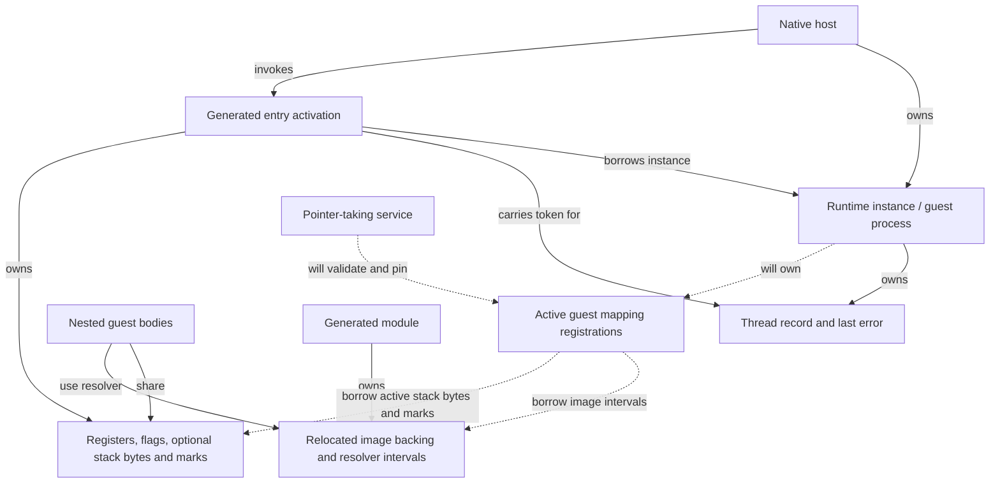

# Forge Runtime on macOS ARM64

A native host can link `libforge_runtime.a`, create a runtime instance and keep a 32-bit last-error value for each of its guest threads. A C translation unit and hand-authored LLVM IR compiled to ARM64 Mach-O exercise the public ABI alongside real lifted calls. Selecting a function with `forge lift` still produces a function-level LLVM module. [Public C header](../runtime/include/forge/runtime.h) · [Build and linkage](../runtime/README.md)

## Guest process and address space

One live `forge_rt_instance` identifies one logical guest process. Its native host creates it and controls its lifetime. Within that lifetime the pair (instance, thread token) selects a guest thread on any host thread. ABI v1 exposes thread services. Module registration, stack publication and checked service access to guest bytes are future operations specified below. A Windows-visible process ID would be a separate process-owned value.

### Ownership today

| Owner | State and lifetime |
| --- | --- |
| Compiler (`forge_core`) | Owns parsing, recovery, instruction semantics and generation of ARM64-targeted IR. The private recovered group carries proven guest-call sites and continuations. Neither the compiler nor the CLI links the runtime. [PE model](../compiler/src/pe/image.h) · [Recovery contract](../compiler/src/lift/recovery.h) · [Compiler build](../compiler/CMakeLists.txt) |
| Generated module | Each invocation initializes its register and flag context. When group analysis requires a checked guest stack, the adapter also allocates and initializes stack storage in that context. Guest bodies share the context across nested calls. Image backing and its resolver belong to the generated module. Writable bytes persist across entry calls to that module, independently of runtime instance lifetime. [Entry adapters](../compiler/src/lift/execution_context.cpp) · [Guest stack](../compiler/src/lift/memory.cpp) · [Image backing](../compiler/src/lift/image_memory.cpp) |
| Native host | Owns each runtime instance from successful creation until destruction. It chooses which guest thread runs and keeps the instance live while callers use it. The existing lifting harnesses separately supply the selected entry's arguments and observe its return or trap. [Existing test harnesses](../tests/support/) |
| Runtime (`forge_runtime`) | Owns its thread records and their last-error values for the instance lifetime. Runtime initialization needs only the native C++ runtime and OS facilities. Its implementation has no LLVM, compiler, CLI11 or Wine dependency. [Runtime component](../runtime/) |

Solid arrows show today's execution path and ownership. Dashed arrows show the future registrations and their borrows.



An instance's thread records are isolated today. The runtime-enabled adapter stores its instance and token in the private invocation context and forwards them on each imported call. The host must supply a live pair. ABI validation occurs at the service call, so an entry that executes no import may return without looking up a token. Runtime-free entries can execute the generated stack and image paths independently. [Entry adapters](../compiler/src/lift/execution_context.cpp) · [Service lowering](../compiler/src/lift/lift.cpp)

Function-level translation gives image bytes and stack bytes different lifetimes.

- A generated module covers a selected root and its recovered callees. Its private writable globals last as long as the native module. Passing a second runtime instance to the same artifact, even after destroying the first, can expose the previous writes. Mixed initialized/zero-filled sections can use a native constructor and entry fallback with an ordinary initialization flag. Process integration must complete initialization before admitting concurrent callers.
- Each outer invocation that needs a stack owns 4 KiB of bytes and per-byte marks at the fixed guest range `[0x70000000, 0x70001000)`. Two independent native activations can therefore assign different storage to the same guest VA. Existing nested recovered calls pass the original context and push frames onto its stack. [Group analysis](../compiler/src/lift/group_analysis.cpp) · [Stack model](../compiler/src/lift/memory.h) · [Image initialization](../compiler/src/lift/image_memory.cpp)

### Native C ABI v1

The public header defines an opaque `forge_rt_instance`, a 64-bit `forge_rt_thread_token` and a 32-bit `forge_rt_status`. Exported functions use C linkage and the native platform calling convention. The creation signature is the version handshake. A caller passes the version it compiled against, including as a literal in generated IR. An incompatible version returns `FORGE_RT_ABI_MISMATCH` before a caller receives an instance. Future incompatible changes must retain a callable version check at this entry point or introduce a separately named entry point.

| Call | On success |
| --- | --- |
| `forge_rt_create(FORGE_RT_ABI_VERSION, &instance)` | Returns a new independent instance to the host. |
| `forge_rt_thread_create(instance, &token)` | Creates a guest thread record with last error zero and publishes its nonzero token. |
| `forge_rt_set_last_error(instance, token, value)` | Stores all 32 bits for the selected thread. |
| `forge_rt_get_last_error(instance, token, &value)` | Copies all 32 bits into the caller's output slot. |
| `forge_rt_thread_destroy(instance, token)` | Releases that thread record and invalidates the token. |
| `forge_rt_destroy(instance)` | Releases the instance and any threads it still owns. |

`FORGE_RT_OK` means the operation completed. A null required instance or output pointer returns `FORGE_RT_INVALID_ARGUMENT`. Zero, retired and foreign thread tokens return `FORGE_RT_INVALID_THREAD` for a valid instance and valid arguments. Native ABI callers treat the token as opaque. Guest-visible Windows HANDLE values will have their own representation and lifetime. Tokens identify a creation, with a shared generation counter ensuring distinct values across runtime instances in the linked runtime. Generation exhaustion fails before reuse. Allocation or capacity exhaustion returns `FORGE_RT_RESOURCE_EXHAUSTED`. Unexpected implementation failures return `FORGE_RT_INTERNAL_ERROR`. Exceptions stay inside the native boundary. All output slots retain their original values on failure. A writable, correctly aligned output slot and a live instance pointer from this runtime are caller preconditions. Passing an arbitrary non-null address cannot be made safe by examining its bits.

Operations on a live instance synchronize access to its records. Guest identity follows the explicit token even when calls move between host threads. One host thread can also serve several guest threads. A read racing a thread removal observes a result consistent with their order. A set followed by a get comprises two operations, so a caller requiring both to be indivisible must arrange its own ordering. Before destroying an instance, its owner stops new calls and waits for every in-flight use to finish. After destruction every copy of that instance pointer is unusable. Destroying a guest thread retires its state only. There is no host thread to join on that account.

### Guest addresses and generated memory

The guest is AMD64 PE32+ with unsigned 64-bit virtual addresses. An RVA is relative to one guest image. A file offset indexes input bytes. A native pointer addresses live host storage on the ARM64 target. Only the backing owner supplies the native address. Future services will receive guest pointers as guest VAs. A future x86 guest will validate its own pointer width at decoding and marshalling boundaries before using the same mapping contract. [Guest range checks](../compiler/src/lift/guest_address.h) · [PE address definitions][pe]

A mapped range has a start VA and a positive byte count. For a guest maximum address `maxVA`, require `length - 1 <= maxVA - start` after checking the start fits. A single byte at `UINT64_MAX` is representable in 64-bit range arithmetic. Guest access still requires an eligible active mapping and the right permission. This arithmetic makes no assumption about the Windows user-mode VA layout. Containment and overlap use byte offsets or inclusive last bytes so they also work at this boundary. Two ranges sharing a byte overlap. Adjacent ranges have no shared byte. Empty requests are handled by the access operation.

The compiler selects image storage during group analysis. The completed image plan owns the selected initialized bytes, relocated fragments and accessible RVA intervals. Supported AMD64 DIR64 fixups use the chosen guest load base. Emission builds native globals and resolver rows containing each accessible interval's guest VA, length, native start and writability. A writable section's aliases share one backing. A section can contain several accessible intervals separated by excluded loader-written bytes or unsupported fixups. Native storage allocated for a hole confers no guest access to that hole. [PE initialization](../compiler/src/pe/pe.cpp) · [Image plan and resolver](../compiler/src/lift/image_memory.cpp)

Generated scalar memory operations can use a proved stack path, or dispatch to the stack or the generated image resolver. The image resolver checks the full scalar width and write permission in one interval before deriving a native pointer. Stack access also checks the byte marks. The outer synthetic return slot is inaccessible to guest data operations. Nested return addresses can be read as concrete guest bytes and are protected from writes while live. Opaque saved-register identities can be copied and restored by translated code. They cannot be exposed as concrete buffer bytes. Generated guards trap on invalid accesses. These paths stay inside the generated module and permit direct native access wherever the compiler proves the relevant conditions. [Stack checks](../compiler/src/lift/memory.cpp) · [Generated memory contract](../README.md#pe-image-memory)

### Process mappings and lifecycle (future)

The process will own the logical mappings shared by its guest threads. A registration will identify the guest range, R/W/X guest permissions, origin (loaded image and RVA, invocation stack, or later heap/VM allocation), backing owner and offset, and active lifetime. Each interval refers to a bounded span of that owner's storage. The process can borrow the bytes even when it owns the registration. It will also own future loaded-module records, allocator state and allocations, and the Windows handle table and process services. The guest thread continues to own its thread-local service state.

Future placement must distinguish a **reservation** from the intervals that permit access inside it. A loaded PE occurrence belongs to one process at its selected load base for one registration lifetime. Validate and reserve the full `SizeOfImage` extent at that base, including headers, gaps, excluded bytes and unselected sections. A stack, heap allocation or other loaded PE cannot claim any part of that reservation, even if the image exposes zero resolver rows. Only the compiler's accessible intervals grant access to the bytes in the reservation. Current PE parsing checks extents at the preferred base and the function-level lifter checks rebased section extents. Process registration will also need the checked total image extent at the selected base. [PE validation](../compiler/src/pe/pe.cpp) · [Rebase validation](../compiler/src/lift/recovery.cpp)

1. **Create the process and attach its images.** The host creates an instance. The module owner prepares initialized backing, supplies each backing's identity and exports the accessible intervals from image emission. Check the image reservation against existing reservations and active mappings. Check its exposed intervals for containment and overlap. Adjacent intervals remain distinct. Commit the reservation, all writable backing claims and publication together. Release provisional claims on failure so a conflict on the last backing leaves the others available. Multiple translated groups for this loaded occurrence attach to its canonical storage. The translation artifact itself identifies neither that occurrence nor its process.
2. **Bind writable backing exclusively.** A particular initialized writable backing can belong to only one process for its entire initialized lifetime. Its owner issues a stable, non-recycled backing identity. Claim it once, atomically across competing processes, using a process identity valid for that creation. Retain the binding or its retirement across detach and process destruction. A recycled backing pointer or recycled instance pointer must never identify the previous creation. Reject a foreign claim even after detach. Another process may reuse the translation artifact or code with fresh, independently initialized writable storage. Immutable backing may be shared when both mappings reference the correct relocated bytes and keep their owner live. The current static-global entry has no such registration enforcement.
3. **Enter on a live thread.** Create or select a thread in that instance. Verify that thread and module belong to the process before execution. Hold the module active while generated code can touch it. An outer activation publishes its stack and marks, if present, before any service can observe them. All simultaneously published stacks must have disjoint guest ranges. Reject a colliding outer or reentrant entry until the compiler and invocation setup support distinct stack bases. A nested guest call or callback on the active guest frame carries the same process, thread and stack lifetime. A module-to-module call will additionally select the proven target in the destination's active loaded image.
4. **Leave and retire.** On each returning or recoverable failure path, close the activation to new uses, invalidate its stack mapping and drain outstanding borrows before releasing stack storage. Keep a thread live through its invocations and service calls. Stop new module entries and drain its active users before unmapping or unloading the module. On process shutdown, stop new uses, drain active invocations and services, retire mappings, release module and backing borrows, close process-owned resources and destroy the instance. A retired registration or borrow cannot be used again. Reusing a numeric guest address for a later mapping can make the same integer designate different storage.

### Checked guest buffers (future)

Read, write and validation operations take a live process/invocation association, a guest start, byte count and requested access. For a zero-length copy, validate the association and return success without looking up the VA, touching bytes or producing a native pointer. A particular Windows API may impose additional requirements on a null parameter. For a nonempty request, check address width and overflow before lookup. A copy must also fit the native buffer and its size type. Each byte must belong to an active mapping in that process with the required permissions. An in/out buffer needs both read and write access. A guest execute permission describes guest policy only. Transferring control still requires a proven translated entry and the proper guest calling convention.

For a segmented copy, validate the **entire** range and hold every affected mapping and its backing live before transferring any bytes. A request may span adjacent compatible intervals backed by separate native allocations. A gap, expired mapping, denied permission or invalid stack byte anywhere fails the whole request and leaves the destination and marks unchanged. Stack input requires concrete readable bytes, including readable nested return addresses. Stack output may initialize uninitialized bytes. It must respect protected return slots and mark exactly the bytes actually written as concrete. A read/write request satisfies both sets of rules. The existing scalar instruction path retains its one-interval width check.

A pin keeps stack storage live. Frame activity can still change a return-slot protection or an origin mark. Hold those checks valid until the transfer and mark updates finish. A synchronous service can use its suspended activation while it has exclusive access to the affected marks. Cross-thread or callback access must coordinate all users that can change those protections, or fail before taking the borrow.

A direct native buffer borrow requires the entire range to fit one contiguous backed interval and the service to preserve its access rules, including stack mark updates. Derive the pointer from the registered native span and checked offset, and scope its use to the validated operation. A standalone validation result grants no lasting pointer. A service that may retain the input beyond that scope must copy it into owned storage. Deferred output requires a lifetime covering actual write-back. An integer guest VA alone cannot pin an expired activation or authorize a native pointer cast.

Register before admitting users. Serialize lookup and pinning with unmapping, backing replacement and permission changes. A successful preflight holds the approved permissions and backing for the duration of the copy or borrow. Invalidation closes the mapping to new operations and drains existing users before revoking rights, replacing the backing or releasing storage. A direct compiled access relies on its proved range, permissions and backing throughout the activation. Quiesce affected executing code before changing any of those assumptions. Hold a lifetime reference across native execution or host I/O, and allow re-entry without holding a mapping-table lock across a callback. Guest threads still require synchronization for conflicting accesses to the bytes. A segmented copy has no guarantee of an atomic data snapshot or update against guest writers.

**Coherence.** Publish the exact image resolver intervals and native storage emitted by the compiler, and the active stack bytes **and marks**. A translated write must reach the bytes a future `WriteFile` reads. A future `ReadFile` must write back to the bytes later read by translated code. Validate and pin all required guest outputs before a host operation with external effects, and commit only the count the service actually produces. Proved native accesses borrow the same stable backing through the activation. Dynamic resolution follows the common mapping, permission and lifetime rules. Registration at lifetime boundaries preserves direct loads and stores between service calls.

| Failure domain | Required outcome |
| --- | --- |
| Runtime misuse or failure | Invalid native association, resource exhaustion and internal errors are native runtime failures. Report them through the runtime status contract. Current lifted last-error calls trap on a non-success status. |
| Guest memory fault | Report the failing guest range or address and access direction for overflow, an unmapped byte, expired mapping, denied permission or invalid stack access. Checked copies expose a failure distinct from native status and Windows last error. |
| Windows service outcome | The API binding applies its documented return value, transfer count, last-error and fault behavior. A guest-buffer fault can become a defined Windows failure or an explicit guest fault according to that binding. The memory helper itself leaves thread last error alone. |

### Guest addresses and calls

Windows x64 passes the first four integer or pointer arguments in RCX, RDX, R8 and R9 by position and declared width. The caller reserves 32 bytes of shadow space and aligns its stack to 16 bytes before CALL. With the return address on the stack, callee-entry RSP is eight modulo 16, and the fifth argument starts at entry RSP + 40. Later positional slots follow at eight-byte intervals. A general service bridge must read these arguments through the guest frame, apply the service signature's signedness and widths, then issue an ordinary Darwin ARM64 call. Return the service result into the defined guest RAX bits and apply the guest volatile-register and flag effects. RSP, continuation and nonvolatile registers retain their guest guarantees. The implemented last-error bindings use only the part of this convention described below. [Windows x64 ABI][win-abi] · [Apple ARM64 ABI][darwin-abi] · [Forge guest frame](../README.md#guest-stack-memory)

Calling through a guest callback address requires a proved guest entry, signature and controlled re-entry into lifted code with the originating process, thread and frame. A callback VA cannot serve as a native function pointer. Floating-point/vector parameters and returns, aggregates, varargs and alternate conventions require separate signature and register rules. PE32 x86 needs its own guest ABI and pointer width. Managed execution and Windows exception dispatch also fall outside v1.

### Lifted last-error services

The host selects the runtime-enabled two-integer entry explicitly. It creates an instance with the ABI version expected by the generated object (1), checks the status, and supplies a live instance and thread token to `forge_lifted_with_runtime`. A version mismatch fails instance creation. Arbitrary or expired non-null instance addresses violate the host lifetime contract. Zero, foreign or retired tokens and a null instance fail at the service boundary. The generated module checks every returned status and takes its normal native trap path before reading an output or executing the continuation.

| Ordinary named import from KERNEL32.dll | Guest behavior | Native ABI call |
| --- | --- | --- |
| `SetLastError` | Read the low 32 defined RCX bits. The void return leaves RAX undefined. | `forge_rt_set_last_error(instance, thread, value)` |
| `GetLastError` | Read the selected thread’s DWORD. Write EAX, defining all of RAX by zero extension. | `forge_rt_get_last_error(instance, thread, &host_dword)` |

Recovery selects the binding by normalized DLL and exact symbol spelling. A static reference to that binding supplies its signature and native symbol to analysis and emission. Each call checks the Windows shadow area and alignment, installs its guest continuation, invokes the service with the Darwin ARM64 C ABI, then validates and pops the guest return slot. The runtime receives only its instance, token and scalar or host output slot. The invocation owns the stack, register state, and native binding arguments. Nested guest bodies share this context. Runtime calls preserve nonvolatile GPRs and RSP and invalidate modeled volatile registers and flags except for the getter’s defined result. Neither last-error service receives a guest pointer. A caller’s saved stack values survive when their slots are provably disjoint from the return slot written by CALL.

The import contract assumes the loader-selected binding remains fixed. Named imports from other modules, delay loads, ordinals, forwarding, runtime hooks, and arbitrary pointer dispatch require additional evidence. [PE recovery](program-architecture.md#imported-call-recovery) · [Native linkage](../runtime/README.md#link-a-lifted-windows-function)

### Implementation boundaries and acceptance

**12C establishes the contract.** The compiler's guest address and nonempty range checks serve image rebasing and stack overlap validation. ABI v1 continues to provide instance and thread services. There is no runtime region table, copy API or live backing claim today. The following cases belong to the tasks that introduce the respective operations.

| Task | Implementation boundary and first evidence |
| --- | --- |
| **12D – Checked Guest Memory Bridge** | Publish the selected image intervals and active stack, with only the binding, invalidation and lifetime protection needed for checked reads/writes. Exercise guest write → service read and service write → guest read on both kinds of backing. Test adjacent intervals in separate host allocations, gaps and denied writes in the last segment, protected or expired stack bytes, output mark updates and invalidation racing a pinned operation. Reject foreign writable-backing claims, including after detach. |
| **12E – Windows x64 ABI Bridge** | Marshal guest arguments by service signature, including stack arguments, buffer direction/length, declared results and failure policy. Group analysis must select bytes reachable solely through an import argument. Writes through a service pointer must invalidate overlapping saved-address facts, including possible aliases when the target is unknown. Test a service receiving a guest buffer that translated instructions never dereference, partial output counts, and subsequent guest loads through an alias. [Import analysis](../compiler/src/lift/group_analysis.cpp) · [Service lowering](../compiler/src/lift/lift.cpp) |
| **12F – Process Lifecycle Integration** | Coordinate startup/shutdown, module registration/unload and thread/invocation teardown. Test two threads sharing image bytes with independent last error, two processes using the same translation with fresh writable backing, and images at disjoint guest VAs. Reject placement inside another image's reserved holes, including an image exposing zero intervals. Force a multi-backing claim to fail and verify rollback. Exercise teardown with active users and native address reuse. Parameterize stack placement before permitting simultaneously active outer stacks in one process. |

Today the generated dynamic resolver sees only its own module's image intervals, and the activation resolves its own stack. Translated dereferences into another image, another live stack or a future heap require process-aware dynamic resolution in generated code as well. Adding the 12D service bridge alone leaves that limitation in place. Heap allocation, Windows virtual memory, general DLL loading, scheduling, Windows exception delivery and 32-bit x86 execution require their own implementations.

## Wine source investigation

The [WineHQ upstream][winehq] is mirrored on GitHub. This investigation reads Wine **10.0**, released January 21, 2025. The annotated [release tag][wine-tag] points to commit `b073859675060c9211fcbccfd90e4e87520dc2c2`. All Wine source links below use that commit. The separate Forge differential environment uses [Debian Wine 8.0](../tests/differential/toolchain/Dockerfile). The following traces come from source inspection. Mach-O portability judgments are architectural assessments. No Wine component was extracted, compiled or timed in this study.

### Representative call paths

**Thread last error — better provided through a native implementation initially.** Windows exposes one DWORD per calling thread. Wine's KERNEL32 export table imports the getter and routes the setter to `RtlSetLastWin32Error`. KernelBase's getter reads `NtCurrentTeb()->LastErrorValue`. Its setter routes to NTDLL, which writes that field. No server request appears in this read or write. Compiling the original body for ARM64 still requires Wine's current-TEB convention and initialization. An explicit instance/thread lookup supplies Forge's equivalent identity. Its lookup and lock occur on the hot path and are included in the benchmark. Future Wine-backed calls would need one authoritative last-error owner across both implementations. [Windows behavior][win-error] · [KERNEL32 exports][w-k32spec] · [KernelBase exports][w-kbspec] · [Getter][w-thread] · [NTDLL setter][w-error]

**Error-code conversion — suitable for selective reuse.** `RtlNtStatusToDosErrorNoTeb` normalizes a status, handles special cases and searches a generated mapping table. It also emits a diagnostic for an unmapped status. Its neighbor `RtlNtStatusToDosError` first writes `LastStatusValue` in the TEB. The narrower helper could compile as native code with fixed-width Windows types, constants, diagnostic handling and the generated table, independently of a loader or server. Keep its unknown-status behavior and regenerate the mapping with the matching inputs on every refresh. Costs to investigate are table lookup, cache footprint and optional diagnostic emission. ABI v1 needs no such conversion. [Conversion functions][w-map] · [Generated table][w-map-table] · [Generator and inputs][w-generator]

**Process identity and modules.** Windows defines a process ID unique while that process is alive. Wine's query reads the TEB's `ClientId.UniqueProcess`. Its initial thread setup receives IDs from the server and installs them in the TEB. A query needs no IPC after that. Forge's logical process identity is its live instance. A future Windows process-ID query needs a guest-visible ID whose uniqueness covers the live guest processes visible to that caller. Equating multiple guest instances to the host PID would collapse distinct identities. **Better provided through a native implementation initially.** [Windows process IDs][win-pid] · [KernelBase query][w-process] · [Server-assigned IDs][w-server-init] · [TEB setup][w-thread-init]

`GetModuleHandleW(NULL)` returns the executable module through the PEB image-base field. The named path builds a Unicode name and calls `LdrGetDllHandleEx`, which takes the loader lock, searches loaded-module records and handles module references according to flags. A module handle must refer to the correct loaded guest image. A future Forge-owned module registry would have to reproduce name matching, aliasing and lifetime semantics. A Mach-O build of the wrapper alone cannot supply this registry. Named lookup **requires deeper Wine infrastructure** as written. Lock contention, path lookup and UTF-16 conversion are relevant costs. [Windows module lookup][win-module] · [KernelBase lookup][w-kb-loader] · [NTDLL lookup][w-loader]

**File creation/open — requires deeper Wine infrastructure.** `CreateFileW` opens or creates a file or device with Windows access, sharing and disposition semantics. KernelBase converts a DOS path to an NT path and calls `NtCreateFile` with object attributes. The Unix side resolves a Unix name for ordinary files, marshals attributes and sends a `create_file` server request. The server opens the file, checks sharing against other opens and creates a per-process handle. A Darwin wrapper around a POSIX file descriptor would need explicit policies for names, case, sharing, handle lifetime, error translation and devices. These rules dominate correctness and maintenance. Name conversion, server IPC and filesystem calls all contribute to open cost. A separately specified regular-file subset might be ported with substantial adaptation. [Windows file semantics][win-file] · [KernelBase][w-file] · [Unix client][w-unix-file] · [Server handle][w-server-file] · [Sharing checks][w-server-fd]

**Events and waits — requires deeper Wine infrastructure.** Windows events may be named or unnamed, manual- or auto-reset. `CreateEventW` calls `CreateEventExW`, which builds NT object attributes and invokes `NtCreateEvent`. In 10.0 the Unix side sends a server request even for unnamed events. `NtSetEvent` sends an event operation. The server owns the object, signaled state, handle rights and waiter wakeups. The multiple-object wait path also enters the server wait machinery. Building these C bodies into Mach-O would still require the object namespace, handle mapping, waiter coordination and server protocol or replacements. Reimplementing only the uncontended path would miss observable reset and contention behavior. Benchmark wait/wakeup under contention separately from creation and signaling. [Windows event semantics][win-event] · [KernelBase][w-sync] · [Unix client][w-unix-sync] · [Wait path][w-unix-wait] · [Server object][w-event] · [Server handlers][w-event-handlers]

**Virtual memory and heap.** `VirtualAlloc` passes process, address, requested size, reserve/commit flags and protection to `NtAllocateVirtualMemory`. The current-process route validates and rounds addresses, takes Wine's VM lock, maps or modifies a tracked view and returns an address in Wine's process layout. A mapping operation can involve the server. Remote allocation queues an APC to the target process via the server. An ordinary local private reservation need not pay the remote IPC cost. Mach-O has native VM facilities, but a faithful adapter must reconcile guest VAs, page sizes and protection, reservation granularity, fault behavior and conflicting views. Direct use **requires deeper Wine infrastructure**. [Windows page semantics][win-vm] · [KernelBase][w-memory] · [Wine views, local and remote paths][w-vm]

`HeapAlloc` forwards to `RtlAllocateHeap`. Wine treats the incoming handle as a native heap pointer and reads its magic field. A Forge adapter must resolve a guest heap handle to a live allocator object before this check. The allocator tracks a process main heap globally, returns pointers into its own memory and uses NT reserve/commit for larger regions. Hot paths include per-size-class allocation, lock contention and occasional VM calls. Portions of the allocator are **reusable with substantial adaptation** once Forge defines guest address translation, synchronization and allocation lifetimes. [Forwarding export][w-kbspec] · [Handle conversion][w-heap-handle] · [Region allocation][w-heap-vm] · [Allocation path][w-heap]

The failure path also depends on Wine's guest thread state. On a nonzero status, `heap_set_status` can raise an exception for out-of-memory or update the TEB's NT status and last-error fields. Microsoft's `HeapAlloc` contract specifies NULL on ordinary failure and says `GetLastError` supplies no extended error information for that call. Check failure behavior against Windows before carrying Wine's thread-state updates into a native adapter. [Windows heap contract][win-heap] · [Wine heap state and failure][w-heap-state] · [TEB update][w-heap-error] · [NT status conversion][w-map]

### Strategy decision

| Strategy | Correctness and coverage | Execution, data and footprint | Maintenance, test and distribution |
| --- | --- | --- | --- |
| Selective Wine-derived source | Preserves reviewed behavior for a bounded helper. Its closure must include generated data, required typedefs and error cases. Omitting an implicit TEB or loader dependency can change results. | A pure routine can run in-process. Costs include marshaling guest scalars/buffers and the routine's tables. IPC depends on the chosen code. | Pin exact sources, retain local adapters, replay patches and compare behavior after updates. Debug with a focused native harness and reference cases. Carry the LGPL obligations of each included file. |
| Dedicated Wine fork | Can preserve more interacting Windows behavior when it retains loader, TEB, Unix and server services. Every removed subsystem needs an implementation or a declared unsupported path. | KernelBase's existing target is a DLL importing NTDLL. NTDLL builds both a PE module and a Unix library. These are not a ready-made standalone Darwin C service library. Keeping the execution stack brings process initialization, shared/server state, IPC on the traced paths and guest/host conversion. | The smallest plausible standalone fork target is an explicit source subset, such as the converter, its table and a native adapter. A broader file/event backend needs the dependencies traced above or replacements. Carry an upstream patch series, track upstream fixes and test host, guest and protocol interactions together. A published fork still owes source and notices. [Kernel32 build][w-k32-build] · [KernelBase build][w-kb-build] · [NTDLL build][w-nt-build] |
| Native compatibility | Fits operations whose Windows contract Forge can represent and verify, starting with last-error storage. Coverage grows one service at a time. Host APIs alone do not guarantee Windows semantics. | Uses a native call plus validation and guest/host conversions where needed. An explicit record costs storage per thread. Files or synchronization may require larger process-wide state, system calls or coordination. | Forge owns behavioral tests and corrections against documented Windows behavior and reference observations. Native code is easier to inspect in one debugger. Independently authored Forge code retains its Apache license. |

**Recommendation.** Start with native last-error state. When a real import needs a table-driven conversion or another narrowly bounded Wine routine, evaluate a selective port behind the same native service boundary. Require a dependency trace, reproducible Mach-O link, reference observations including failure cases, and a distribution plan for the specific files. Treat full file, loader and event behavior as separate architectural decisions. A Wine-hosted backend could use a pinned fork to preserve broader semantics, at the price of coordinating two execution models and a larger deployment. Evidence is insufficient to claim speed or footprint advantages for any unbuilt backend. The v1 smoke initializes entirely in-process without Wine.

### Third-party source and distribution policy

This task adds Forge-authored code only. A future contribution that copies or modifies Wine source must carry a provenance record next to the imported code. Include the upstream repository, release and commit, original paths, copyright holders, precise file and dependency licenses, generated inputs and scripts, dated local modifications and their rationale. Keep the patch or diff reproducible. Record the refresh command, patch order, local reference tests, and who maintains the subset. Update the provenance, notices, tests and comparison results together on each refresh.

Wine's root notice grants LGPL-2.1-or-later. The headers in the cited KernelBase, NTDLL, Unix and server implementation files carry that grant and individual author notices. The error table and its generator have their own LGPL headers, as do the status/error input headers. The export spec files used to trace forwarding do not declare an individual license at their start, and KERNEL32's spec cites other inputs. Resolve their provenance before copying them. NTDLL's build also includes a conditional musl dependency. Its copyright file lists both MIT and file-specific licenses. Audit the actual files and generated artifacts selected by a proposed build. [Wine license][w-license] · [Spec provenance][w-k32spec] · [Generated table][w-map-table] · [Generator][w-generator] · [Status definitions][w-ntstatus] · [Error definitions][w-winerror] · [musl notices][w-musl]

| Future distribution | Engineering implications to verify for the shipped artifact |
| --- | --- |
| Copied, modified or forked library | LGPL 2.1 §§1–2 require preserving notices and marking modified files with dates. Under §2(c) the entire distributed derivative library must carry the LGPL. Identifiable independent works can retain their own terms when distributed separately. §4 requires complete corresponding source for a distributed library object, including its interface definitions and build/install scripts. Record where recipients obtain the matching source, including local changes. |
| Static link or combined archive | For a §6(a) relink route, provide the library source and a machine-readable form of the application, such as linkable objects, so a recipient can rebuild an executable with a modified library. Include the necessary instructions, link inputs and toolchain details. Review §7 when combining independent facilities into a single archive, including a separate uncombined copy of the covered work and notice. |
| Replaceable dynamic library | §6(b) has a shared-library route when the application loads the separate library and operates with an interface-compatible replacement. Distributing a modified dylib still entails its own source and notice obligations. Verify that signing, runtime search paths, hardened-runtime rules and packaging allow the intended replacement on macOS. |

Both §6 linking routes require prominent notice of the LGPL library, a copy of its license, and terms permitting modification for the user's own use and reverse engineering to debug those modifications. For each release containing third-party code, record the chosen license version and distribution route, the exact shipped binaries, source location, notices, and the relink or replacement procedure with its test result. Review obligations for any distributed third-party guest code/objects, the chosen boundaries between Apache and LGPL works, and whether signing or store terms affect replacement or debugging. The final packaging and license choices require separate review. This engineering policy records technical evidence and open questions. [Pinned LGPL text, especially §§1–7][w-lgpl] · [Forge license](../LICENSE)

## Native linkage and performance

CTest exercises `runtime_contract` and a C translation unit in `runtime_c_smoke`. On supported Apple Silicon builds, `runtime_ir_smoke` verifies hand-authored ARM64-targeted IR with `opt`, emits an object with `llc`, links a native driver with the runtime archive, and executes it. The IR loads each 64-bit token from host storage and passes it to the public setter or getter. The C driver checks a successful roundtrip, then flips bit 63 of the sole live token and verifies that both calls reject it, the stored last error survives, and the getter preserves its output. The runtime-only configuration makes the C/linkage tests reproducible without provisioning the compiler. See the [runtime build commands](../runtime/README.md) and [IR fixture](../tests/integration/runtime_smoke.ll).

### Reproduce the native-call benchmark

Run the two configurations sequentially from the repository root on an Apple Silicon Mac.

```sh
for config in Debug Release; do
    dir="build/tmp/runtime-bench-$config"
    cmake -S . -B "$dir" -G "Unix Makefiles" -DFORGE_RUNTIME_ONLY=ON -DCMAKE_BUILD_TYPE="$config" \
        -DCMAKE_INTERPROCEDURAL_OPTIMIZATION=OFF
    cmake --build "$dir" --target runtime_benchmark
    "$dir/tests/runtime_benchmark"
done
```

On November 16, 2026, the host was an Apple M2 Max (12 cores, 96 GiB), running macOS 26.7.3 (25G342), Apple Clang 21.0.0 (clang-2100.4.1.1), macOS SDK 27.2 and CMake 4.4.5. Debug used `-g` at the compiler's default optimization level. Release used `-O3 -DNDEBUG`. Both used C++20, native ARM64, and disabled LTO and sanitizers.

The direct path calls two out-of-line functions operating on a caller-owned 32-bit cell. The checked path calls the public setter and getter on one live guest thread. Both use the same timed loop, argument/result widths, return-status checks, changing values and checked 64-bit sum (2,147,983,647,500,000 per timed batch). The Release disassembly retained all four call sites. After 100,000 warm-up pairs per path, nine samples each execute one million pairs in alternating order, using a monotonic clock. Throughput counts two calls per pair. [Benchmark driver](../tests/benchmarks/runtime_calls.cpp) · [Direct baseline](../tests/benchmarks/runtime_direct.cpp)

| Operation | Debug median ns [min, max] | Release median ns [min, max] |
| --- | ---: | ---: |
| Direct set/get pair | 11.59 [11.24, 15.74] | 1.58 [1.52, 1.80] |
| Checked runtime set/get pair | 114.32 [112.72, 117.71] | 15.33 [15.05, 23.84] |
| Within-sample difference per pair | 101.97 [101.13, 104.87] | 13.75 [13.53, 22.32] |
| Create empty runtime | 31.87 [31.46, 41.82] | 12.49 [12.37, 19.17] |
| Destroy empty runtime | 27.12 [26.15, 29.43] | 15.65 [13.98, 20.10] |
| Create guest thread | 159.32 [154.94, 168.65] | 19.91 [19.75, 28.28] |
| Destroy guest thread | 128.04 [125.57, 132.93] | 21.29 [20.34, 29.14] |

The checked path averaged 57.16 ns per call in Debug (17.50 million calls/s) and 7.66 ns in Release (130.48 million calls/s). The corresponding direct figures were 5.79 ns (172.58 million calls/s) and 0.79 ns (1,264.09 million calls/s). The difference includes uncontended locking and two validations/lookups. These pair averages do not distinguish getter and setter latency.

Lifecycle measurements warm up once, then separately time creation and destruction of batches of 4,096 objects. The thread measurements reuse a live instance and its previously grown table capacity. They cover warm allocation and cleanup. Cold process startup, contention and concurrent guest execution need separate measurements. Scheduling and clock frequency on the shared development host were uncontrolled. This benchmark has no CI timing threshold and measures no imported Windows services, Wine paths, IPC, Rosetta execution or complete applications.

[winehq]: https://gitlab.winehq.org/wine/wine
[wine-tag]: https://api.github.com/repos/wine-mirror/wine/git/tags/2e9cb99369e5ead9d7fe9836dcd43c05e42890bc
[pe]: https://learn.microsoft.com/en-us/windows/win32/debug/pe-format
[win-abi]: https://learn.microsoft.com/en-us/cpp/build/x64-calling-convention
[darwin-abi]: https://developer.apple.com/documentation/xcode/writing-arm64-code-for-apple-platforms
[win-error]: https://learn.microsoft.com/en-us/windows/win32/api/errhandlingapi/nf-errhandlingapi-getlasterror
[win-pid]: https://learn.microsoft.com/en-us/windows/win32/api/processthreadsapi/nf-processthreadsapi-getcurrentprocessid
[win-module]: https://learn.microsoft.com/en-us/windows/win32/api/libloaderapi/nf-libloaderapi-getmodulehandlew
[win-file]: https://learn.microsoft.com/en-us/windows/win32/api/fileapi/nf-fileapi-createfilew
[win-event]: https://learn.microsoft.com/en-us/windows/win32/api/synchapi/nf-synchapi-createeventw
[win-vm]: https://learn.microsoft.com/en-us/windows/win32/api/memoryapi/nf-memoryapi-virtualalloc
[win-heap]: https://learn.microsoft.com/en-us/windows/win32/api/heapapi/nf-heapapi-heapalloc
[w-k32spec]: https://github.com/wine-mirror/wine/blob/b073859675060c9211fcbccfd90e4e87520dc2c2/dlls/kernel32/kernel32.spec
[w-kbspec]: https://github.com/wine-mirror/wine/blob/b073859675060c9211fcbccfd90e4e87520dc2c2/dlls/kernelbase/kernelbase.spec
[w-thread]: https://github.com/wine-mirror/wine/blob/b073859675060c9211fcbccfd90e4e87520dc2c2/dlls/kernelbase/thread.c#L170-L175
[w-error]: https://github.com/wine-mirror/wine/blob/b073859675060c9211fcbccfd90e4e87520dc2c2/dlls/ntdll/error.c#L95-L125
[w-map]: https://github.com/wine-mirror/wine/blob/b073859675060c9211fcbccfd90e4e87520dc2c2/dlls/ntdll/error.c#L47-L82
[w-map-table]: https://github.com/wine-mirror/wine/blob/b073859675060c9211fcbccfd90e4e87520dc2c2/dlls/ntdll/error.h
[w-generator]: https://github.com/wine-mirror/wine/blob/b073859675060c9211fcbccfd90e4e87520dc2c2/dlls/ntdll/make_errors
[w-process]: https://github.com/wine-mirror/wine/blob/b073859675060c9211fcbccfd90e4e87520dc2c2/dlls/kernelbase/process.c#L764-L769
[w-server-init]: https://github.com/wine-mirror/wine/blob/b073859675060c9211fcbccfd90e4e87520dc2c2/dlls/ntdll/unix/server.c#L1611-L1632
[w-thread-init]: https://github.com/wine-mirror/wine/blob/b073859675060c9211fcbccfd90e4e87520dc2c2/dlls/ntdll/unix/thread.c#L1171-L1186
[w-kb-loader]: https://github.com/wine-mirror/wine/blob/b073859675060c9211fcbccfd90e4e87520dc2c2/dlls/kernelbase/loader.c#L336-L418
[w-loader]: https://github.com/wine-mirror/wine/blob/b073859675060c9211fcbccfd90e4e87520dc2c2/dlls/ntdll/loader.c#L3425-L3477
[w-file]: https://github.com/wine-mirror/wine/blob/b073859675060c9211fcbccfd90e4e87520dc2c2/dlls/kernelbase/file.c#L778-L896
[w-unix-file]: https://github.com/wine-mirror/wine/blob/b073859675060c9211fcbccfd90e4e87520dc2c2/dlls/ntdll/unix/file.c#L4009-L4094
[w-server-file]: https://github.com/wine-mirror/wine/blob/b073859675060c9211fcbccfd90e4e87520dc2c2/server/file.c#L641-L672
[w-server-fd]: https://github.com/wine-mirror/wine/blob/b073859675060c9211fcbccfd90e4e87520dc2c2/server/fd.c#L1579-L1624
[w-sync]: https://github.com/wine-mirror/wine/blob/b073859675060c9211fcbccfd90e4e87520dc2c2/dlls/kernelbase/sync.c#L524-L585
[w-unix-sync]: https://github.com/wine-mirror/wine/blob/b073859675060c9211fcbccfd90e4e87520dc2c2/dlls/ntdll/unix/sync.c#L417-L483
[w-unix-wait]: https://github.com/wine-mirror/wine/blob/b073859675060c9211fcbccfd90e4e87520dc2c2/dlls/ntdll/unix/sync.c#L1572-L1596
[w-event]: https://github.com/wine-mirror/wine/blob/b073859675060c9211fcbccfd90e4e87520dc2c2/server/event.c#L139-L205
[w-event-handlers]: https://github.com/wine-mirror/wine/blob/b073859675060c9211fcbccfd90e4e87520dc2c2/server/event.c#L280-L331
[w-memory]: https://github.com/wine-mirror/wine/blob/b073859675060c9211fcbccfd90e4e87520dc2c2/dlls/kernelbase/memory.c#L413-L431
[w-vm]: https://github.com/wine-mirror/wine/blob/b073859675060c9211fcbccfd90e4e87520dc2c2/dlls/ntdll/unix/virtual.c#L4534-L4708
[w-heap-state]: https://github.com/wine-mirror/wine/blob/b073859675060c9211fcbccfd90e4e87520dc2c2/dlls/ntdll/heap.c#L331-L604
[w-heap-handle]: https://github.com/wine-mirror/wine/blob/b073859675060c9211fcbccfd90e4e87520dc2c2/dlls/ntdll/heap.c#L756-L780
[w-heap-error]: https://github.com/wine-mirror/wine/blob/b073859675060c9211fcbccfd90e4e87520dc2c2/dlls/ntdll/error.c#L127-L141
[w-heap-vm]: https://github.com/wine-mirror/wine/blob/b073859675060c9211fcbccfd90e4e87520dc2c2/dlls/ntdll/heap.c#L974-L1004
[w-heap]: https://github.com/wine-mirror/wine/blob/b073859675060c9211fcbccfd90e4e87520dc2c2/dlls/ntdll/heap.c#L2035-L2068
[w-k32-build]: https://github.com/wine-mirror/wine/blob/b073859675060c9211fcbccfd90e4e87520dc2c2/dlls/kernel32/Makefile.in#L1-L6
[w-kb-build]: https://github.com/wine-mirror/wine/blob/b073859675060c9211fcbccfd90e4e87520dc2c2/dlls/kernelbase/Makefile.in#L1-L8
[w-nt-build]: https://github.com/wine-mirror/wine/blob/b073859675060c9211fcbccfd90e4e87520dc2c2/dlls/ntdll/Makefile.in#L1-L9
[w-license]: https://github.com/wine-mirror/wine/blob/b073859675060c9211fcbccfd90e4e87520dc2c2/LICENSE
[w-lgpl]: https://github.com/wine-mirror/wine/blob/b073859675060c9211fcbccfd90e4e87520dc2c2/COPYING.LIB
[w-musl]: https://github.com/wine-mirror/wine/blob/b073859675060c9211fcbccfd90e4e87520dc2c2/libs/musl/COPYRIGHT
[w-ntstatus]: https://github.com/wine-mirror/wine/blob/b073859675060c9211fcbccfd90e4e87520dc2c2/include/ntstatus.h
[w-winerror]: https://github.com/wine-mirror/wine/blob/b073859675060c9211fcbccfd90e4e87520dc2c2/include/winerror.h

### Lifted entry measurement

Run the following after a Release differential comparison for `imports/last_error`. Each binary uses the same Release C++ host and runtime. The measured guest path enters the typed wrapper, calls a nested helper to set the value and calls the getter twice, including guest stack, continuation and status checks. The loop includes checksum accumulation and excludes instance creation, CLI lifting, compilation and output formatting.

```sh
for variant in baseline o2; do
    build/differential/windows-x64/release/imports/last_error/"$variant"/native/bin/differential_runtime_pairs --benchmark
done
```

The driver warms up for 100,000 entries, then reports the median and range of nine 100,000-entry batches with verified checksums. On an Apple M2 Max, one local run measured **76.04 ns/entry** for baseline (75.00–79.72) and **23.54 ns/entry** for O2 (22.81–24.48). These observations include the complete guest operation. The direct ABI benchmark above measures a different sequence and remains independently reproducible. CI imposes no timing threshold.
