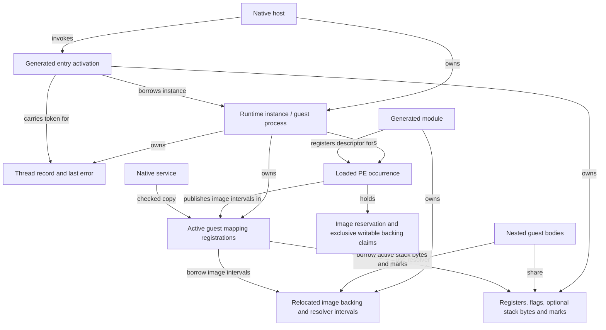

# Forge Runtime on macOS ARM64

A native host can link `libforge_runtime.a`, create a runtime instance and keep a 32-bit last-error value for each of its guest threads. A C translation unit and hand-authored LLVM IR compiled to ARM64 Mach-O exercise the public ABI alongside real lifted calls. The compiler API also produces reusable process artifacts for one-shot execution. The CLI can publish a function-level LLVM module or link a process artifact with the native startup adapter. [Compile a native executable](../README.md#compile-and-run-a-native-executable) [Process artifact contract](#12f--process-lifecycle-integration) [Public C header](../runtime/include/forge/runtime.h) · [Build and linkage](../runtime/README.md)

## Guest process and address space

One live `forge_rt_instance` identifies one logical guest process. Its native host creates it and controls its lifetime. Within that lifetime the pair (instance, thread token) selects a guest thread on any host thread. ABI v1 exposes thread services and checked guest-memory operations. Lifting with `--checked-memory` enables image registration and stack publication at the existing typed runtime entry. A Windows-visible process ID would be a separate process-owned value.

### Function-level entry ownership

| Owner | State and lifetime |
| --- | --- |
| Compiler (`forge_core`) | Owns parsing, recovery, instruction semantics and generation of ARM64-targeted IR. The private recovered group carries proven guest-call sites and continuations. Neither the compiler nor the CLI links the runtime. [PE model](../compiler/src/pe/image.h) · [Recovery contract](../compiler/src/lift/recovery.h) · [Compiler build](../compiler/CMakeLists.txt) |
| Generated module | Each invocation initializes its register and flag context. When group analysis requires a checked guest stack, the adapter also allocates and initializes stack storage in that context. Guest bodies share the context across nested calls. Image backing and its resolver belong to the generated module. Writable bytes persist across entry calls to that module, independently of runtime instance lifetime. [Entry adapters](../compiler/src/lift/execution_context.cpp) · [Guest stack](../compiler/src/lift/memory.cpp) · [Image backing](../compiler/src/lift/image_memory.cpp) |
| Native host | Owns each runtime instance from successful creation until destruction. It chooses which guest thread runs and keeps the instance live while callers use it. The existing lifting harnesses separately supply the selected entry's arguments and observe its return or trap. [Existing test harnesses](../tests/support/) |
| Runtime (`forge_runtime`) | Owns its thread records, active invocation associations, image reservations and mapping registrations. Runtime initialization needs only the native C++ runtime and OS facilities. Its implementation has no LLVM, compiler, CLI11 or Wine dependency. [Runtime component](../runtime/) |

With checked memory enabled, the runtime borrows the storage that generated instructions already access.



With plain `--runtime`, the adapter stores its instance and token in the private invocation context and forwards them on each imported call. The host must supply a live pair. ABI validation occurs at the service call, so an entry that executes no import may return without looking up a token. Runtime-free entries can execute the generated stack and image paths independently. [Entry adapters](../compiler/src/lift/execution_context.cpp) · [Service lowering](../compiler/src/lift/lift.cpp)

Function-level translation gives image bytes and stack bytes different lifetimes.

- A generated module covers a selected root and its recovered callees. Its private writable globals last as long as the native module. Plain entries reuse those globals across calls. Checked entries finish one-time initialization of mixed sections before publication and claim the writable backing for one loaded occurrence.
- Each outer invocation that needs a stack owns 4 KiB of bytes and per-byte marks at the fixed guest range `[0x70000000, 0x70001000)`. Two independent native activations can therefore assign different storage to the same guest VA. Existing nested recovered calls pass the original context and push frames onto its stack. [Group analysis](../compiler/src/lift/group_analysis.cpp) · [Stack model](../compiler/src/lift/memory.h) · [Image initialization](../compiler/src/lift/image_memory.cpp)

### Native C ABI v1

The public header defines an opaque `forge_rt_instance`, a 64-bit `forge_rt_thread_token` and a 32-bit `forge_rt_status`. Exported functions use C linkage and the native platform calling convention. The creation signature is the version handshake. A caller passes the version it compiled against, including as a literal in generated IR. An incompatible version returns `FORGE_RT_ABI_MISMATCH` before a caller receives an instance. Future incompatible changes must retain a callable version check at this entry point or introduce a separately named entry point.

| Call | On success |
| --- | --- |
| `forge_rt_create(FORGE_RT_ABI_VERSION, &instance)` | Returns a new independent instance to the host. |
| `forge_rt_thread_create(instance, &token)` | Creates a guest thread record with last error zero and publishes its nonzero token. |
| `forge_rt_set_last_error(instance, token, value)` | Stores all 32 bits for the selected thread. |
| `forge_rt_get_last_error(instance, token, &value)` | Copies all 32 bits into the caller's output slot. |
| `forge_rt_thread_destroy(instance, token)` | Releases that thread record and invalidates the token. |
| `forge_rt_destroy(instance)` | Releases the instance and any threads it still owns. |

`FORGE_RT_OK` means the operation completed. A null required instance or output pointer returns `FORGE_RT_INVALID_ARGUMENT`. Zero, retired and foreign thread tokens return `FORGE_RT_INVALID_THREAD` for a valid instance and valid arguments. Native ABI callers treat the token as opaque. Guest-visible standard handles use separate opaque values scoped to one managed process. Tokens identify a creation, with a shared generation counter ensuring distinct values across runtime instances in the linked runtime. Generation exhaustion fails before reuse. Allocation or capacity exhaustion returns `FORGE_RT_RESOURCE_EXHAUSTED`. Unexpected implementation failures return `FORGE_RT_INTERNAL_ERROR`. Exceptions stay inside the native boundary. Ordinary output slots retain their original values on failure. The checked memory operations also have a dedicated guest-fault diagnostic. A writable, correctly aligned output slot and a live instance pointer from this runtime are caller preconditions. Passing an arbitrary non-null address cannot be made safe by examining its bits.

Operations on a live instance synchronize access to its records. Guest identity follows the explicit token even when calls move between host threads. One host thread can also serve several guest threads. A read racing a thread removal observes a result consistent with their order. A set followed by a get comprises two operations, so a caller requiring both to be indivisible must arrange its own ordering. Before destroying an instance, its owner stops new calls and waits for every in-flight use to finish. After destruction every copy of that instance pointer is unusable. Destroying a guest thread retires its state only. There is no host thread to join on that account.

### Guest addresses and generated memory

The guest is AMD64 PE32+ with unsigned 64-bit virtual addresses. An RVA is relative to one guest image. A file offset indexes input bytes. A native pointer addresses live host storage on the ARM64 target. Only the backing owner supplies the native address. Future services will receive guest pointers as guest VAs. A future x86 guest will validate its own pointer width at decoding and marshalling boundaries before using the same mapping contract. [Guest range checks](../runtime/include/forge/guest_range.h) · [PE address definitions][pe]

A mapped range has a start VA and a positive byte count. For a guest maximum address `maxVA`, require `length - 1 <= maxVA - start` after checking the start fits. A single byte at `UINT64_MAX` is representable in 64-bit range arithmetic. Guest access still requires an eligible active mapping and the right permission. This arithmetic makes no assumption about the Windows user-mode VA layout. Containment and overlap use byte offsets or inclusive last bytes so they also work at this boundary. Two ranges sharing a byte overlap. Adjacent ranges have no shared byte. Empty requests are handled by the access operation.

The compiler selects image storage during group analysis. The completed image plan owns the selected initialized bytes, relocated fragments and accessible RVA intervals. Supported AMD64 DIR64 fixups use the chosen guest load base. Emission builds native globals and resolver rows containing each accessible interval's guest VA, length, native start and writability. A writable section's aliases share one backing. A section can contain several accessible intervals separated by excluded loader-written bytes or unsupported fixups. Native storage allocated for a hole confers no guest access to that hole. [PE initialization](../compiler/src/pe/pe.cpp) · [Image plan and resolver](../compiler/src/lift/image_memory.cpp)

Generated scalar memory operations can use a proved stack path, or dispatch to the stack or the generated image resolver. The image resolver checks the full scalar width and write permission in one interval before deriving a native pointer. Stack access also checks the byte marks. The outer synthetic return slot is inaccessible to guest data operations. Nested return addresses can be read as concrete guest bytes and are protected from writes while live. Opaque saved-register identities can be copied and restored by translated code. They cannot be exposed as concrete buffer bytes. Function entries trap on invalid accesses. Process entries propagate a tagged failure to their host. These paths stay inside the generated module and permit direct native access wherever the compiler proves the relevant conditions. [Stack checks](../compiler/src/lift/memory.cpp) · [Generated memory contract](../README.md#pe-image-memory)

### Process mappings and lifecycle

The low-level function-entry contract lets a host lend its own backing. For runtime-owned backing and one-shot execution, see [process lifecycle integration](#12f--process-lifecycle-integration).

Each checked function artifact supplies a native C descriptor generated from its image plan. The descriptor identifies one translated group from the same PE snapshot and selected load base as its code. The process reserves the full `SizeOfImage`, including headers, gaps, excluded bytes and images with zero published rows. Before emitting a checked artifact, the compiler verifies that this reservation fits at the selected guest base and, if the entry publishes a stack, that the two ranges are disjoint. Only the sorted resolver intervals grant access. Their guest start, length, native byte pointer and R/W/X permissions describe the same storage used by generated code.

On the first checked entry, `forge_rt_enter` validates the thread, image and optional stack, checks overlaps against existing reservations, and commits the image and activation together. Later entries reuse the registration in that instance. A checked module also exports `const forge_rt_image *forge_lifted_image(void)`. This accessor completes backing initialization and supplies the same stable descriptor to a host that needs explicit registration or detach. The runtime entry uses it for lazy registration. The owner keeps the descriptor, row table and backing addresses stable while borrowed. Descriptors, row tables and claim words reside outside guest-accessible storage. [Generated descriptors and C ABI](../runtime/include/forge/runtime.h)

Each initialized writable backing has an owner-supplied claim word shared by all its aliases, including read-only intervals. Each interval's permissions govern reads and writes through its guest VA. The first successful registration binds the backing to a non-recycled occurrence identity, even after detach or process destruction. A failed registration consumes no claims. Loading the same guest VAs independently requires fresh writable storage. Immutable relocated bytes can be shared. The published permissions and backing are fixed for the registration lifetime, including between entries when optimizations may have folded immutable loads.

An outer entry obtains a fresh invocation token and publishes its stack bytes, marks and synthetic return-slot location. The owner lends the bytes and marks exclusively to that activation. Native descriptor producers must keep the two spans disjoint from each other, all image backing, other active stacks and registration metadata across instances. Nested recovered guest bodies share that activation. Each guest thread admits one independent execution chain. The fixed guest stack VA admits at most one published stack per process. Entry collisions fail before the guest body runs. `forge_rt_leave` removes the association and stack before the generated activation releases its storage. A native service can call other runtime functions synchronously. Guest execution and imported calls run with the mapping lock released.

Detaching an executing image or destroying a busy guest thread reports a lifecycle failure. A successful detach waits out current checked copies in that instance and retires its reservation. Before releasing descriptor or backing storage, the owner stops new registrations and entries that use it, waits for outstanding descriptor users, and detaches every registration borrowing that storage or destroys each such instance. This includes other instances sharing immutable image bytes. Instance destruction retains the host's existing stop-and-drain precondition. Generated guard traps terminate native execution. Recovering a trapped activation through signal handling or nonlocal jumps has no cleanup protocol.

### Checked guest buffers

A native service obtains the current invocation with `forge_rt_current_invocation(instance, thread, &invocation)`. It passes the instance, thread, invocation, guest VA and byte count to `forge_rt_read_guest`, `forge_rt_write_guest` or `forge_rt_validate_guest`. Validation accepts read, write or both. Copy calls also take a native buffer and its capacity. For a nonempty copy the caller supplies live, disjoint host storage for its buffer and outputs. A zero-length operation validates the association and access direction, then succeeds without looking up the VA or touching the buffer. Windows APIs can apply their own null-parameter rules.

The process lock protects lookup, validation, transfer and stack-mark updates. The bridge checks unsigned range overflow, locates the first mapping, and walks consecutive intervals by remaining length. Every byte must be mapped with the requested permissions. Adjacent guest intervals can refer to separate native allocations. Only after the entire range passes does the bridge copy the bytes and mark the stack output concrete. Failure leaves the host read destination, guest destination and marks unchanged. A validation succeeds for that call alone. It supplies no lasting pointer or permission for later host I/O.

Only the synchronous, innermost activation on its entering native thread can expose its stack. This prevents a service from racing changes to frame protections or opaque origins. Input accepts concrete bytes and live nested guest return addresses. The synthetic outer return slot is inaccessible. Output may initialize an uninitialized byte or overwrite an opaque save, and must avoid all protected return bytes. Read/write validation applies both rules. Guest threads remain responsible for synchronizing conflicting direct accesses to shared image bytes.

| Failure domain | Observable outcome |
| --- | --- |
| Native runtime | Invalid association, invalid host arguments, busy lifecycle, mapping conflicts, exhaustion and internal failures return a native status. The function-level entry traps on a failed native call. A process entry returns a tagged result. |
| Guest memory | `FORGE_RT_GUEST_FAULT` supplies the requested start VA for range overflow, or the first failing VA for unmapped memory, denied permission or invalid stack access. It records the requested access and reason. Retired invocation tokens fail association validation even when the same stack VA has been reused. |
| Windows service | The binding chooses the Windows return value, transfer count and last-error behavior. Checked memory operations preserve thread last error. |

Translated scalar instructions keep their existing stack checks and single-interval image resolver. Both paths access the same native bytes. The runtime performs synchronization at registration and checked-copy boundaries. A pointer-taking service with external effects will need to hold its outputs valid through write-back and commit the count actually returned. A future scoped native borrow requires one contiguous interval and the same stack protection and mark-update guarantees. Longer-lived input must be copied into owned storage. [Stack lowering](../compiler/src/lift/memory.cpp) · [Image resolver](../compiler/src/lift/image_memory.cpp)

### Guest addresses and calls

Windows x64 passes the first four integer or pointer arguments in RCX, RDX, R8 and R9 by position and declared width. The caller reserves 32 bytes of shadow space and aligns its stack to 16 bytes before CALL. With the return address on the stack, callee-entry RSP is eight modulo 16, and the fifth argument starts at entry RSP + 40. Later positional slots follow at eight-byte intervals. Forge reads only the declared four or eight bytes from each register or stack slot. For imports, lowering uses the RSP returned by the existing guest CALL push. Address analysis sees the caller before that push, so the fifth argument is at caller RSP + 32. Both stages use the same positional rule. Stack loads check bounds and byte marks before entering the native service. [Windows x64 ABI][win-abi] · [Apple ARM64 ABI][darwin-abi] · [Forge guest frame](../README.md#guest-stack-memory)

Calling through a guest callback address requires a proved guest entry, signature and controlled re-entry into lifted code with the originating process, thread and frame. A callback VA cannot serve as a native function pointer. Floating-point/vector parameters and returns, aggregates, varargs and alternate conventions require separate signature and register rules. PE32 x86 needs its own guest ABI and pointer width. Managed execution and Windows exception dispatch also fall outside v1.

### Lifted last-error services

The host selects the runtime-enabled two-integer entry explicitly. It creates an instance with the ABI version expected by the generated object (1), checks the status, and supplies a live instance and thread token to `forge_lifted_with_runtime`. A version mismatch fails instance creation. Arbitrary or expired non-null instance addresses violate the host lifetime contract. Zero, foreign or retired tokens and a null instance fail at the service boundary. The generated module checks every returned status and takes its normal native trap path before reading an output or executing the continuation.

| Ordinary named import from KERNEL32.dll | Guest behavior | Native ABI call |
| --- | --- | --- |
| `SetLastError` | Read the low 32 defined RCX bits. The void return leaves RAX undefined. | `forge_rt_set_last_error(instance, thread, value)` |
| `GetLastError` | Read the selected thread’s DWORD. Write EAX, defining all of RAX by zero extension. | `forge_rt_get_last_error(instance, thread, &host_dword)` |

Recovery selects the binding by normalized DLL and exact symbol spelling. A static reference to that binding supplies its signature and native symbol to analysis and emission. Each call checks the Windows shadow area and alignment, installs its guest continuation, invokes the service with the Darwin ARM64 C ABI, then validates and pops the guest return slot. The runtime receives only its instance, token and scalar or host output slot. The invocation owns the stack, register state, and native binding arguments. Nested guest bodies share this context. Runtime calls preserve nonvolatile GPRs and RSP and invalidate modeled volatile registers and flags except for the getter’s defined result. Neither last-error service receives a guest pointer. A caller’s saved stack values survive when their slots are provably disjoint from the return slot written by CALL.

The import contract assumes the loader-selected binding remains fixed. Named imports from other modules, delay loads, ordinals, forwarding, runtime hooks, and arbitrary pointer dispatch require additional evidence. [PE recovery](program-architecture.md#imported-call-recovery) · [Native linkage](../runtime/README.md#link-a-lifted-windows-function)

### Implementation boundaries and acceptance

The checked bridge implements the 12C range and ownership contract for one generated group per occurrence. The runtime contract suite covers segmented copies and registration lifetimes. The ARM64 integration suite exercises generated stores, service copies and generated reloads with baseline and O2 code. [Bridge integration](../tests/integration/test_checked_memory.py)

#### 12E – Windows x64 ABI Bridge

The production catalogue binds ordinary named KERNEL32 imports. Function-level entries support `GetLastError`, `SetLastError`, and `lstrlenA`. Managed process entries also support `GetStdHandle`, `WriteFile`, and `ExitProcess`. Each Windows signature selects a direct native symbol at lift time. The shared declaration checks its fixed-width C prototype at compile time. The supported value types are signed and unsigned 32- and 64-bit integers, unsigned pointer-sized words, opaque 64-bit handles, guest virtual addresses, and void results. Handle bits have meaning only to the Windows service. [Service catalogue](../runtime/include/forge/service_signature.h)

The native ABI passes the instance, thread, and declared scalar arguments, then a host result slot for non-void services and a host fault slot for checked-memory services. Its return is a Forge status. The bridge checks the status before the guest sees a result or executes its continuation. A function-level entry traps on failure. A process entry propagates the fault or native status. Successful 32-bit results write EAX and zero the upper half of RAX, including negative signed results. Other scalar results write full RAX. A void return leaves RAX undefined. The bridge preserves guest nonvolatile registers and RSP and invalidates volatile register/flag definitions. Ordinary lifted calls continue to use guest bodies. [Service lowering](../compiler/src/lift/lift.cpp)

To add a service, declare its C adapter and register a `bind` entry with its normalized DLL, exact import name, last-error policy, result and positional arguments. Mark memory arguments as input, output or in/out and give each a fixed byte count, an unsigned length argument index (zero-based), or a NUL-terminated input extent. Specify whether the service accepts null. Scalar services use `--runtime`. Memory access requires explicit `--checked-memory` on the existing two-integer public entry. Unsupported signatures receive a validation error, including floating-point/vector values, aggregates, variadics, alternate conventions, callbacks and cross-boundary unwinding.

A pointer adapter obtains the current invocation and constructs a `guestBuffer` using the binding and argument index. The binding supplies the view’s extent. The view borrows synchronous invocation state and holds a guest VA. A null-address or address-overflow fault is published only after checking the captured invocation token. A stale token returns an invocation error and preserves the caller’s diagnostic. Each scalar or bounded buffer operation checks the declared extent and uses the existing runtime copy or validation primitive. The service handles an absent optional argument at the point its contract specifies. Each operation checks the actual mappings and stack marks. A successful validation does not reserve the range for a later transfer. Services choose the order of memory operations, Windows errors and external effects, and must propagate each failure. [Guest buffer operations](../runtime/include/forge/service_memory.h)

**String service.** `lstrlenA` accepts an optional NUL-terminated input and returns a signed 32-bit length. The service obtains the current synchronous invocation and reads through `forge_rt_read_guest` into 256-byte local chunks. If a chunk includes inaccessible bytes after a terminator, checked byte reads recover the readable prefix and succeed at that terminator. No guest VA becomes a host pointer. Input bytes and Windows last error are preserved on every path. A null address returns zero after invocation validation, matching the [documented Windows contract](https://learn.microsoft.com/en-us/windows/win32/api/winbase/nf-winbase-lstrlena). Host outputs must be nonnull and disjoint from each other and guest storage. Length changes only on success; a memory fault changes only the diagnostic and reports the first failing address, or the original scan address for overflow. Other runtime failures preserve both outputs.

The initial service examines at most **1 MiB, including the NUL**. A terminator at offset 1,048,575 succeeds; a terminator at offset 1,048,576 is outside this implementation's supported range. Exhausting the limit returns `FORGE_RT_RESOURCE_EXHAUSTED`, never a truncated success. This is a temporary service compatibility restriction, not a checked-memory transfer limit or permanent Windows contract. It can be increased or removed without redesigning the ABI.

After address analysis converges, group analysis selects data reachable solely through pointer arguments. The initial analysis requires stack provenance or bounded exact image/stack address alternatives; null is also supported. Unresolved origins, executable-code pointers, protected starting bytes, and mapping-budget failures produce call-site diagnostics. A standalone PE entry also admits a proven read-only argument within its registered headers. Other entry contracts reject header pointers. For fixed buffers and buffers with a proved byte count, the compiler selects eligible portions of every intersecting PE section. It reads the length at its declared width from the pre-call registers or stack and uses the largest proved alternative. A proved zero count selects no bytes. An unknown count or a NUL scan selects the starting data section. The existing permission, relocation, protected-hole and mapping-budget rules apply. Writable aliases share the same persistent backing. Selection never stops at an initial NUL, so translated stores can extend or shorten the string before either call. Stack reads use the published activation and its concrete-byte/return-slot checks. Traversal into an unregistered section or protected hole faults; no unrelated image data is registered to compensate for unknown provenance.

These provenance restrictions belong to the initial compiler analysis. The native service ABI accepts guest virtual addresses and validates the actual registered mappings dynamically, including adjacent mappings backed by separate native allocations. Future heap or process-wide mapping support does not require a new service ABI. The service is read-only, so saved stack-address facts survive unless CALL's own return-slot write overlaps them.

Pinned Wine 8 changes last error to 87 for NULL while returning zero. Forge intentionally retains the specified preservation policy. Differential tests compare NULL's documented result and continuation; native contract tests also verify preservation. The [reference probe and comparison boundary](../tests/differential/README.md#pointer-taking-string-import) record this backend difference separately from Windows guarantees.

For a bounded output, address analysis invalidates saved stack-pointer facts overlapping the possible write. A pointer spilled and reloaded within a nested activation retains its frame offset, so a disjoint save survives even when the output pointer is passed on the stack. Unbounded or unresolved aliases conservatively discard potentially stale saves. A test-only five-argument service exercises the shape of `WriteFile`, copies the count to guest memory, and emits its observable marker after the checked operations succeed. The same suite checks six scalar arguments, protected stack slots, signed results, and nested calls in baseline and optimized IR. [Lifted ABI fixtures](../tests/integration/test_service_abi.py)

#### 12F – Process Lifecycle Integration

Set `LiftRequest::output` to `LiftOutput::ProcessArtifact` with `EntryMode::WindowsX64I64Pair` and the selected root RVA. The generated module exports `const forge_rt_artifact *forge_lifted_artifact(void)`. This descriptor has its own version, the compiled guest load base, full PE image size, selected entry RVA, original PE entry RVA, used DLL/service names, memory templates and a native entry thunk. The group still has to pass normal recovery and ABI checks. A host targeting the PE entry selects the observed PE entry RVA. [Compiler interface](../compiler/src/lift/lift.h) · [Process C ABI](../runtime/include/forge/process.h)

| Owner | Lifetime and access |
| --- | --- |
| Compiled module | Owns immutable code, tables, read-only image bytes, and sparse initializers for writable backings. Keep the module loaded at stable native addresses through the last process close. |
| Process | Owns one runtime instance, its complete image reservation and bound rows, one private allocation and exclusive claim per selected writable backing, and one guest execution context. Each alias of a writable backing addresses the same allocation. |
| Execution context | Owns register bits and origins, flags, stack bytes and marks. Its guest thread owns last error, initially zero. Native services borrow the process instance and thread for the synchronous invocation. |

Registration zero-fills writable storage and applies the artifact's initialized prefix and supported relocation fragments at the compiled base. Both direct guest operations and checked service transfers see the resulting bytes. Sorted intervals grant access within the full reservation. Holes and loader-written IAT slots retain their exclusions. Imported calls use the linked native adapters recorded by recovery. [Image emission](../compiler/src/lift/image_memory.cpp) · [Process ownership](../runtime/src/process.cpp)

| Host operation | State and outcome |
| --- | --- |
| `forge_rt_process_create` | Creates a handle in `Created` after checking the runtime ABI version. |
| `forge_rt_process_register` | Validates the artifact and prepares the private image, thread, and stack together. Success makes the process `Ready`. Failure leaves it `Created` and retryable. In `Ready`, the same descriptor is idempotent and a different descriptor reports `MAPPING_CONFLICT`. |
| `forge_rt_process_run` | Admits exactly one run from `Ready`. Native code runs outside the lifecycle lock. Concurrent or reentrant admission, registration and close on a running process return `BUSY`. A rejected run preserves the caller's result slot. |
| `forge_rt_process_allow_host_output_signals` | In `Ready`, records the embedding host’s assurance that its output streams have safe signal handling throughout the run. |
| `forge_rt_process_get_state` | Reports the current state, including during execution or after close. |
| `forge_rt_process_close` | Releases process resources in any non-running state and leaves the handle `Closed`. Repeated close succeeds. |
| `forge_rt_process_destroy` | Closes as needed and frees the handle. The host must quiesce other callers before destroy. A fresh process runs the same artifact again. |

The stack occupies 4 KiB at guest VA `0x70000000`, disjoint from the full image reservation even for a stackless guest root. Initial RSP is `0x70000fd8`, eight modulo sixteen, with a protected eight-byte synthetic return and 32 bytes of shadow space above it. Each process uses its own bytes at this guest range. Nested calls share them and retain the existing Windows frame, origin and return-address checks.

The host can pass a null input pointer to start with RCX and RDX zero, or supply both registers in a `forge_rt_entry_inputs` value. A valid outer return moves the process to `Exited` and delivers the full 64-bit RAX. A memory, control-flow, or ABI fault moves it to `Faulted`. The result also represents an unsupported execution condition or an infrastructure failure carrying a runtime status. An admitted run returns `FORGE_RT_OK` when it delivers any of these results. Inspect `result.kind` before using the payload. Memory faults carry a guest address, access mask, and reason. A service's checked fault is copied verbatim. Generated bodies propagate failure before observing the service output, checking a caller continuation, or executing later guest effects. On return, the runtime retires the invocation and stack mapping. Close retires the image and releases its storage.

When a scalar stack access crosses the outer return slot or stack end, the process reports the first byte that the operation cannot access. For example, a four-byte read starting one uninitialized byte below the return slot faults at that byte. A write from the same address faults at the return slot. A register copy can read an opaque saved byte and preserve its origin.

A scalar image access must fit a single resolver interval. If it crosses into a gap or a region that denies the requested access, the process reports the first failing address and the full access mask. If every byte is accessible across consecutive intervals, the process returns `FORGE_RT_UNSUPPORTED` with status `FORGE_RT_OK` and an empty fault payload. Both outcomes leave the process `Faulted` before the instruction transfers data. Regenerate process artifacts and link them with the runtime providing `forge_rt_report_scalar_boundary` to obtain these diagnostics.

The executable bootstrap in `libforge_startup.a` is a native host for this ABI. Its `main` checks the artifact version and confirms that the compiled entry RVA equals the original PE entry RVA. It creates a process, registers the artifact, runs it with null entry inputs, and destroys the process before returning the host status. Registration and execution borrow the statically linked descriptor and code. A tagged normal return or explicit process exit supplies the guest DWORD whose low byte becomes the host exit status. All other outcomes produce a diagnostic on stderr and status 125. The compiler includes the validated PE headers as an immutable backing in standalone artifacts. Each process borrows the linked header bytes through its checked region table. The bootstrap uses the same checked stack, image, service adapters and direct guest calls as other process hosts. [Bootstrap source](../runtime/src/startup.cpp)

### Standard streams and process exit

An artifact declaring `KERNEL32.dll!GetStdHandle` or `KERNEL32.dll!WriteFile` captures all available standard streams at registration. Each process owns close-on-exec duplicates outside the standard descriptor range, so later host redirection preserves its original streams. Other artifacts can register under an exhausted descriptor limit. Hand-authored entries declare the same console dependencies, including those used by their native adapters. A console call from an active invocation without captured handles returns `FORGE_RT_INVALID_STATE`. A descriptor shortage during capture returns `FORGE_RT_RESOURCE_EXHAUSTED` and leaves registration retryable.

Each guest handle is an opaque 64-bit value resolved in the owning process. Every admitted run releases its duplicates after invocation retirement and before publishing the terminal state and result. Closing a ready process also releases its duplicates. A pipe reader can observe EOF as soon as the last writer closes, even while the host retains the completed guest process. The embedding host retains ownership of its original descriptors.

`GetStdHandle` interprets its selector as a DWORD. The bit patterns `0xfffffff6`, `0xfffffff5`, and `0xfffffff4` select stdin, stdout, and stderr. A missing stream returns NULL. An unknown selector returns `INVALID_HANDLE_VALUE` and sets `ERROR_INVALID_HANDLE`. A successful lookup preserves the calling thread’s last error. [Windows standard handles](https://learn.microsoft.com/en-us/windows/console/getstdhandle)

`WriteFile` supports synchronous byte writes to stdout and stderr. The ABI supplies the handle, guest source VA, DWORD size, and guest count VA in the first four argument registers. The fifth argument comes from callee-entry RSP + 40. A nonzero fifth argument fails with `ERROR_NOT_SUPPORTED` before accessing guest buffers. For a synchronous write the adapter validates the full nonempty input, validates the writable four-byte count, and zeroes it before resolving the handle. A NULL count fails with `ERROR_INVALID_PARAMETER`. Inaccessible guest memory produces the existing tagged memory fault, including the first inaccessible address. An unknown handle returns `ERROR_INVALID_HANDLE`. Stdin and an output handle backed by a read-only descriptor return `ERROR_ACCESS_DENIED`, including for a zero-length write. A writable output handle and valid count support a zero-length write without reading the source.

The adapter copies checked guest bytes into a bounded native buffer. It retries interrupted writes and continues after short writes. On success the guest receives TRUE, the completed DWORD count, and its previous last error. A host write failure returns FALSE with the actual prefix count and a Win32 error. A safely reported broken pipe maps to `ERROR_BROKEN_PIPE`. The managed invocation keeps the guest stack and image live until count writeback. Input reading, general files, overlapped operations and console character conversion are outside this subset. [Windows synchronous writes](https://learn.microsoft.com/en-us/windows/win32/api/fileapi/nf-fileapi-writefile)

The standalone bootstrap ignores SIGPIPE and SIGXFSZ so guests can inspect broken-pipe and file-size failures. Embedded hosts retain control of their signal dispositions and descriptor flags. Forge recognizes descriptor-level pipe suppression through Darwin’s `F_GETNOSIGPIPE` or an ignored SIGPIPE. Socket writes suppress SIGPIPE per send. A finite host file-size limit requires safe SIGXFSZ handling for regular-file writes. An embedder that manages these signals another way can call `forge_rt_process_allow_host_output_signals(process)` in `Ready`. Under automatic detection and explicit assurance alike, the host maintains a safe signal policy throughout the run. This includes changes to signal dispositions, file-size limits, and flags shared through descriptor aliases while a write is blocked. If Forge cannot establish safe output, it returns `FORGE_RT_HOST_CONFIGURATION` before the host write. Hosts using unusual stream devices or filesystems that can generate additional signals must manage those signals throughout the borrow.

`ExitProcess` takes the low 32 bits of RCX and records a `FORGE_RT_EXIT_PROCESS` result with status `FORGE_RT_OK` and the zero-extended DWORD in `value`. The terminal call ends the current guest body. Each enclosing lifted call propagates the terminal outcome to the entry thunk before any guest continuation, return-address validation, or RAX read. The process runner retires the invocation, publishes the result, and transitions to `Exited`. Hosts can inspect the complete code before destruction. Only the standalone bootstrap truncates it to a shell exit status. [Windows process exit](https://learn.microsoft.com/en-us/windows/win32/api/processthreadsapi/nf-processthreadsapi-exitprocess)

## Wine source investigation

The [WineHQ upstream][winehq] is mirrored on GitHub. This investigation reads Wine **10.0**, released January 21, 2025. The annotated [release tag][wine-tag] points to commit `b073859675060c9211fcbccfd90e4e87520dc2c2`. All Wine source links below use that commit. The separate Forge differential environment uses [Debian Wine 8.0](../tests/differential/toolchain/Dockerfile). The following traces come from source inspection. Mach-O portability judgments are architectural assessments. No Wine component was extracted, compiled or timed in this study.

### Representative call paths

**Thread last error — better provided through a native implementation initially.** Windows exposes one DWORD per calling thread. Wine's KERNEL32 export table imports the getter and routes the setter to `RtlSetLastWin32Error`. KernelBase's getter reads `NtCurrentTeb()->LastErrorValue`. Its setter routes to NTDLL, which writes that field. No server request appears in this read or write. Compiling the original body for ARM64 still requires Wine's current-TEB convention and initialization. An explicit instance/thread lookup supplies Forge's equivalent identity. Its lookup and lock occur on the hot path and are included in the benchmark. Future Wine-backed calls would need one authoritative last-error owner across both implementations. [Windows behavior][win-error] · [KERNEL32 exports][w-k32spec] · [KernelBase exports][w-kbspec] · [Getter][w-thread] · [NTDLL setter][w-error]

**Error-code conversion — suitable for selective reuse.** `RtlNtStatusToDosErrorNoTeb` normalizes a status, handles special cases and searches a generated mapping table. It also emits a diagnostic for an unmapped status. Its neighbor `RtlNtStatusToDosError` first writes `LastStatusValue` in the TEB. The narrower helper could compile as native code with fixed-width Windows types, constants, diagnostic handling and the generated table, independently of a loader or server. Keep its unknown-status behavior and regenerate the mapping with the matching inputs on every refresh. Costs to investigate are table lookup, cache footprint and optional diagnostic emission. ABI v1 needs no such conversion. [Conversion functions][w-map] · [Generated table][w-map-table] · [Generator and inputs][w-generator]

**Process identity and modules.** Windows defines a process ID unique while that process is alive. Wine's query reads the TEB's `ClientId.UniqueProcess`. Its initial thread setup receives IDs from the server and installs them in the TEB. A query needs no IPC after that. Forge's logical process identity is its live instance. A future Windows process-ID query needs a guest-visible ID whose uniqueness covers the live guest processes visible to that caller. Equating multiple guest instances to the host PID would collapse distinct identities. **Better provided through a native implementation initially.** [Windows process IDs][win-pid] · [KernelBase query][w-process] · [Server-assigned IDs][w-server-init] · [TEB setup][w-thread-init]

`GetModuleHandleW(NULL)` returns the executable module through the PEB image-base field. The named path builds a Unicode name and calls `LdrGetDllHandleEx`, which takes the loader lock, searches loaded-module records and handles module references according to flags. A module handle must refer to the correct loaded guest image. A future Forge-owned module registry would have to reproduce name matching, aliasing and lifetime semantics. A Mach-O build of the wrapper alone cannot supply this registry. Named lookup **requires deeper Wine infrastructure** as written. Lock contention, path lookup and UTF-16 conversion are relevant costs. [Windows module lookup][win-module] · [KernelBase lookup][w-kb-loader] · [NTDLL lookup][w-loader]

**File creation/open — requires deeper Wine infrastructure.** `CreateFileW` opens or creates a file or device with Windows access, sharing and disposition semantics. KernelBase converts a DOS path to an NT path and calls `NtCreateFile` with object attributes. The Unix side resolves a Unix name for ordinary files, marshals attributes and sends a `create_file` server request. The server opens the file, checks sharing against other opens and creates a per-process handle. A Darwin wrapper around a POSIX file descriptor would need explicit policies for names, case, sharing, handle lifetime, error translation and devices. These rules dominate correctness and maintenance. Name conversion, server IPC and filesystem calls all contribute to open cost. A separately specified regular-file subset might be ported with substantial adaptation. [Windows file semantics][win-file] · [KernelBase][w-file] · [Unix client][w-unix-file] · [Server handle][w-server-file] · [Sharing checks][w-server-fd]

**Events and waits — requires deeper Wine infrastructure.** Windows events may be named or unnamed, manual- or auto-reset. `CreateEventW` calls `CreateEventExW`, which builds NT object attributes and invokes `NtCreateEvent`. In 10.0 the Unix side sends a server request even for unnamed events. `NtSetEvent` sends an event operation. The server owns the object, signaled state, handle rights and waiter wakeups. The multiple-object wait path also enters the server wait machinery. Building these C bodies into Mach-O would still require the object namespace, handle mapping, waiter coordination and server protocol or replacements. Reimplementing only the uncontended path would miss observable reset and contention behavior. Benchmark wait/wakeup under contention separately from creation and signaling. [Windows event semantics][win-event] · [KernelBase][w-sync] · [Unix client][w-unix-sync] · [Wait path][w-unix-wait] · [Server object][w-event] · [Server handlers][w-event-handlers]

**Virtual memory and heap.** `VirtualAlloc` passes process, address, requested size, reserve/commit flags and protection to `NtAllocateVirtualMemory`. The current-process route validates and rounds addresses, takes Wine's VM lock, maps or modifies a tracked view and returns an address in Wine's process layout. A mapping operation can involve the server. Remote allocation queues an APC to the target process via the server. An ordinary local private reservation need not pay the remote IPC cost. Mach-O has native VM facilities, but a faithful adapter must reconcile guest VAs, page sizes and protection, reservation granularity, fault behavior and conflicting views. Direct use **requires deeper Wine infrastructure**. [Windows page semantics][win-vm] · [KernelBase][w-memory] · [Wine views, local and remote paths][w-vm]

`HeapAlloc` forwards to `RtlAllocateHeap`. Wine treats the incoming handle as a native heap pointer and reads its magic field. A Forge adapter must resolve a guest heap handle to a live allocator object before this check. The allocator tracks a process main heap globally, returns pointers into its own memory and uses NT reserve/commit for larger regions. Hot paths include per-size-class allocation, lock contention and occasional VM calls. Portions of the allocator are **reusable with substantial adaptation** once Forge defines guest address translation, synchronization and allocation lifetimes. [Forwarding export][w-kbspec] · [Handle conversion][w-heap-handle] · [Region allocation][w-heap-vm] · [Allocation path][w-heap]

The failure path also depends on Wine's guest thread state. On a nonzero status, `heap_set_status` can raise an exception for out-of-memory or update the TEB's NT status and last-error fields. Microsoft's `HeapAlloc` contract specifies NULL on ordinary failure and says `GetLastError` supplies no extended error information for that call. Check failure behavior against Windows before carrying Wine's thread-state updates into a native adapter. [Windows heap contract][win-heap] · [Wine heap state and failure][w-heap-state] · [TEB update][w-heap-error] · [NT status conversion][w-map]

### Strategy decision

| Strategy | Correctness and coverage | Execution, data and footprint | Maintenance, test and distribution |
| --- | --- | --- | --- |
| Selective Wine-derived source | Preserves reviewed behavior for a bounded helper. Its closure must include generated data, required typedefs and error cases. Omitting an implicit TEB or loader dependency can change results. | A pure routine can run in-process. Costs include marshaling guest scalars/buffers and the routine's tables. IPC depends on the chosen code. | Pin exact sources, retain local adapters, replay patches and compare behavior after updates. Debug with a focused native harness and reference cases. Carry the LGPL obligations of each included file. |
| Dedicated Wine fork | Can preserve more interacting Windows behavior when it retains loader, TEB, Unix and server services. Every removed subsystem needs an implementation or a declared unsupported path. | KernelBase's existing target is a DLL importing NTDLL. NTDLL builds both a PE module and a Unix library. These are not a ready-made standalone Darwin C service library. Keeping the execution stack brings process initialization, shared/server state, IPC on the traced paths and guest/host conversion. | The smallest plausible standalone fork target is an explicit source subset, such as the converter, its table and a native adapter. A broader file/event backend needs the dependencies traced above or replacements. Carry an upstream patch series, track upstream fixes and test host, guest and protocol interactions together. A published fork still owes source and notices. [Kernel32 build][w-k32-build] · [KernelBase build][w-kb-build] · [NTDLL build][w-nt-build] |
| Native compatibility | Fits operations whose Windows contract Forge can represent and verify, starting with last-error storage. Coverage grows one service at a time. Host APIs alone do not guarantee Windows semantics. | Uses a native call plus validation and guest/host conversions where needed. An explicit record costs storage per thread. Files or synchronization may require larger process-wide state, system calls or coordination. | Forge owns behavioral tests and corrections against documented Windows behavior and reference observations. Native code is easier to inspect in one debugger. Independently authored Forge code retains its Apache license. |

**Recommendation.** Start with native last-error state. When a real import needs a table-driven conversion or another narrowly bounded Wine routine, evaluate a selective port behind the same native service boundary. Require a dependency trace, reproducible Mach-O link, reference observations including failure cases, and a distribution plan for the specific files. Treat full file, loader and event behavior as separate architectural decisions. A Wine-hosted backend could use a pinned fork to preserve broader semantics, at the price of coordinating two execution models and a larger deployment. Evidence is insufficient to claim speed or footprint advantages for any unbuilt backend. The v1 smoke initializes entirely in-process without Wine.

### Third-party source and distribution policy

This task adds Forge-authored code only. A future contribution that copies or modifies Wine source must carry a provenance record next to the imported code. Include the upstream repository, release and commit, original paths, copyright holders, precise file and dependency licenses, generated inputs and scripts, dated local modifications and their rationale. Keep the patch or diff reproducible. Record the refresh command, patch order, local reference tests, and who maintains the subset. Update the provenance, notices, tests and comparison results together on each refresh.

Wine's root notice grants LGPL-2.1-or-later. The headers in the cited KernelBase, NTDLL, Unix and server implementation files carry that grant and individual author notices. The error table and its generator have their own LGPL headers, as do the status/error input headers. The export spec files used to trace forwarding do not declare an individual license at their start, and KERNEL32's spec cites other inputs. Resolve their provenance before copying them. NTDLL's build also includes a conditional musl dependency. Its copyright file lists both MIT and file-specific licenses. Audit the actual files and generated artifacts selected by a proposed build. [Wine license][w-license] · [Spec provenance][w-k32spec] · [Generated table][w-map-table] · [Generator][w-generator] · [Status definitions][w-ntstatus] · [Error definitions][w-winerror] · [musl notices][w-musl]

| Future distribution | Engineering implications to verify for the shipped artifact |
| --- | --- |
| Copied, modified or forked library | LGPL 2.1 §§1–2 require preserving notices and marking modified files with dates. Under §2(c) the entire distributed derivative library must carry the LGPL. Identifiable independent works can retain their own terms when distributed separately. §4 requires complete corresponding source for a distributed library object, including its interface definitions and build/install scripts. Record where recipients obtain the matching source, including local changes. |
| Static link or combined archive | For a §6(a) relink route, provide the library source and a machine-readable form of the application, such as linkable objects, so a recipient can rebuild an executable with a modified library. Include the necessary instructions, link inputs and toolchain details. Review §7 when combining independent facilities into a single archive, including a separate uncombined copy of the covered work and notice. |
| Replaceable dynamic library | §6(b) has a shared-library route when the application loads the separate library and operates with an interface-compatible replacement. Distributing a modified dylib still entails its own source and notice obligations. Verify that signing, runtime search paths, hardened-runtime rules and packaging allow the intended replacement on macOS. |

Both §6 linking routes require prominent notice of the LGPL library, a copy of its license, and terms permitting modification for the user's own use and reverse engineering to debug those modifications. For each release containing third-party code, record the chosen license version and distribution route, the exact shipped binaries, source location, notices, and the relink or replacement procedure with its test result. Review obligations for any distributed third-party guest code/objects, the chosen boundaries between Apache and LGPL works, and whether signing or store terms affect replacement or debugging. The final packaging and license choices require separate review. This engineering policy records technical evidence and open questions. [Pinned LGPL text, especially §§1–7][w-lgpl] · [Forge license](../LICENSE)

## Native linkage and performance

CTest exercises `runtime_contract` and a C translation unit in `runtime_c_smoke`. On supported Apple Silicon builds, `runtime_ir_smoke` verifies hand-authored ARM64-targeted IR with `opt`, emits an object with `llc`, links a native driver with the runtime archive, and executes it. The IR loads each 64-bit token from host storage and passes it to the public setter or getter. The C driver checks a successful roundtrip, then flips bit 63 of the sole live token and verifies that both calls reject it, the stored last error survives, and the getter preserves its output. The runtime-only configuration makes the C/linkage tests reproducible without provisioning the compiler. See the [runtime build commands](../runtime/README.md) and [IR fixture](../tests/integration/runtime_smoke.ll).

### Reproduce the native-call benchmark

Run the two configurations sequentially from the repository root on an Apple Silicon Mac.

```sh
for config in Debug Release; do
    dir="build/tmp/runtime-bench-$config"
    cmake -S . -B "$dir" -G "Unix Makefiles" -DFORGE_RUNTIME_ONLY=ON -DCMAKE_BUILD_TYPE="$config" \
        -DCMAKE_INTERPROCEDURAL_OPTIMIZATION=OFF
    cmake --build "$dir" --target runtime_benchmark
    "$dir/tests/runtime_benchmark"
done
```

On November 16, 2026, the host was an Apple M2 Max (12 cores, 96 GiB), running macOS 26.7.3 (25G342), Apple Clang 21.0.0 (clang-2100.4.1.1), macOS SDK 27.2 and CMake 4.4.5. Debug used `-g` at the compiler's default optimization level. Release used `-O3 -DNDEBUG`. Both used C++20, native ARM64, and disabled LTO and sanitizers.

The direct path calls two out-of-line functions operating on a caller-owned 32-bit cell. The checked path calls the public setter and getter on one live guest thread. Both use the same timed loop, argument/result widths, return-status checks, changing values and checked 64-bit sum (2,147,983,647,500,000 per timed batch). The Release disassembly retained all four call sites. After 100,000 warm-up pairs per path, nine samples each execute one million pairs in alternating order, using a monotonic clock. Throughput counts two calls per pair. [Benchmark driver](../tests/benchmarks/runtime_calls.cpp) · [Direct baseline](../tests/benchmarks/runtime_direct.cpp)

| Operation | Debug median ns [min, max] | Release median ns [min, max] |
| --- | ---: | ---: |
| Direct set/get pair | 11.59 [11.24, 15.74] | 1.58 [1.52, 1.80] |
| Checked runtime set/get pair | 114.32 [112.72, 117.71] | 15.33 [15.05, 23.84] |
| Within-sample difference per pair | 101.97 [101.13, 104.87] | 13.75 [13.53, 22.32] |
| Create empty runtime | 31.87 [31.46, 41.82] | 12.49 [12.37, 19.17] |
| Destroy empty runtime | 27.12 [26.15, 29.43] | 15.65 [13.98, 20.10] |
| Create guest thread | 159.32 [154.94, 168.65] | 19.91 [19.75, 28.28] |
| Destroy guest thread | 128.04 [125.57, 132.93] | 21.29 [20.34, 29.14] |

The checked path averaged 57.16 ns per call in Debug (17.50 million calls/s) and 7.66 ns in Release (130.48 million calls/s). The corresponding direct figures were 5.79 ns (172.58 million calls/s) and 0.79 ns (1,264.09 million calls/s). The difference includes uncontended locking and two validations/lookups. These pair averages do not distinguish getter and setter latency.

Lifecycle measurements warm up once, then separately time creation and destruction of batches of 4,096 objects. The thread measurements reuse a live instance and its previously grown table capacity. They cover warm allocation and cleanup. Cold process startup, contention and concurrent guest execution need separate measurements. Scheduling and clock frequency on the shared development host were uncontrolled. This benchmark has no CI timing threshold and measures no imported Windows services, Wine paths, IPC, Rosetta execution or complete applications.

[winehq]: https://gitlab.winehq.org/wine/wine
[wine-tag]: https://api.github.com/repos/wine-mirror/wine/git/tags/2e9cb99369e5ead9d7fe9836dcd43c05e42890bc
[pe]: https://learn.microsoft.com/en-us/windows/win32/debug/pe-format
[win-abi]: https://learn.microsoft.com/en-us/cpp/build/x64-calling-convention
[darwin-abi]: https://developer.apple.com/documentation/xcode/writing-arm64-code-for-apple-platforms
[win-error]: https://learn.microsoft.com/en-us/windows/win32/api/errhandlingapi/nf-errhandlingapi-getlasterror
[win-pid]: https://learn.microsoft.com/en-us/windows/win32/api/processthreadsapi/nf-processthreadsapi-getcurrentprocessid
[win-module]: https://learn.microsoft.com/en-us/windows/win32/api/libloaderapi/nf-libloaderapi-getmodulehandlew
[win-file]: https://learn.microsoft.com/en-us/windows/win32/api/fileapi/nf-fileapi-createfilew
[win-event]: https://learn.microsoft.com/en-us/windows/win32/api/synchapi/nf-synchapi-createeventw
[win-vm]: https://learn.microsoft.com/en-us/windows/win32/api/memoryapi/nf-memoryapi-virtualalloc
[win-heap]: https://learn.microsoft.com/en-us/windows/win32/api/heapapi/nf-heapapi-heapalloc
[w-k32spec]: https://github.com/wine-mirror/wine/blob/b073859675060c9211fcbccfd90e4e87520dc2c2/dlls/kernel32/kernel32.spec
[w-kbspec]: https://github.com/wine-mirror/wine/blob/b073859675060c9211fcbccfd90e4e87520dc2c2/dlls/kernelbase/kernelbase.spec
[w-thread]: https://github.com/wine-mirror/wine/blob/b073859675060c9211fcbccfd90e4e87520dc2c2/dlls/kernelbase/thread.c#L170-L175
[w-error]: https://github.com/wine-mirror/wine/blob/b073859675060c9211fcbccfd90e4e87520dc2c2/dlls/ntdll/error.c#L95-L125
[w-map]: https://github.com/wine-mirror/wine/blob/b073859675060c9211fcbccfd90e4e87520dc2c2/dlls/ntdll/error.c#L47-L82
[w-map-table]: https://github.com/wine-mirror/wine/blob/b073859675060c9211fcbccfd90e4e87520dc2c2/dlls/ntdll/error.h
[w-generator]: https://github.com/wine-mirror/wine/blob/b073859675060c9211fcbccfd90e4e87520dc2c2/dlls/ntdll/make_errors
[w-process]: https://github.com/wine-mirror/wine/blob/b073859675060c9211fcbccfd90e4e87520dc2c2/dlls/kernelbase/process.c#L764-L769
[w-server-init]: https://github.com/wine-mirror/wine/blob/b073859675060c9211fcbccfd90e4e87520dc2c2/dlls/ntdll/unix/server.c#L1611-L1632
[w-thread-init]: https://github.com/wine-mirror/wine/blob/b073859675060c9211fcbccfd90e4e87520dc2c2/dlls/ntdll/unix/thread.c#L1171-L1186
[w-kb-loader]: https://github.com/wine-mirror/wine/blob/b073859675060c9211fcbccfd90e4e87520dc2c2/dlls/kernelbase/loader.c#L336-L418
[w-loader]: https://github.com/wine-mirror/wine/blob/b073859675060c9211fcbccfd90e4e87520dc2c2/dlls/ntdll/loader.c#L3425-L3477
[w-file]: https://github.com/wine-mirror/wine/blob/b073859675060c9211fcbccfd90e4e87520dc2c2/dlls/kernelbase/file.c#L778-L896
[w-unix-file]: https://github.com/wine-mirror/wine/blob/b073859675060c9211fcbccfd90e4e87520dc2c2/dlls/ntdll/unix/file.c#L4009-L4094
[w-server-file]: https://github.com/wine-mirror/wine/blob/b073859675060c9211fcbccfd90e4e87520dc2c2/server/file.c#L641-L672
[w-server-fd]: https://github.com/wine-mirror/wine/blob/b073859675060c9211fcbccfd90e4e87520dc2c2/server/fd.c#L1579-L1624
[w-sync]: https://github.com/wine-mirror/wine/blob/b073859675060c9211fcbccfd90e4e87520dc2c2/dlls/kernelbase/sync.c#L524-L585
[w-unix-sync]: https://github.com/wine-mirror/wine/blob/b073859675060c9211fcbccfd90e4e87520dc2c2/dlls/ntdll/unix/sync.c#L417-L483
[w-unix-wait]: https://github.com/wine-mirror/wine/blob/b073859675060c9211fcbccfd90e4e87520dc2c2/dlls/ntdll/unix/sync.c#L1572-L1596
[w-event]: https://github.com/wine-mirror/wine/blob/b073859675060c9211fcbccfd90e4e87520dc2c2/server/event.c#L139-L205
[w-event-handlers]: https://github.com/wine-mirror/wine/blob/b073859675060c9211fcbccfd90e4e87520dc2c2/server/event.c#L280-L331
[w-memory]: https://github.com/wine-mirror/wine/blob/b073859675060c9211fcbccfd90e4e87520dc2c2/dlls/kernelbase/memory.c#L413-L431
[w-vm]: https://github.com/wine-mirror/wine/blob/b073859675060c9211fcbccfd90e4e87520dc2c2/dlls/ntdll/unix/virtual.c#L4534-L4708
[w-heap-state]: https://github.com/wine-mirror/wine/blob/b073859675060c9211fcbccfd90e4e87520dc2c2/dlls/ntdll/heap.c#L331-L604
[w-heap-handle]: https://github.com/wine-mirror/wine/blob/b073859675060c9211fcbccfd90e4e87520dc2c2/dlls/ntdll/heap.c#L756-L780
[w-heap-error]: https://github.com/wine-mirror/wine/blob/b073859675060c9211fcbccfd90e4e87520dc2c2/dlls/ntdll/error.c#L127-L141
[w-heap-vm]: https://github.com/wine-mirror/wine/blob/b073859675060c9211fcbccfd90e4e87520dc2c2/dlls/ntdll/heap.c#L974-L1004
[w-heap]: https://github.com/wine-mirror/wine/blob/b073859675060c9211fcbccfd90e4e87520dc2c2/dlls/ntdll/heap.c#L2035-L2068
[w-k32-build]: https://github.com/wine-mirror/wine/blob/b073859675060c9211fcbccfd90e4e87520dc2c2/dlls/kernel32/Makefile.in#L1-L6
[w-kb-build]: https://github.com/wine-mirror/wine/blob/b073859675060c9211fcbccfd90e4e87520dc2c2/dlls/kernelbase/Makefile.in#L1-L8
[w-nt-build]: https://github.com/wine-mirror/wine/blob/b073859675060c9211fcbccfd90e4e87520dc2c2/dlls/ntdll/Makefile.in#L1-L9
[w-license]: https://github.com/wine-mirror/wine/blob/b073859675060c9211fcbccfd90e4e87520dc2c2/LICENSE
[w-lgpl]: https://github.com/wine-mirror/wine/blob/b073859675060c9211fcbccfd90e4e87520dc2c2/COPYING.LIB
[w-musl]: https://github.com/wine-mirror/wine/blob/b073859675060c9211fcbccfd90e4e87520dc2c2/libs/musl/COPYRIGHT
[w-ntstatus]: https://github.com/wine-mirror/wine/blob/b073859675060c9211fcbccfd90e4e87520dc2c2/include/ntstatus.h
[w-winerror]: https://github.com/wine-mirror/wine/blob/b073859675060c9211fcbccfd90e4e87520dc2c2/include/winerror.h

### Lifted entry measurement

Run the following after a Release differential comparison for `imports/last_error`. Each binary uses the same Release C++ host and runtime. The measured guest path enters the typed wrapper, calls a nested helper to set the value and calls the getter twice, including guest stack, continuation and status checks. The loop includes checksum accumulation and excludes instance creation, CLI lifting, compilation and output formatting.

```sh
for variant in baseline o2; do
    build/differential/windows-x64/release/imports/last_error/"$variant"/native/bin/differential_runtime_pairs --benchmark
done
```

The driver warms up for 100,000 entries, then reports the median and range of nine 100,000-entry batches with verified checksums. On an Apple M2 Max, one local run measured **76.04 ns/entry** for baseline (75.00–79.72) and **23.54 ns/entry** for O2 (22.81–24.48). These observations include the complete guest operation. The direct ABI benchmark above measures a different sequence and remains independently reproducible. CI imposes no timing threshold.

To measure bridge entry overhead, lift the same Release `imports/last_error` PE once with `--runtime` and once with `--checked-memory`. Apply `opt -passes='default<O2>'` and `llc -filetype=obj` to each, then link each object with the same Release archive and O2-compiled `runtime_pairs.cpp`. Run both executables with `--benchmark` for steady-state entries and `--benchmark-first-entry` for first admission. The latter times nine batches of 1,024 calls, each on a separately created instance and thread. Instance creation and destruction are outside the timed interval. This fixture has one immutable resolver row and a per-invocation stack.

On a shared Apple Silicon host, six alternating runs of the O2 pair produced the following median of run medians. Times include the guest calls and their stack checks. The first-entry measurement also includes the bridge's first image registration in each instance.

| Release `last_error` entry | Plain runtime | Checked memory |
| --- | ---: | ---: |
| First entry per instance | 84.4 ns | 136.0 ns |
| Repeated entry | 74.1 ns | 113.1 ns |
